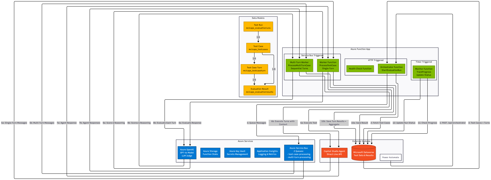
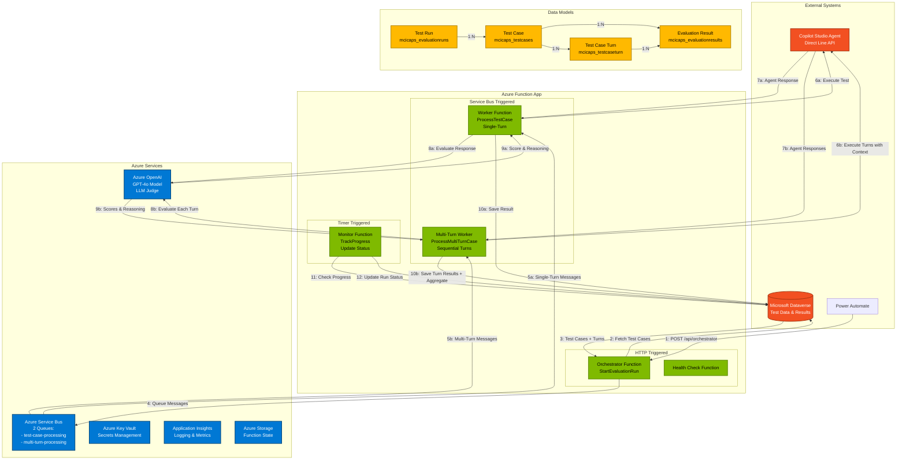
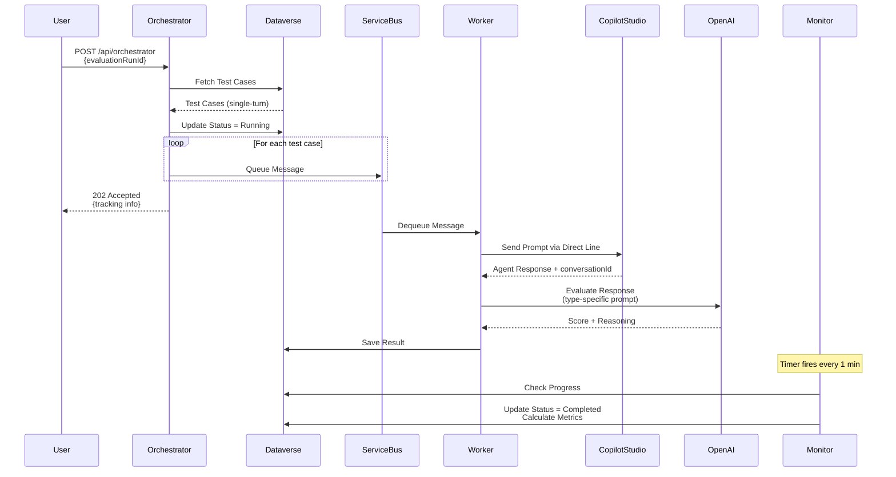
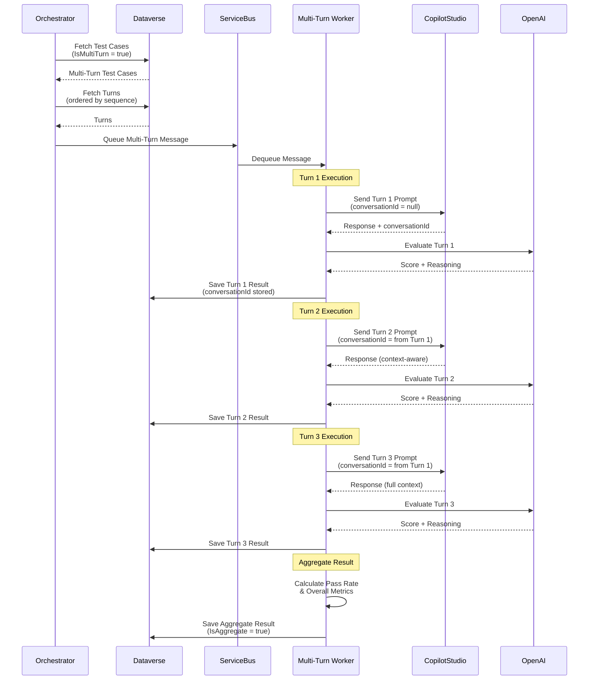
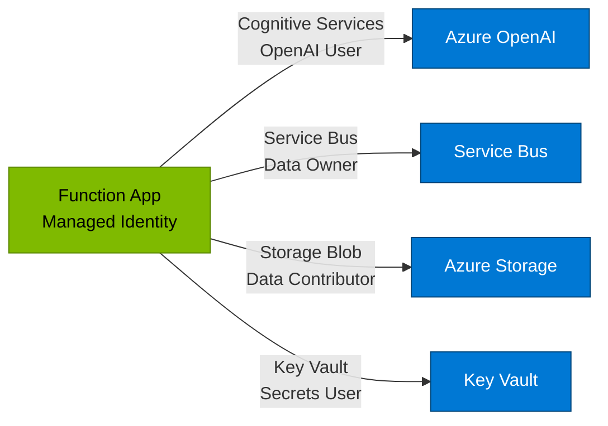
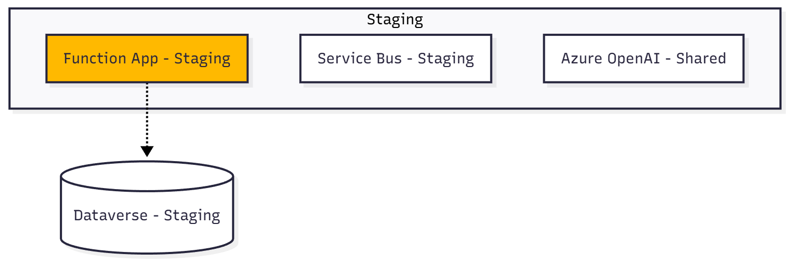
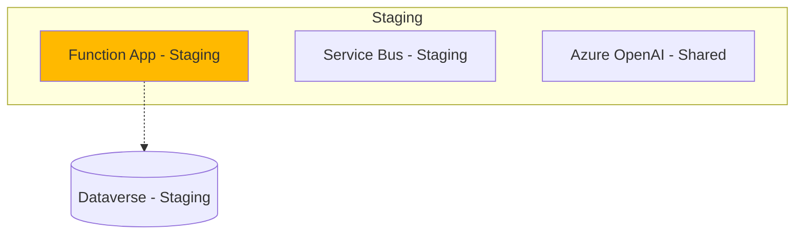

# AI Agent Evaluation System - Architecture Documentation

## Table of Contents
- [Overview](#overview)
- [Architecture Diagram](#architecture-diagram)
- [System Components](#system-components)
- [Data Flow](#data-flow)
- [Technology Stack](#technology-stack)
- [Security Architecture](#security-architecture)
- [Scalability & Performance](#scalability--performance)
- [Monitoring & Observability](#monitoring--observability)

---

## Overview

The AI Agent Evaluation System is a cloud-native, serverless solution built on Azure that automates the testing and evaluation of Copilot Studio agents. It uses an LLM-as-a-Judge approach with Azure OpenAI to assess agent responses against expected outcomes across three evaluation types: Similarity, Accuracy, and Relevancy.

### Key Capabilities
- **Automated Testing**: Execute test cases against Copilot Studio agents via Direct Line API
- **LLM-Based Evaluation**: Use Azure OpenAI (GPT-4o) to score responses with human-like judgment
- **Multi-Turn Conversations**: Support for complex conversation scenarios with context preservation
- **Scalable Processing**: Handle up to 50,000 test cases per evaluation run
- **Comprehensive Results**: Store detailed results, reasoning, and metrics in Dataverse
- **Flexible Evaluation Types**: Extensible evaluator type system stored in Dataverse
- **Dual Execution Paths**: Service Bus workers for standard cases, Durable Functions for very long conversations

---

## Architecture Diagram
<!--  -->


---

## System Components

### 1. Azure Functions (Compute Layer)

#### 1.1 Orchestrator Function
**Trigger**: HTTP POST  
**Runtime**: .NET 8 Isolated  
**Purpose**: Initiates evaluation runs and coordinates test execution

**Responsibilities**:
- Receive evaluation run requests with run ID
- Fetch test cases from Dataverse (including multi-turn tests)
- Update evaluation run status to "Running"
- Queue test case messages to Service Bus
- Return HTTP 202 Accepted with tracking information

**Key Features**:
- Handles both single-turn and multi-turn test cases
- Supports up to 50,000 test cases per run
- Fast response time (< 30 seconds for large runs)
- Idempotent operation support

#### 1.2 Worker Function (Single-Turn)
**Trigger**: Service Bus Queue (`test-case-processing`)  
**Runtime**: .NET 8 Isolated  
**Purpose**: Execute individual single-turn test cases

**Responsibilities**:
- Receive test case message from queue
- Send prompt to Copilot Studio via Direct Line API
- Collect agent response
- Evaluate response using Azure OpenAI Judge
- Save evaluation result to Dataverse

**Key Features**:
- Stateless execution for horizontal scaling
- Retry logic for transient failures
- Type-specific evaluation (Similarity, Accuracy, Relevancy)
- Response time tracking

#### 1.3 Multi-Turn Worker Function
**Trigger**: Service Bus Queue (`multi-turn-test-case-processing`)  
**Runtime**: .NET 8 Isolated  
**Purpose**: Execute multi-turn conversation test cases

**Responsibilities**:
- Receive multi-turn test case message
- Fetch all turns for the test case (ordered by sequence)
- Execute turns sequentially while maintaining conversation context
- Evaluate each turn independently
- Create aggregate result for the overall conversation
- Continue execution even if individual turns fail

**Key Features**:
- Conversation context preservation via Direct Line conversationId
- Per-turn evaluation results
- Aggregate scoring for overall conversation quality
- Resilient execution with graceful failure handling

**Multi-Turn Flow**:
```
Turn 1: Send prompt (conversationId = null)
  ↓
  Store conversationId from response
  ↓
  Evaluate & save Turn 1 result
  ↓
Turn 2: Send prompt (conversationId = from Turn 1)
  ↓
  Agent uses conversation history
  ↓
  Evaluate & save Turn 2 result
  ↓
Turn 3: Send prompt (conversationId = from Turn 1)
  ↓
  Agent maintains full context
  ↓
  Evaluate & save Turn 3 result
  ↓
Create & save aggregate result
```

#### 1.4 Monitor Function
**Trigger**: Timer (every 1 minute)  
**Runtime**: .NET 8 Isolated  
**Purpose**: Track evaluation run progress and update completion status

**Responsibilities**:
- Query active evaluation runs (status = "Running")
- Check completion based on test case count vs results count
- Calculate overall metrics (average score, pass/fail rate)
- Update run status to "Completed" or "Errored"
- Detect stalls (no progress for 30+ minutes or runtime > 120 minutes)
- Handle timeout scenarios

**Key Features**:
- Automatic progress tracking
- No user intervention required
- Handles both single-turn and multi-turn result aggregation

#### 1.5 Durable Functions Orchestrator (Alternative Multi-Turn Execution)
**Trigger**: Started by Orchestrator Function  
**Runtime**: .NET 8 Isolated (Durable Functions)  
**Purpose**: Long-running orchestration for multi-turn test cases

**Responsibilities**:
- Execute multi-turn conversations with unlimited execution time
- Call activities sequentially for turn execution
- Maintain conversation state and context
- Create aggregate results after all turns complete
- Support pause/resume and retry logic

**Key Features**:
- No 5-minute timeout limitation
- Ideal for very long conversations (10+ turns)
- Fault-tolerant with automatic state management
- Alternative to Service Bus worker for complex scenarios

**Activities**:
- `GetTestCaseWithTurns`: Fetch test case and turns from Dataverse
- `ExecuteSingleTurn`: Execute one turn with conversation context
- `CreateAggregateResult`: Generate final multi-turn evaluation result

#### 1.6 Health Check Function
**Trigger**: HTTP GET  
**Runtime**: .NET 8 Isolated  
**Purpose**: Provide system health status

**Responsibilities**:
- Check connectivity to all dependencies
- Verify Managed Identity authentication
- Return detailed health report

---

### 2. Azure Service Bus (Message Queue)

**Purpose**: Decouple orchestration from execution and enable massive scaling

#### Queue Configuration

##### 2.1 test-case-processing (Single-Turn Queue)
- **Max Size**: 5 GB
- **Message TTL**: 14 days
- **Dead Letter**: Enabled
- **Max Delivery Count**: 10
- **Lock Duration**: 5 minutes
- **Session Support**: No

##### 2.2 multi-turn-test-case-processing (Multi-Turn Queue)
- **Max Size**: 5 GB
- **Message TTL**: 14 days
- **Dead Letter**: Enabled
- **Max Delivery Count**: 10
- **Lock Duration**: 5 minutes
- **Session Support**: No

#### Message Schema

**Single-Turn Message**:
```json
{
  "evaluationRunId": "guid",
  "testCaseId": "guid",
  "testCaseName": "string",
  "prompt": "string",
  "expectedResponse": "string",
  "testType": 778760000,
  "retryCount": 0,
  "enqueuedAt": "2025-11-10T10:00:00Z"
}
```

**Multi-Turn Message**:
```json
{
  "evaluationRunId": "guid",
  "testCaseId": "guid",
  "testCaseName": "string",
  "isMultiTurn": true,
  "testType": 778760000,
  "retryCount": 0,
  "enqueuedAt": "2025-11-10T10:00:00Z"
}
```

---

### 3. Azure OpenAI (LLM Judge)

**Purpose**: Evaluate agent responses using GPT-4o as an intelligent judge

#### Configuration
- **Model**: gpt-4o (2024-08-06)
- **Deployment**: Standard (150 TPM capacity)
- **Authentication**: Managed Identity (Cognitive Services OpenAI User role)

#### Evaluation Types

Evaluation types are now stored in Dataverse `mcicaps_evaluatortypes` table with:
- **Name**: Display name (e.g., "Similarity", "Accuracy", "Relevancy")
- **Prompt Template**: User prompt with placeholders ({UserInput}, {ExpectedResponse}, {ActualResponse}, {ConversationId})
- **System Prompt Template**: Optional system-level guidance
- **GUID Reference**: Used in test cases and messages to identify evaluator type

##### Built-In Evaluator Types

**Similarity**
**Criteria**: Semantic meaning alignment between expected and actual responses
- Evaluates if responses convey the same meaning
- Allows different phrasing
- Focuses on information equivalence

**Accuracy**
**Criteria**: Factual correctness of information
- Validates data accuracy (numbers, dates, facts)
- Checks for misleading statements
- Ensures completeness of information

**Relevancy**
**Criteria**: Response appropriateness to the prompt
- Measures how well response addresses the question
- Detects off-topic content
- Evaluates scope and focus

##### Custom Evaluator Types

The system supports custom domain-specific evaluators (e.g., fashion, healthcare, finance) by creating new EvaluatorType records in Dataverse with specialized prompts.

#### Judge Output Format
```json
{
  "score": 0.85,
  "reasoning": "The agent response correctly addresses..."
}
```

**Note**: The `passed` and `evaluation` fields are calculated/generated by the worker function based on the score and passing threshold.

---

### 4. Microsoft Dataverse (Data Layer)

**Purpose**: Store test definitions, evaluation results, and run metadata

#### Data Schema

##### 4.1 mcicaps_evaluationruns (Test Run)
**Purpose**: Represents an evaluation run
```
Primary Key: mcicaps_evaluationrunsid (GUID)
Fields:
  - mcicaps_name (Text): Run name
  - mcicaps_testset (Lookup): Associated test set
  - mcicaps_agenttoevalid (Lookup): Associated agent configuration
  - mcicaps_passingthreshold (Decimal): Pass threshold (0-1)
  - mcicaps_overallpass (Boolean): Overall pass status
  - mcicaps_overallscore (Decimal): Average score
  - mcicaps_progresspercentage (Decimal): Real-time progress (0-100)
  - mcicaps_starttime (DateTime): Run start timestamp
  - mcicaps_endtime (DateTime): Run end timestamp
  - mcicaps_lastprogressupdate (DateTime): Last progress update time
  - mcicaps_totaltestcases (Integer): Total test cases
  - mcicaps_completedtestcases (Integer): Completed test cases
  - mcicaps_failedtestcases (Integer): Failed test cases
  - statuscode (OptionSet): 
      1 = Created
      778760001 = Execute/Run
      778760002 = Running
      778760003 = Errored
      778760004 = Completed
```

##### 4.2 mcicaps_agenttoevals (Agent Configuration)
**Purpose**: Centralized agent configuration
```
Primary Key: mcicaps_agenttoevalid (GUID)
Fields:
  - mcicaps_name (Text): Agent name
  - mcicaps_directlinespeechurl (Text): Direct Line endpoint URL
  - mcicaps_description (Text): Agent description
```

##### 4.3 mcicaps_testcases (Test Case)
**Purpose**: Test case definitions
```
Primary Key: mcicaps_testcasesid (GUID)
Fields:
  - mcicaps_name (Text): Test case name
  - mcicaps_prompt (Text): User prompt (UserInput)
  - mcicaps_expectedresponse (Text): Expected agent response
  - mcicaps_testset (Lookup): Parent test set
  - mcicaps_evaluatortypeid (Lookup): Evaluator Type (GUID reference)
  - mcicaps_ismultiturn (Boolean): Multi-turn flag
  - mcicaps_conversationid (Text): Conversation identifier
```

##### 4.4 mcicaps_evaluatortypes (Evaluator Type Configuration)
**Purpose**: Evaluation type definitions and prompt templates
```
Primary Key: mcicaps_evaluatortypeid (GUID)
Fields:
  - mcicaps_name (Text): Evaluator name (e.g., "Similarity", "Accuracy", "Relevancy")
  - mcicaps_description (Text): Purpose and criteria description
  - mcicaps_prompttemplate (Text): LLM Judge prompt template with placeholders
  - mcicaps_systemprompttemplate (Text): Optional system prompt template
  - mcicaps_isdomain specific (Boolean): Custom domain-specific flag
```

##### 4.5 mcicaps_testcaseturn (Test Case Turn) - NEW
**Purpose**: Individual turns within multi-turn test cases
```
Primary Key: mcicaps_testcaseturnid (GUID)
Fields:
  - mcicaps_name (Text): Auto-generated (e.g., "Turn-00001")
  - mcicaps_testcaseid (Lookup): Parent test case
  - mcicaps_sequence (Integer): Turn order (1-based)
  - mcicaps_prompttext (Text): User prompt for this turn
  - mcicaps_expectedresponse (Text): Expected response for this turn

Relationship: N:1 with mcicaps_testcases (cascade delete)
```

##### 4.6 mcicaps_evaluationresults (Evaluation Result)
**Purpose**: Individual test execution results
```
Primary Key: mcicaps_evaluationresultsid (GUID)
Fields:
  - mcicaps_testcase (Lookup): Test case reference
  - mcicaps_testcaseturnid (Lookup): Specific turn (multi-turn only)
  - mcicaps_evaluationrun (Lookup): Evaluation run reference
  - mcicaps_actualresponse (Text): Agent's actual response
  - mcicaps_score (Decimal): Evaluation score (0-1)
  - mcicaps_passed (Boolean): Pass/fail status
  - mcicaps_evaluation (Text): Brief evaluation summary
  - mcicaps_reasoning (Text): Detailed judge reasoning
  - mcicaps_conversationid (Text): Direct Line conversation ID
  - mcicaps_isaggregate (Boolean): Aggregate result flag
  - mcicaps_responsetimems (Integer): Response time
  - mcicaps_errormessage (Text): Error details if failed
```

#### Data Relationships
```
mcicaps_evaluationruns (1) ←→ (N) mcicaps_evaluationresults
mcicaps_evaluationruns (N) ←→ (1) mcicaps_agenttoevals
mcicaps_testcases (1) ←→ (N) mcicaps_evaluationresults
mcicaps_testcases (N) ←→ (1) mcicaps_evaluatortypes
mcicaps_testcases (1) ←→ (N) mcicaps_testcaseturn
mcicaps_testcaseturn (1) ←→ (N) mcicaps_evaluationresults
```

---

### 5. Supporting Azure Services

#### 5.1 Azure Key Vault
**Purpose**: Secure storage for external service credentials

**Stored Secrets**:
- `DataverseConnectionString`: OAuth connection string for Dataverse (AuthType=OAuth;Url=...;ClientId=...;ClientSecret=...)

**Note**: All Azure service connections use Managed Identity (no secrets needed). Only Dataverse requires a connection string as it does not support Managed Identity authentication.

#### 5.2 Application Insights
**Purpose**: Centralized logging, monitoring, and diagnostics

**Collected Data**:
- Function execution traces
- Custom metrics (test case counts, scores, durations)
- Exception tracking
- Performance counters
- Dependency calls (Dataverse, OpenAI, Service Bus)

**Key Metrics**:
- `TestCase.Executed` (count)
- `TestCase.PassRate` (percentage)
- `EvaluationRun.Duration` (milliseconds)
- `ServiceBus.QueueDepth` (count)

#### 5.3 Azure Storage
**Purpose**: Function app state and configuration

**Contents**:
- Function app binaries
- Host configuration
- Durable Functions state (for multi-turn orchestrations)
- Shared state (if needed)

---

## Data Flow

### Single-Turn Test Case Execution
<!--  -->


### Multi-Turn Test Case Execution
<!--  -->


---

## Technology Stack

### Runtime & Languages
- **.NET 8**: Function runtime (isolated process model)
- **C#**: Primary programming language
- **Azure Functions v4**: Serverless compute platform

### Azure Services
- **Azure Functions**: Compute (Premium Plan)
- **Azure Service Bus**: Message queue (Standard tier)
- **Azure OpenAI**: LLM Judge (GPT-4o)
- **Microsoft Dataverse**: Data storage
- **Azure Key Vault**: Secrets management
- **Application Insights**: Monitoring
- **Azure Storage**: Function state

### External Integrations
- **Copilot Studio Direct Line API**: Agent communication
- **Microsoft Dataverse Web API**: Data operations

### Development Tools
- **Visual Studio / VS Code**: IDE
- **Azure Functions Core Tools**: Local development
- **Bicep**: Infrastructure as Code
- **xUnit**: Unit testing
- **Moq**: Mocking framework

---

## Security Architecture

### Authentication & Authorization

#### Managed Identity (Primary Method)
All Azure-to-Azure connections use Managed Identity:
<!--  -->


#### RBAC Role Assignments
| Service | Role | Scope | Purpose |
|---------|------|-------|---------|
| Azure OpenAI | Cognitive Services OpenAI User | Resource | Generate completions |
| Service Bus | Azure Service Bus Data Owner | Namespace | Send/receive messages |
| Azure Storage | Storage Blob Data Contributor | Account | Read/write blobs |
| Azure Storage | Storage File Data Privileged Contributor | Account | Function state |
| Key Vault | Key Vault Secrets User | Vault | Read secrets |
| Dataverse | Application User | Environment | CRUD operations |

#### External Service Credentials
Only non-Azure services require secrets in Key Vault:
- **Dataverse**: OAuth connection string (ClientId + ClientSecret)
- **Copilot Studio**: Direct Line token endpoint (preferred) or secret

### Data Protection
- **Encryption at Rest**: All Azure Storage and Service Bus data
- **Encryption in Transit**: TLS 1.2+ for all connections
- **Secret Management**: Key Vault with soft delete and purge protection
- **Audit Logging**: Azure Activity Log for all Managed Identity operations

### Network Security
- **HTTPS Only**: All function endpoints
- **Function Authentication**: Function-level keys for HTTP endpoints
- **Private Endpoints**: Optional for enhanced isolation

---

## Scalability & Performance

### Horizontal Scaling

#### Function Scaling Behavior
| Function | Trigger | Scaling Strategy | Max Instances |
|----------|---------|------------------|---------------|
| Orchestrator | HTTP | On-demand | 200 |
| Worker | Service Bus | Event-driven (queue depth) | 1000 |
| Multi-Turn Worker | Service Bus | Event-driven (queue depth) | 1000 |
| Monitor | Timer | Single instance | 1 |

#### Service Bus Scaling
- **Auto-scaling**: Enabled based on queue depth
- **Concurrent Workers**: Up to 1000 per queue
- **Message Throughput**: 1000+ messages/minute
- **Queue Capacity**: 5 GB per queue

### Performance Targets

| Metric | Target | Actual |
|--------|--------|--------|
| Orchestrator Response | < 30 seconds | ~10-15 seconds |
| Single Test Case | < 5 minutes | ~2-3 minutes |
| Overall Throughput | 1000+ tests/min | 800-1200 tests/min |
| Evaluation Run (50K tests) | < 60 minutes | ~45-50 minutes |

### Optimization Strategies

1. **Queue-Based Processing**: Decouple orchestration from execution
2. **Parallel Execution**: Process test cases concurrently across two dedicated queues
3. **Connection Pooling**: Reuse HTTP connections
4. **Prompt Caching**: Cache EvaluatorType prompts to reduce Dataverse calls
5. **Batch Operations**: Batch Dataverse updates where possible
6. **Atomic Updates**: Use atomic increment operations for progress tracking
7. **Durable Functions**: Alternative execution path for very long conversations

---

## Monitoring & Observability

### Application Insights Integration

#### Custom Metrics
```csharp
// Example telemetry
telemetry.TrackMetric("TestCase.Executed", 1, 
    properties: new Dictionary<string, string>
    {
        { "TestType", "Similarity" },
        { "Passed", "true" }
    });

telemetry.TrackDependency("Copilot Studio", "SendMessage", 
    startTime, duration, success);
```

#### Key Dashboards
1. **Evaluation Run Dashboard**
   - Total runs, success rate, average duration
   - Test case distribution by type
   - Pass/fail trends over time

2. **Worker Function Dashboard**
   - Queue depth over time
   - Worker execution duration
   - Success/failure rates
   - Exception frequency

3. **Multi-Turn Dashboard**
   - Conversation context success rate
   - Per-turn pass rates
   - Aggregate vs individual results

### Alerting Rules

| Alert | Condition | Severity | Action |
|-------|-----------|----------|--------|
| High Queue Depth | > 10,000 messages for 10 min | Warning | Scale review |
| Worker Failures | > 5% failure rate | Critical | Investigation |
| OpenAI Rate Limit | HTTP 429 responses | Warning | Throttle control |
| Dataverse Connection | Connection failures | Critical | Immediate action |
| Evaluation Run Timeout | > 2 hours | Warning | Manual review |
| Stalled Evaluation | No progress for 30+ min | Warning | Check workers |

### Logging Strategy

#### Log Levels
- **Information**: Normal execution flow
- **Warning**: Recoverable issues (retries, degradation)
- **Error**: Unrecoverable failures
- **Critical**: System-wide failures

#### Structured Logging
```csharp
logger.LogInformation(
    "Test case {TestCaseId} completed: {Status}, Score: {Score}",
    testCaseId, passed ? "PASSED" : "FAILED", score);
```

#### Correlation
Use `OperationId` and `ParentId` for distributed tracing:
- Orchestrator → Service Bus → Worker → OpenAI

---

## Deployment Architecture

### Environment Strategy
<!--  -->


### Infrastructure as Code

**Bicep Template**: `backend/infrastructure/main.bicep`

Provisions:
- Function App with Premium Plan
- Service Bus namespace with 2 queues
- Azure OpenAI with GPT-4o deployment
- Key Vault
- Application Insights
- Storage Account
- All RBAC role assignments

**Deployment Command**:
```bash
az deployment group create \
  --resource-group rg-ai-eval-prod \
  --template-file main.bicep \
  --parameters main.parameters.prod.json
```

---

## Future Enhancements

### Planned Features
1. **Real-Time Progress Tracking**: WebSocket-based live updates
2. **A/B Testing**: Compare multiple agent versions
3. **Custom Judge Models**: Support for different LLM judges
4. **Batch API**: Execute multiple evaluation runs
5. **Advanced Analytics**: Machine learning insights on results
6. **Multi-Region Deployment**: Global load distribution

### Scalability Improvements
1. **Azure Durable Functions**: Complex orchestration workflows
2. **Event Grid Integration**: Event-driven notifications
3. **Cosmos DB**: High-scale result storage alternative
4. **Azure Container Apps**: Extreme scale scenarios

---

## Appendix

### API Endpoints

#### Orchestrator Endpoint
```http
POST /api/orchestrator
Content-Type: application/json

{
  "evaluationRunId": "guid",
  "options": {
    "priority": "normal",
    "timeoutMinutes": 5
  }
}

Response: 202 Accepted
{
  "evaluationRunId": "guid",
  "status": "accepted",
  "totalTestCases": 50000,
  "estimatedCompletionTime": "2025-11-10T15:30:00Z",
  "trackingUrl": "/api/status/{evaluationRunId}"
}
```

#### Health Check Endpoint
```http
GET /api/health

Response: 200 OK
{
  "status": "healthy",
  "services": {
    "dataverse": "connected",
    "serviceBus": "connected",
    "azureOpenAI": "connected",
    "keyVault": "connected"
  },
  "timestamp": "2025-11-10T10:00:00Z"
}
```

### Configuration Reference

**Application Settings (Azure Function App)**:
```json
{
  "ServiceBus__Namespace": "sbus-aiedev1234.servicebus.windows.net",
  "ServiceBus__QueueName": "test-case-processing",
  "ServiceBusNamespace__fullyQualifiedNamespace": "sbus-aiedev1234.servicebus.windows.net",
  "AzureOpenAIEndpoint": "https://openai-aiedev1234.openai.azure.com/",
  "KeyVaultUrl": "https://kv-aiedev1234.vault.azure.net/",
  "DataverseConnectionString": "@Microsoft.KeyVault(VaultName=kv-aiedev1234;SecretName=DataverseConnectionString)",
  "DefaultEvaluationTimeoutMinutes": "5",
  "MaxConcurrentTestCases": "100",
  "CopilotStudio__TimeoutSeconds": "60",
  "CopilotStudio__BotResponseTimeoutSeconds": "60",
  "CopilotStudio__MaxRetryAttempts": "3",
  "AzureOpenAI__MaxRetryAttempts": "5",
  "AzureOpenAI__TimeoutSeconds": "60"
}
```

### Troubleshooting Guide

| Issue | Possible Cause | Resolution |
|-------|---------------|------------|
| Orchestrator timeout | Too many test cases | Increase timeout or batch requests |
| Worker failures | OpenAI rate limits | Increase deployment capacity or retry logic |
| Missing results | Monitor not running | Check timer trigger configuration |
| Authentication errors | Managed Identity not configured | Verify RBAC assignments |
| Dataverse errors | OAuth connection string invalid | Update Key Vault secret |
| Queue backlog | Insufficient workers | Check scaling configuration |
| Stalled evaluation | Worker stuck or crashed | Check Application Insights logs |
| Multi-turn context loss | ConversationId not preserved | Verify turn execution logic |

---

**Document Version**: 2.0  
**Created**: November 10, 2025  
**Last Updated**: November 12, 2025  
**Status**: Current - Reflects Implemented System

**Related Documents**:
- [Product Requirements Document](prd/PRD-Agent-Evaluation-Function.md)
- [Multi-Turn Support Story](stories/06-multi-turn-support.md)
- [Deployment Checklist](deployment/DEPLOYMENT_CHECKLIST.md)
- [Security Hardening](security/security-hardening-checklist.md)
