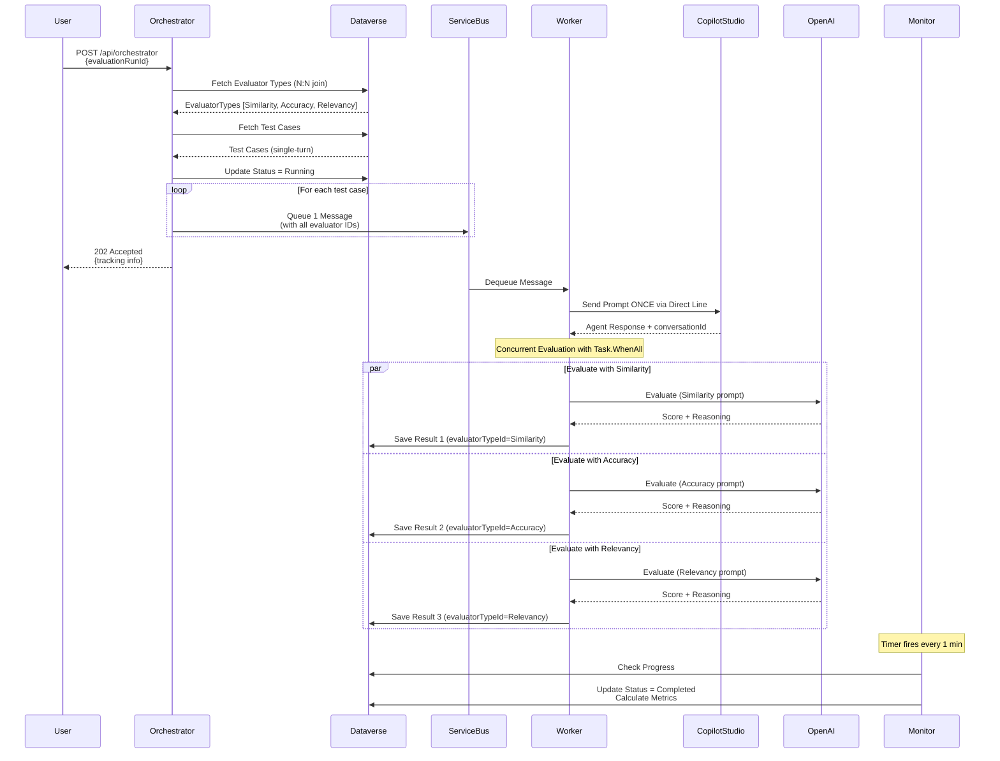
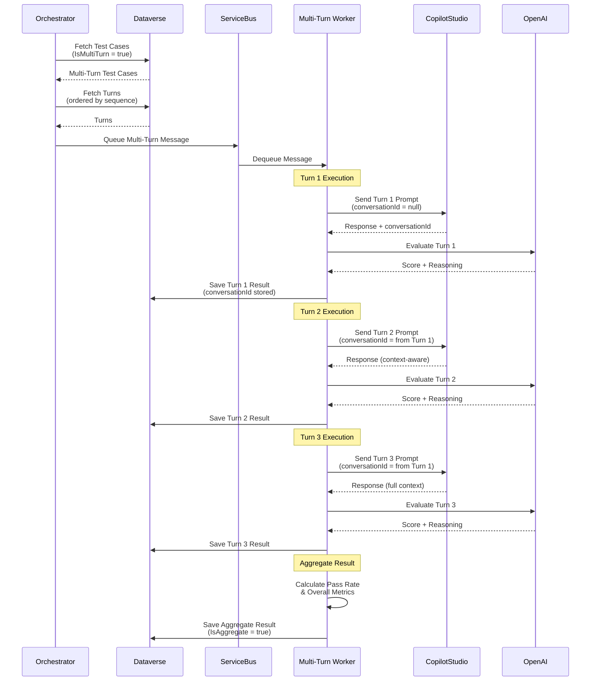
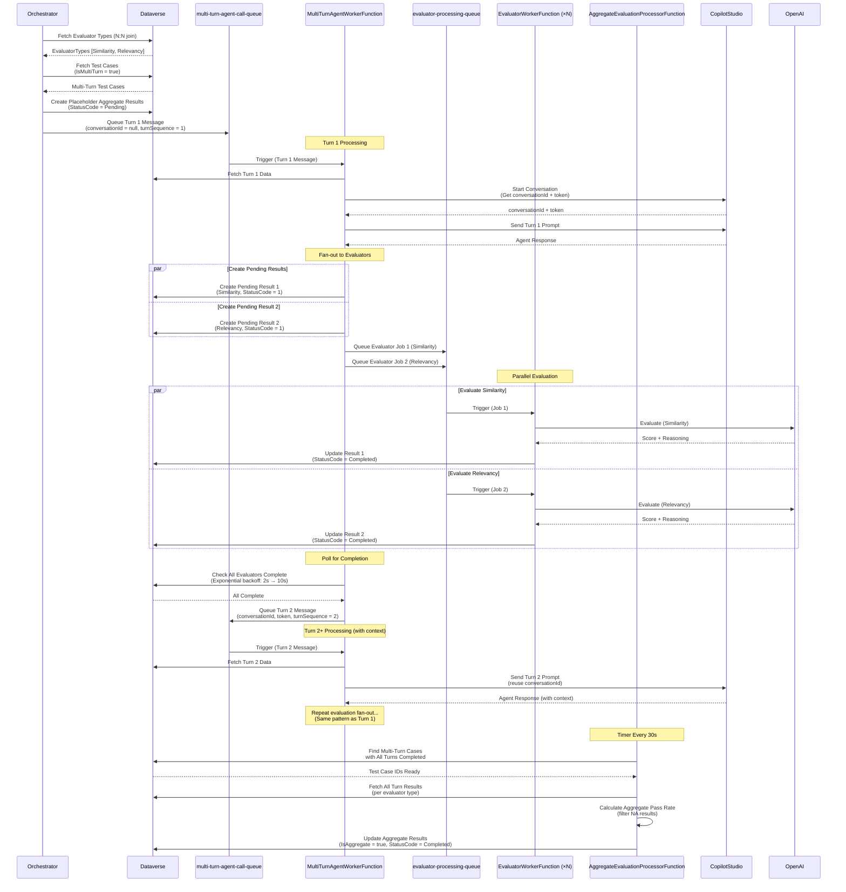
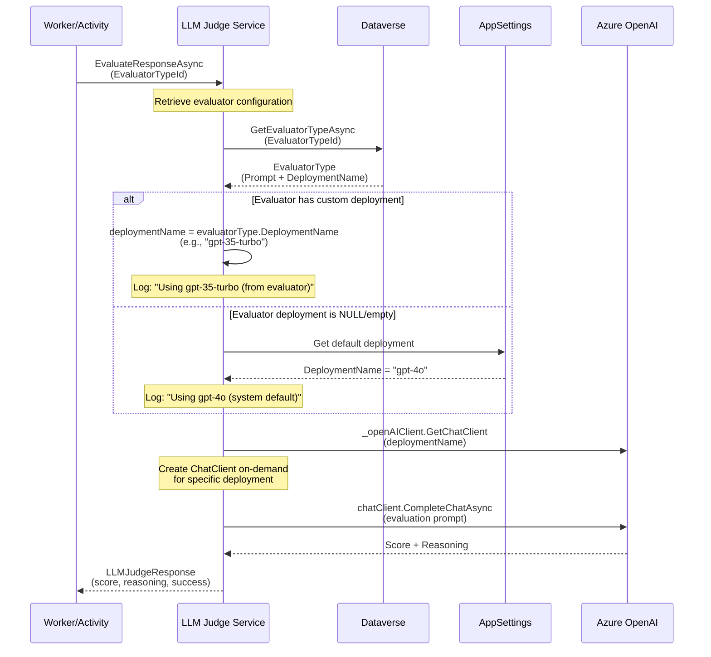
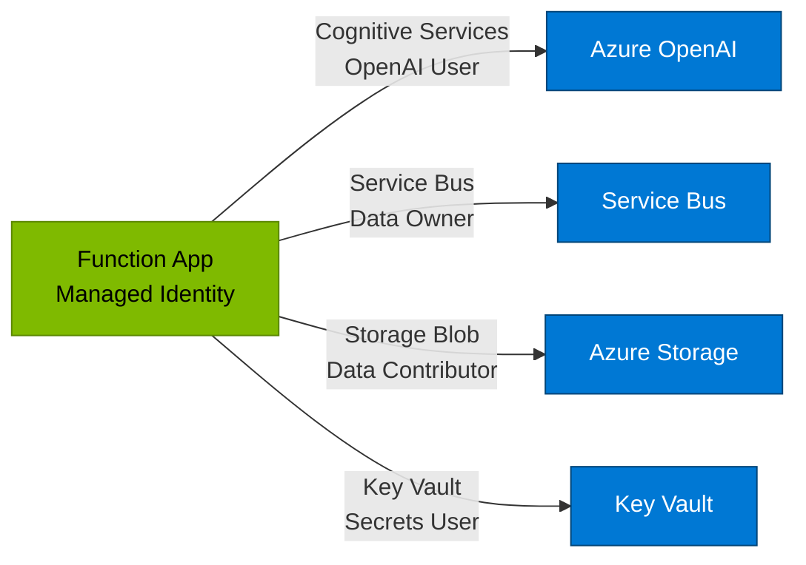
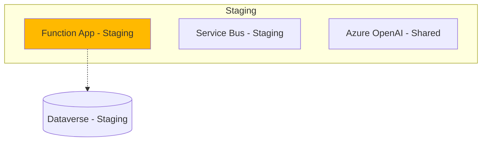

# AI Agent Evaluation System - Architecture Documentation

## Table of Contents
- [Overview](#overview)
- [Architecture Diagram](#architecture-diagram)
- [System Components](#system-components)
- [Data Flow](#data-flow)
- [Technology Stack](#technology-stack)
- [Security Architecture](#security-architecture)
- [Scalability & Performance](#scalability--performance)
- [Monitoring & Observability](#monitoring--observability)

---

## Overview

The AI Agent Evaluation System is a cloud-native, serverless solution built on Azure that automates the testing and evaluation of Copilot Studio agents. It uses an LLM-as-a-Judge approach with Azure OpenAI to assess agent responses against expected outcomes across multiple evaluation dimensions.

**Architecture Version**: 2.0 (Async Multi-Evaluator)  
**Last Updated**: November 2025  
**Implementation Status**: Phase 1 & 2 Complete

### Key Capabilities
- **Automated Testing**: Execute test cases against Copilot Studio agents via Direct Line API
- **LLM-Based Evaluation**: Use Azure OpenAI (GPT-4o) to score responses with human-like judgment
- **Multi-Evaluator Support**: Evaluate each test case across multiple evaluators (Similarity, Accuracy, Relevancy, custom) in parallel
- **Async Architecture**: Decouple agent calls from evaluations for 3-5× throughput improvement
- **Multi-Turn Conversations**: Support for complex conversation scenarios with context preservation via Service Bus message passing
- **Scalable Processing**: Handle up to 50,000 test cases per evaluation run with parallel evaluator processing
- **Comprehensive Results**: Store detailed results, reasoning, and metrics in Dataverse with pending/completed status tracking
- **Flexible Evaluation Types**: Extensible evaluator type system stored in Dataverse
- **Unified Execution**: Pure Service Bus queue-based architecture for both single-turn and multi-turn scenarios

---

## Architecture Diagram

**Version 3.0**: Service Bus-Based Multi-Turn Architecture (Story 11 Complete)

```mermaid
flowchart TB
    subgraph subGraph0["External Systems"]
        CS["Copilot Studio Agent<br>Direct Line API"]
        DV[("Microsoft Dataverse<br>Test Data &amp; Results")]
        USER["Power Automate"]
    end
    subgraph subGraph1["HTTP Triggered"]
        ORCH["Orchestrator Function<br>StartEvaluationRun"]
        HEALTH["Health Check Function"]
    end
    subgraph subGraph2["Service Bus Triggered - Async Workers"]
        AGENT_WORKER["AgentWorkerFunction<br>ProcessAgentCall<br>(Single-Turn Only)"]
        MT_AGENT_WORKER["MultiTurnAgentWorkerFunction<br>ProcessMultiTurnAgentCall<br>(Multi-Turn with Context)"]
        EVAL_WORKER["EvaluatorWorkerFunction<br>ProcessEvaluatorJob<br>(Parallel Processing)"]
    end
    subgraph subGraph3["Timer Triggered"]
        MONITOR["Monitor Function<br>TrackProgress<br>Update Status"]
        AGG_PROC["AggregateEvaluationProcessorFunction<br>ProcessPendingAggregates<br>(Multi-Turn Completion)"]
    end
    subgraph subGraph4["Azure Function App"]
        subGraph1
        subGraph2
        subGraph3
    end
    subgraph subGraph5["Azure Services"]
        SBUS["Azure Service Bus<br>3 Queues:<br>- agent-call-queue<br>- multi-turn-agent-call-queue<br>- evaluator-processing-queue"]
        AOAI["Azure OpenAI<br>GPT-4o Model<br>LLM Judge"]
        KV["Azure Key Vault<br>Secrets Management"]
        AI["Application Insights<br>Logging &amp; Metrics"]
        STORAGE["Azure Storage<br>Function State"]
    end
    subgraph subGraph7["Data Models"]
        TR["Test Run<br>mcicaps_evaluationruns"]
        TC["Test Case<br>mcicaps_testcases"]
        TURN["Test Case Turn<br>mcicaps_testcaseturn"]
        RES["Evaluation Result<br>mcicaps_evaluationresults<br><b>StatusCode: Pending/Completed/Errored</b>"]
        EVAL["Evaluator Type<br>mcicaps_evaluatortypes"]
        AGENT["Agent To Eval<br>mcicaps_agenttoevals"]
    end
    USER -- 1: POST /api/evaluations/start --> ORCH
    ORCH -- 2: Fetch Test Cases --> DV
    DV -- 3: Test Cases + Turns --> ORCH
    ORCH -- 4a: Queue AgentCallMessage<br>(Single-Turn) --> SBUS
    ORCH -- 4b: Queue MultiTurnAgentCallMessage<br>(Multi-Turn Turn 1) --> SBUS
    SBUS -- 5a: agent-call-queue --> AGENT_WORKER
    SBUS -- 5b: multi-turn-agent-call-queue --> MT_AGENT_WORKER
    AGENT_WORKER -- 6: Call Agent --> CS
    CS -- 7: Agent Response --> AGENT_WORKER
    AGENT_WORKER -- 8a: Create Pending Results<br>(StatusCode=1) --> DV
    AGENT_WORKER -- 8b: Queue N Evaluator Jobs --> SBUS
    MT_AGENT_WORKER -- 9: Get Turn Data --> DV
    MT_AGENT_WORKER -- 10: Call Agent<br>(with conversationId) --> CS
    CS -- 11: Agent Response<br>+ conversationId --> MT_AGENT_WORKER
    MT_AGENT_WORKER -- 12a: Create Pending Results --> DV
    MT_AGENT_WORKER -- 12b: Queue N Evaluator Jobs --> SBUS
    MT_AGENT_WORKER -- 12c: Queue Next Turn<br>(if not last) --> SBUS
    SBUS -- 13: evaluator-processing-queue<br>(Parallel) --> EVAL_WORKER
    EVAL_WORKER -- 14: Retrieve Pending --> DV
    EVAL_WORKER -- 15: Evaluate --> AOAI
    AOAI -- 16: Score & Reasoning --> EVAL_WORKER
    EVAL_WORKER -- 17: Update to Completed --> DV
    AGG_PROC -- 18: Find Completed Aggregates --> DV
    AGG_PROC -- 19: Calculate Final Score --> DV
    MONITOR -- 20: Check Progress --> DV
    MONITOR -- 21: Update Run Status --> DV
  TR -- 1:N --> TC
  TR -- N:1 --> AGENT
  TR -- N:N --> EVAL
  RES -- N:1 --> EVAL
  TC -- 1:N --> TURN & RES
  TURN -- 1:N --> RES
    CS:::external
    DV:::external
    ORCH:::function
    HEALTH:::function
    AGENT_WORKER:::function
    MT_AGENT_WORKER:::function
    EVAL_WORKER:::function
    MONITOR:::function
    AGG_PROC:::function
    SBUS:::azureService
    AOAI:::azureService
    KV:::azureService
    AI:::azureService
    STORAGE:::azureService
    TR:::data
    TC:::data
    TURN:::data
    RES:::data
    EVAL:::data
    AGENT:::data
    classDef azureService fill:#0078D4,stroke:#004578,stroke-width:2px,color:#fff
    classDef function fill:#7FBA00,stroke:#5A8700,stroke-width:2px,color:#000
    classDef external fill:#F25022,stroke:#A73513,stroke-width:2px,color:#fff
    classDef data fill:#FFB900,stroke:#B38500,stroke-width:2px,color:#000
```

<!--  -->


---

## System Components

### 1. Azure Functions (Compute Layer)

#### 1.1 Orchestrator Function
**Trigger**: HTTP POST  
**Runtime**: .NET 8 Isolated  
**Purpose**: Initiates evaluation runs and coordinates test execution

**Responsibilities**:
- Receive evaluation run requests with run ID
- Fetch test cases from Dataverse (including multi-turn tests)
- Update evaluation run status to "Running"
- Queue agent call messages to Service Bus
  - Single-turn → `agent-call-queue`
  - Multi-turn → `multi-turn-agent-call-queue`
- Return HTTP 202 Accepted with tracking information

**Key Features**:
- Handles both single-turn and multi-turn test cases
- Supports up to 50,000 test cases per run
- Fast response time (< 30 seconds for large runs)
- Idempotent operation support
- Unified Service Bus architecture for all test types

**Architecture Evolution**:
- **v1.0**: Synchronous execution in single worker
- **v2.0**: Async with agent/evaluator separation, Durable Functions for multi-turn (deprecated Story 11)
- **v3.0** (Story 11): Pure Service Bus architecture for all test types, removed Durable Functions dependency

#### 1.2 AgentWorkerFunction (Agent Call Processing)
**Trigger**: Service Bus Queue (`agent-call-queue`)  
**Runtime**: .NET 8 Isolated  
**Purpose**: Call Copilot Studio agent and create pending evaluation results

**Responsibilities**:
- Receive agent call message from queue
- Send prompt to Copilot Studio via Direct Line API with retry logic
- Collect agent response
- Create **pending** evaluation results (StatusCode=1) for each evaluator type
- Queue evaluator job messages to `evaluator-processing-queue` (parallel fan-out)
- Handle NA scenarios (evaluators requiring expected response)

**Key Features**:
- Stateless execution for horizontal scaling
- Exponential backoff retry for agent calls
- Creates N pending results for N evaluators (1 agent call → N evaluations)
- Automatic NA result creation without queuing
- Error handling: Creates error results for all evaluators if agent fails

**Performance Impact**:
- Single agent call per test case (shared across all evaluators)
- Parallel evaluator processing (3-5× throughput improvement)

#### 1.3 EvaluatorWorkerFunction (Evaluation Processing)
**Trigger**: Service Bus Queue (`evaluator-processing-queue`)  
**Runtime**: .NET 8 Isolated  
**Purpose**: Evaluate pending results using LLM Judge

**Responsibilities**:
- Receive evaluator job message from queue
- Retrieve pending evaluation result from Dataverse
- Check idempotency (skip if already completed)
- Use `LLMJudgeServiceFactory` to get appropriate judge (Azure OpenAI or Copilot Studio)
- Evaluate response using selected judge
- Update result to **Completed** or **Errored** in Dataverse
- Increment completion counter

**Key Features**:
- Stateless execution for horizontal scaling
- Idempotent via status check (Pending → Completed/Errored)
- Retry logic for transient LLM failures
- Type-specific evaluation (Similarity, Accuracy, Relevancy, custom)
- Dynamic judge selection via factory pattern
- Supports both single-turn and multi-turn scenarios

**Performance Impact**:
- Parallel processing of evaluators (up to 1000 concurrent workers)
- Independent scaling from agent call volume

#### 1.4 Monitor Function
**Trigger**: Timer (every 1 minute)  
**Runtime**: .NET 8 Isolated  
**Purpose**: Track evaluation run progress and update completion status

**Responsibilities**:
- Query active evaluation runs (status = "Running")
- Check completion based on total evaluation units vs completed results count
- Calculate overall metrics (average score, pass/fail rate)
- Update run status to "Completed" or "Errored"
- Detect stalls (no progress for 30+ minutes or runtime > 120 minutes)
- Handle timeout scenarios

**Key Features**:
- Automatic progress tracking
- No user intervention required
- Handles both single-turn and multi-turn result aggregation
- Tracks evaluation units (TestCase × EvaluatorType pairs)

**Architecture Change (v2.0)**:
- Previously: Tracked test cases
- Now: Tracks evaluation units (1 test × 5 evaluators = 5 units)

#### 1.5 MultiTurnAgentWorkerFunction (Multi-Turn Execution - Story 11)
**Trigger**: Service Bus Queue (`multi-turn-agent-call-queue`)  
**Runtime**: .NET 8 Isolated  
**Purpose**: Execute multi-turn test cases with conversation context preservation via Service Bus

**Responsibilities**:
- Process multi-turn agent call messages from queue
- Retrieve turn data from Dataverse
- Call Copilot Studio with conversation context (conversationId for Turn 2+)
- Capture conversationId and DirectLine token from Turn 1
- Create pending evaluation results for all evaluators
- Queue evaluator jobs for parallel processing
- Queue next turn message if not last turn
- Handle retry logic with exponential backoff (30s, 60s, 90s)

**Key Features**:
- Pure Service Bus architecture (no Durable Functions)
- Conversation context passed via messages (stateless)
- Max retries: 3 (configurable via `AzureOpenAI:MaxRetryAttempts`)
- NA scenario handling (evaluator requires expected response but none provided)
- Multi-evaluator fan-out (one agent call → N evaluator jobs)
- Dead letter queue for persistent failures

**Flow**:
1. Receive `MultiTurnAgentCallMessage` from queue (includes turnSequence, conversationId, token)
2. Get turn data from Dataverse (`mcicaps_testcaseturn`)
3. Call Copilot Studio Direct Line API (with conversationId for Turn 2+)
4. For each evaluator: Create pending result or NA result, queue evaluator job
5. If not last turn: Queue next turn message with conversationId
6. On failure: Exponential backoff retry, max 3 attempts
7. After max retries: Create error results for all evaluators

**Architecture Benefits (Story 11 Migration)**:
- **Reliability**: No stuck orchestrations, clear visibility via queue depth
- **Simplicity**: Stateless workers, no state management or replay logic
- **Retry**: Built-in Service Bus retry with dead letter queue
- **Monitoring**: Queue metrics provide real-time progress tracking

#### 1.6 AggregateEvaluationProcessorFunction (Multi-Turn Completion)
**Trigger**: Timer (every 30 seconds)  
**Runtime**: .NET 8 Isolated  
**Purpose**: Calculate aggregate scores for completed multi-turn test cases

**Responsibilities**:
- Find pending aggregate results where all turns are completed
- Calculate average score across all completed turns
- Exclude NA results from aggregate calculation
- Update aggregate result to completed status
- Increment evaluation run completion counter

**Flow**:
1. Query pending aggregates (`IsAggregate=true, StatusCode=Pending`)
2. For each: Calculate average score from completed turns
3. Update aggregate result and increment completion counter

#### 1.7 Health Check Function
**Trigger**: HTTP GET  
**Runtime**: .NET 8 Isolated  
**Purpose**: Provide system health status

**Responsibilities**:
- Check connectivity to all dependencies
- Verify Managed Identity authentication
- Return detailed health report

---

### 2. Azure Service Bus (Message Queue)

**Purpose**: Decouple agent calls from evaluations and enable massive parallel scaling

**Architecture Version**: 2.0 (Async Multi-Evaluator)

#### Queue Configuration

##### 2.1 agent-call-queue (Single-Turn Agent Calls)
- **Max Size**: 5 GB
- **Message TTL**: 14 days
- **Dead Letter**: Enabled
- **Max Delivery Count**: 10
- **Lock Duration**: 5 minutes
- **Session Support**: No
- **Status**: Active - used by AgentWorkerFunction
- **Purpose**: Queue single-turn agent call messages

**Flow**: 
- OrchestratorFunction → agent-call-queue → AgentWorkerFunction → evaluator-processing-queue

##### 2.2 multi-turn-agent-call-queue (Multi-Turn Agent Calls - Story 11)
- **Max Size**: 5 GB
- **Message TTL**: 14 days
- **Dead Letter**: Enabled
- **Max Delivery Count**: 10
- **Lock Duration**: 5 minutes (per turn)
- **Session Support**: No
- **Scheduled Messages**: Enabled (for retry backoff)
- **Status**: Active - used by MultiTurnAgentWorkerFunction
- **Purpose**: Queue multi-turn agent call messages with conversation context

**Flow**: 
- OrchestratorFunction → multi-turn-agent-call-queue (Turn 1) → MultiTurnAgentWorkerFunction
- MultiTurnAgentWorkerFunction → multi-turn-agent-call-queue (Turn 2+) → MultiTurnAgentWorkerFunction
- One message per turn per test case

**Message Features**:
- Contains `conversationId` (null for Turn 1, populated for Turn 2+)
- Contains `directLineToken` for session continuity
- Contains `retryCount` for exponential backoff tracking

##### 2.3 evaluator-processing-queue (Evaluations)
- **Max Size**: 5 GB
- **Message TTL**: 14 days
- **Dead Letter**: Enabled
- **Max Delivery Count**: 10
- **Lock Duration**: 5 minutes
- **Session Support**: No
- **Status**: Active - used by EvaluatorWorkerFunction
- **Purpose**: Queue evaluator jobs for parallel processing

**Flow**: 
- AgentWorkerFunction OR MultiTurnAgentWorkerFunction → evaluator-processing-queue → EvaluatorWorkerFunction (×N parallel)
- 1 agent call → N evaluator jobs (fan-out pattern)

#### Message Schema

**AgentCallMessage** (v2.0):
```json
{
  "evaluationRunId": "guid",
  "testCaseId": "guid",
  "directLineUrl": "string",
  "userInput": "string",
  "expectedResponse": "string",
  "evaluatorTypeIds": ["guid1", "guid2", "guid3"],
  "conversationId": "string",
  "directLineToken": "string",
  "passingThreshold": 0.7,
  "testCaseTurnId": "guid (null for single-turn)"
}
```

**EvaluatorJobMessage** (v2.0):
```json
{
  "evaluationResultId": "guid",
  "evaluationRunId": "guid"
}
```

**Architecture Change (v2.0)**:
- Previously: 1 message per test case (inline evaluation)
- Now: 1 agent message + N evaluator messages (async fan-out)
- Result: 3-5× throughput improvement via parallel evaluator processing

---

### 3. LLM Judge (Configurable Backend)

**Purpose**: Evaluate agent responses using configurable judge backends (Azure OpenAI or Copilot Studio)

#### Architecture Pattern: Factory Pattern

The system uses `LLMJudgeServiceFactory` to dynamically select the appropriate judge implementation based on Dataverse configuration:

```
EvaluatorType → JudgeAgent → Factory → AzureOpenAIJudgeService | CopilotStudioJudgeService
```

**Factory Behavior**:
1. Fetches `EvaluatorType` from Dataverse using evaluator type ID
2. Retrieves linked `JudgeAgent` via `mcicaps_judgeagentid` lookup
3. Validates configuration based on judge type
4. Creates appropriate service instance:
   - `AzureOpenAIJudgeService` for JudgeType = 778760000
   - `CopilotStudioJudgeService` for JudgeType = 778760001
5. Falls back to default Azure OpenAI if no Judge Agent configured

#### Azure OpenAI Judge

**Configuration**:
- **Models**: Supports multiple deployments (gpt-4o, gpt-4-turbo, gpt-35-turbo, etc.)
- **Default Deployment**: gpt-4o (2024-08-06) - Standard (150 TPM capacity)
- **Authentication**: Managed Identity (Cognitive Services OpenAI User role)
- **Dynamic Selection**: Per-judge-agent endpoint and deployment configuration

**Features**:
- On-demand `ChatClient` creation with judge-specific endpoint
- Supports multiple Azure OpenAI instances
- JSON response parsing with structured evaluation format
- Retry logic with exponential backoff

#### Copilot Studio Judge

**Configuration**:
- **Integration**: Direct Line API
- **Authentication**: Token-based via Direct Line endpoint
- **Optional Model Routing**: Prefix injection for multi-model agents

**Features**:
- Optional MODEL prefix for topic routing: `MODEL: gpt-4o\n\n{prompt}`
- JSON response parsing with markdown code fence removal
- Regex fallback for non-JSON responses
- Stateless execution (new conversation per evaluation)
- Supports domain-specific judge agents

**Model Routing** (Optional):
If `mcicaps_modelname` is specified in Judge Agent:
- System prefixes all prompts with `MODEL: {modelname}\n\n`
- Copilot Studio agent routes to appropriate topic/model
- Enables single agent to support multiple models
- If NULL, no prefix added (agent uses default topic)

**Benefits**:
- Cost optimization (Azure OpenAI vs Power Platform licensing)
- Domain-specific evaluations (specialized Copilot Studio agents)
- Flexible model selection per evaluator type
- Centralized judge configuration in Dataverse

#### Evaluation Types

Evaluation types are now stored in Dataverse `mcicaps_evaluatortypes` table with:
- **Name**: Display name (e.g., "Similarity", "Accuracy", "Relevancy")
- **Prompt Template**: User prompt with placeholders ({UserInput}, {ExpectedResponse}, {ActualResponse}, {ConversationId})
- **System Prompt Template**: Optional system-level guidance
- **Deployment Name**: Azure OpenAI deployment name (optional - uses system default if not specified)
- **GUID Reference**: Used in test cases and messages to identify evaluator type

##### Built-In Evaluator Types

**Similarity**
**Criteria**: Semantic meaning alignment between expected and actual responses
- Evaluates if responses convey the same meaning
- Allows different phrasing
- Focuses on information equivalence

**Accuracy**
**Criteria**: Factual correctness of information
- Validates data accuracy (numbers, dates, facts)
- Checks for misleading statements
- Ensures completeness of information

**Relevancy**
**Criteria**: Response appropriateness to the prompt
- Measures how well response addresses the question
- Detects off-topic content
- Evaluates scope and focus

##### Custom Evaluator Types

The system supports custom domain-specific evaluators (e.g., fashion, healthcare, finance) by creating new EvaluatorType records in Dataverse with specialized prompts.

#### Judge Output Format
```json
{
  "score": 0.85,
  "reasoning": "The agent response correctly addresses..."
}
```

**Note**: The `passed` and `evaluation` fields are calculated/generated by the worker function based on the score and passing threshold.

---

## Data Flow

### Single-Turn Evaluation Flow (v2.0 Async Architecture)

```
1. User → POST /api/evaluations/start → OrchestratorFunction
2. OrchestratorFunction:
   - Fetches test cases from Dataverse
   - Updates run status to Running
   - For each test case:
     * Creates AgentCallMessage with all evaluator IDs
     * Queues to agent-call-queue
3. AgentWorkerFunction (triggered by agent-call-queue):
   - Calls Copilot Studio (with retry)
   - Gets agent response
   - For each evaluator:
     * Creates pending result (StatusCode=1) in Dataverse
     * Queues EvaluatorJobMessage to evaluator-processing-queue
   - Handles NA scenarios inline
4. EvaluatorWorkerFunction (×N parallel, triggered by evaluator-processing-queue):
   - Retrieves pending result from Dataverse
   - Checks idempotency (skip if completed)
   - Calls LLM Judge (Azure OpenAI or Copilot Studio)
   - Updates result to Completed (StatusCode=778760003) or Errored
   - Increments completion counter
5. MonitorFunction (timer every 1 min):
   - Checks if all evaluation units completed
   - Updates run status to Completed
```

**Performance Characteristics**:
- 1 agent call per test case (shared across N evaluators)
- N parallel evaluator workers (3-5× faster than sequential)
- Max throughput: 1000 concurrent agent calls, unlimited evaluator workers

### Multi-Turn Evaluation Flow (v2.0 Async Architecture)

```
1. User → POST /api/evaluations/start → OrchestratorFunction
2. OrchestratorFunction:
   - Fetches multi-turn test cases
   - For each multi-turn test case:
     * Creates placeholder aggregate results
     * Queues Turn 1 message to multi-turn-agent-call-queue
3. MultiTurnAgentWorkerFunction (Turn 1):
   - Calls Copilot Studio to get conversationId and Direct Line token
   - Sends prompt for Turn 1
   - Gets agent response
   - For each evaluator:
     * Creates pending result (StatusCode=1) in Dataverse
     * Queues EvaluatorJobMessage to evaluator-processing-queue
   - Waits for all evaluators to complete (polling with exponential backoff)
   - Queues Turn 2 message with conversationId to multi-turn-agent-call-queue
4. EvaluatorWorkerFunction (×N parallel):
   - Processes evaluation jobs
   - Updates results to Completed (778760003) or Errored (778760004)
5. MultiTurnAgentWorkerFunction (Turn 2+):
   - Reuses conversationId from previous turn
   - Sends next turn prompt
   - Repeats evaluation process
   - Queues next turn or completes
6. AggregateEvaluationProcessorFunction (timer every 30s):
   - Finds multi-turn test cases with all turns completed
   - Calculates aggregate pass rate across turns
   - Updates aggregate result records (mcicaps_isaggregate = true)
7. MonitorFunction (timer every 1 min):
   - Checks if all test cases completed
   - Updates run status to Completed
```

**Performance Characteristics**:
- Conversation context preserved across turns via conversationId
- Each turn: 1 agent call → N parallel evaluators → poll for completion → queue next turn
- No timeout limits (queue-based execution)
- Retry logic: Exponential backoff (30s, 60s, 90s) with max 3 retries
- Dead letter after 10 delivery attempts

### Evaluation Result State Machine (v2.0)

```
StatusCode Values:
  1 (Pending) → Created by AgentWorker, waiting for evaluation
  778760003 (Completed) → Evaluation successful
  778760004 (Errored) → Evaluation failed or timed out
  778760005 (NotApplicable) → NA scenario (no expected response)
```

**State Transitions**:
```
[Created by AgentWorker]
   ↓
Pending (1)
   ↓ [EvaluatorWorker processes]
   ├→ Completed (778760003) [LLM Judge success]
   ├→ Errored (778760004) [LLM Judge failure or timeout]
   └→ NotApplicable (778760005) [Created directly, no queuing]
```

---

### 4. Microsoft Dataverse (Data Layer)

**Purpose**: Store test definitions, evaluation results, and run metadata

#### Data Schema

##### 4.1 mcicaps_evaluationruns (Test Run)
**Purpose**: Represents an evaluation run
```
Primary Key: mcicaps_evaluationrunsid (GUID)
Fields:
  - mcicaps_name (Text): Run name
  - mcicaps_testset (Lookup): Associated test set
  - mcicaps_agenttoevalid (Lookup): Associated agent configuration
  - mcicaps_passingthreshold (Decimal): Pass threshold (0-1)
  - mcicaps_overallpass (Boolean): Overall pass status
  - mcicaps_overallscore (Decimal): Average score
  - mcicaps_progresspercentage (Decimal): Real-time progress (0-100)
  - mcicaps_starttime (DateTime): Run start timestamp
  - mcicaps_endtime (DateTime): Run end timestamp
  - mcicaps_lastprogressupdate (DateTime): Last progress update time
  - mcicaps_totaltestcases (Integer): Total test cases
  - mcicaps_completedtestcases (Integer): Completed test cases
  - mcicaps_failedtestcases (Integer): Failed test cases
  - statuscode (OptionSet): 
      1 = Created
      778760001 = Execute/Run
      778760002 = Running
      778760003 = Errored
      778760004 = Completed
```

##### 4.2 mcicaps_agenttoevals (Agent Configuration)
**Purpose**: Centralized agent configuration
```
Primary Key: mcicaps_agenttoevalid (GUID)
Fields:
  - mcicaps_name (Text): Agent name
  - mcicaps_directlinespeechurl (Text): Direct Line endpoint URL
  - mcicaps_description (Text): Agent description
```

##### 4.3 mcicaps_testcases (Test Case)
**Purpose**: Test case definitions
```
Primary Key: mcicaps_testcasesid (GUID)
Fields:
  - mcicaps_name (Text): Test case name
  - mcicaps_prompt (Text): User prompt (UserInput)
  - mcicaps_expectedresponse (Text): Expected agent response
  - mcicaps_testset (Lookup): Parent test set
  - (Removed) mcicaps_evaluatortypeid (Lookup): Evaluator Type (moved to run-level N:N association)
  - mcicaps_ismultiturn (Boolean): Multi-turn flag
  - mcicaps_conversationid (Text): Conversation identifier
```

##### 4.4 mcicaps_judgeagents (Judge Agent Configuration) - NEW
**Purpose**: Configurable LLM Judge backends (Azure OpenAI or Copilot Studio)
```
Primary Key: mcicaps_judgeagentid (GUID)
Fields:
  - mcicaps_name (Text): Judge agent name (e.g., "GPT-4o Judge", "Finance Domain Judge")
  - mcicaps_description (Text): Purpose and configuration notes
  - mcicaps_judgetype (Choice/OptionSet): Judge backend type
    - 778760000: Azure OpenAI
    - 778760001: Copilot Studio
  
  Azure OpenAI Fields (required when mcicaps_judgetype = 778760000):
  - mcicaps_aoaiendpoint (Text): Azure OpenAI endpoint URL
  - mcicaps_aoaideploymentname (Text): Deployment name (e.g., gpt-4o, gpt-4-turbo)
  
  Copilot Studio Fields (required when mcicaps_judgetype = 778760001):
  - mcicaps_directlineurl (Text): Direct Line token endpoint URL
  - mcicaps_modelname (Text, Optional): Model name for topic routing (e.g., "gpt-4o", "gpt-4-turbo")
      * If specified, system prefixes prompts with "MODEL: {modelname}\n\n"
      * If NULL/empty, no prefix added (agent uses default topic)
      * Enables multi-model Copilot Studio agents with topic-based routing

Notes:
  - Reusable across multiple evaluator types
  - Enables centralized judge configuration
  - Supports cost optimization and domain-specific evaluations
```

##### 4.5 mcicaps_evaluatortypes (Evaluator Type Configuration)
**Purpose**: Evaluation type definitions and prompt templates
```
Primary Key: mcicaps_evaluatortypeid (GUID)
Fields:
  - mcicaps_name (Text): Evaluator name (e.g., "Similarity", "Accuracy", "Relevancy")
  - mcicaps_description (Text): Purpose and criteria description
  - mcicaps_evaluatorprompt (Text): LLM Judge prompt template with placeholders
  - mcicaps_judgeagentid (Lookup): Reference to Judge Agent configuration (replaces mcicaps_deploymentname)
  - mcicaps_requiresexpectedresponse (Boolean): If true and expected response missing, evaluation result marked Not Applicable

Migration Notes:
  - mcicaps_deploymentname field removed (replaced by Judge Agent lookup)
  - If mcicaps_judgeagentid is NULL, factory falls back to system default Azure OpenAI from AppSettings
  - Fields not in use: mcicaps_systemprompttemplate, mcicaps_isdomainspecific
```

##### 4.6 mcicaps_evaluationruns_mcicaps_evaluato (Run ↔ EvaluatorType Join) - NEW
**Purpose**: N:N relationship table defining evaluator types selected for a specific evaluation run (multi-evaluator support)
```
Relationship Name: EvaluationRuns_mcicaps_EvaluatorType_mcicaps_EvaluatorType
Relationship Table: mcicaps_evaluationruns_mcicaps_evaluato (auto-generated by Dataverse with schema prefix, truncated at 50 chars)
Primary Key: mcicaps_evaluationruns_mcicaps_evaluatoid (GUID)
Fields:
  - mcicaps_evaluationrunid (Lookup): Evaluation run
  - mcicaps_evaluatortypeid (Lookup): Evaluator type
  - createdon (DateTime)
Notes:
  - Order is arbitrary (no weighting yet)
  - OrchestratorFunction and worker functions enumerate evaluator types from this join when processing test cases
```

##### 4.7 mcicaps_testcaseturn (Test Case Turn)
**Purpose**: Individual turns within multi-turn test cases
```
Primary Key: mcicaps_testcaseturnid (GUID)
Fields:
  - mcicaps_name (Text): Auto-generated (e.g., "Turn-00001")
  - mcicaps_testcaseid (Lookup): Parent test case
  - mcicaps_sequence (Integer): Turn order (1-based)
  - mcicaps_prompttext (Text): User prompt for this turn
  - mcicaps_expectedresponse (Text): Expected response for this turn

Relationship: N:1 with mcicaps_testcases (cascade delete)
```

##### 4.8 mcicaps_evaluationresults (Evaluation Result)
**Purpose**: Individual test execution results
```
Primary Key: mcicaps_evaluationresultsid (GUID, auto-generated)
Fields:
  - mcicaps_testcase (Lookup): Test case reference
  - mcicaps_testcaseturnid (Lookup): Specific turn (multi-turn only)
  - mcicaps_evaluation (Lookup): Evaluation run reference
  - mcicaps_actualresponse (Text): Agent's actual response
  - mcicaps_score (Decimal): Evaluation score (0-1)
  - mcicaps_passed (Boolean): Pass/fail status
  - mcicaps_reasoning (Text): Detailed judge reasoning
  - mcicaps_conversationid (Text): Direct Line conversation ID
  - mcicaps_isaggregate (Boolean): Aggregate result flag
  - mcicaps_evaluatortypeid (Lookup): Evaluator type used for this result (required for all results including aggregates)
  - mcicaps_executiontime (Integer): Total evaluation execution time in milliseconds (includes Copilot Studio + LLM Judge time)
  - mcicaps_mcsexecutiontime (Integer): Copilot Studio execution time in milliseconds (Direct Line API response time)
  - mcicaps_errormessage (Text): Error details if failed
  - statuscode (Choice/OptionSet): Result lifecycle status (v2.0 async architecture)
    - 1: Pending (created by AgentWorker, waiting for EvaluatorWorker processing)
    - 778760001: Running (reserved for future use)
    - 778760002: Completed (successfully finished with score - LEGACY, updated to 778760003)
    - 778760003: Completed (successfully finished with score)
    - 778760004: Errored (finished with error or timeout)
    - 778760005: Not Applicable (evaluator requires expected response but none provided; evaluation skipped, score set to 0.0)
```

**Performance Metrics**:
- `mcicaps_executiontime`: Measures total evaluation time including both Copilot Studio API call and LLM Judge evaluation
- `mcicaps_mcsexecutiontime`: Measures only the Copilot Studio (Direct Line API) response time, useful for:
  - Identifying performance bottlenecks (is it MCS or the judge?)
  - Tracking agent response time trends over time
  - Separate SLA monitoring for Copilot Studio vs evaluation infrastructure

**Aggregate Result Pattern** (Story 08, updated Story 11):
- **Multi-Turn:** OrchestratorFunction creates placeholder aggregate result with `statuscode = 1` (Pending) before queuing Turn 1
- **Tracking:** The auto-generated `mcicaps_evaluationresultsid` serves as the aggregate result tracker
- **Idempotency:** Query for existing aggregate result before message queuing prevents duplicates
- **Completion:** AggregateEvaluationProcessorFunction updates placeholder result to `statuscode = 778760002` or `778760003` with final scores
- **Monitor:** Only counts results with `statuscode = 778760002` as completed, preventing premature run completion

#### Data Relationships
```
mcicaps_evaluationruns (1) ←→ (N) mcicaps_evaluationresults
mcicaps_evaluationruns (N) ←→ (1) mcicaps_agenttoevals
mcicaps_testcases (1) ←→ (N) mcicaps_evaluationresults
mcicaps_evaluationruns (N) ←→ (N) mcicaps_evaluatortypes (via mcicaps_evaluationruns_mcicaps_evaluato)
mcicaps_evaluationresults (N) ←→ (1) mcicaps_evaluatortypes
mcicaps_testcases (1) ←→ (N) mcicaps_testcaseturn
mcicaps_testcaseturn (1) ←→ (N) mcicaps_evaluationresults
```

#### Dataverse Query Optimization (Added Nov 2025)

**Purpose**: Optimize Dataverse queries to follow best practices and improve performance

##### Query Pattern Guidelines
1. **Single-Record by ID**: Use `Retrieve()` instead of `RetrieveMultiple()` with filter
2. **Multi-Record Queries**: Always implement pagination to prevent memory issues and timeouts
3. **Batch Queries**: Use `ConditionOperator.In` to fetch multiple records in a single query

##### Optimized Queries

**Single-Record Queries (Using Retrieve)**:
| Method | Line | Table | Purpose |
|--------|------|-------|---------|
| `GetEvaluationRunAsync` | 155 | evaluationruns | Fetch run by ID |
| `UpdateEvaluationRunProgressAsync` | 405 | evaluationruns | Get total test cases for progress calc |
| `GetTestCaseAsync` | 575 | testcases | Fetch test case by ID |
| `RecalculateAndSetProgressCounts` | 860 | evaluationruns | Get total test cases for recalculation |
| `GetEvaluatorTypeAsync` | 935 | evaluatortypes | Fetch evaluator type by ID |
| `GetJudgeAgentAsync` | 1080 | judgeagents | Fetch judge agent by ID |
| `GetAgentToEvalAsync` | 1145 | agenttoeval | Fetch agent config by ID |

**Multi-Record Queries (With Pagination)**:
| Method | Line | Table | Page Size | Typical Size | Purpose |
|--------|------|-------|-----------|--------------|---------|
| `GetTestCasesAsync` | 260 | testcases | 5000 | 1000-10K | Fetch all test cases for run |
| `GetRunningEvaluationRunsAsync` | 665 | evaluationruns | 1000 | 1-10 | Monitor function checks |
| `GetEvaluationResultsAsync` | 730 | evaluationresults | 5000 | 1K-50K+ | Fetch all results for run completion |
| `GetPendingAggregateResultsAsync` | 1760 | evaluationresults | 1000 | 0-1000 | Aggregate processor checks |
| `GetTurnResultsForTestCaseAsync` | 1820 | evaluationresults | 1000 | 3-10 | Calculate aggregate for multi-turn |

**Batch Queries (Optimized N+1)**:
| Method | Line | Table | Batch Size | Purpose |
|--------|------|-------|-----------|---------|
| `GetAllTurnsForTestCasesAsync` | 1310 | testcaseturn | Up to 1000 | Fetch all turns for multiple test cases in single query |
| `GetAggregateResultsForEvaluationRunAsync` | 1540 | evaluationresults | Up to 1000 | Check for existing aggregates (idempotency) |

**Queries Remaining as RetrieveMultiple** (Justified):
| Method | Line | Justification |
|--------|------|--------------|
| `GetAggregateResultForTestCaseAsync` | 1395 | Filters by compound key (evaluationRunId + testCaseId + isAggregate), TopCount=1 |
| `GetEvaluatorTypesForRunAsync` | 1020 | N:N join query, typically returns 1-5 results |
| `GetTestCaseTurnsAsync` | 1230 | Single test case turns, typically 3-10 results |
| `GetAggregateResultsForTestCaseAsync` | 1475 | Single test case, 1 result per evaluator (typically 1-5) |

##### Performance Impact
- **Single-Record Queries**: ~30-50ms reduction per query (eliminated filter processing)
- **Paginated Queries**: Prevents timeout and memory issues with large result sets (50K+ records)
- **Batch Queries**: 
  - `GetAllTurnsForTestCasesAsync`: Reduced from 100s to 1-2s for 1000 test cases
  - `GetAggregateResultsForEvaluationRunAsync`: Prevents N queries for idempotency checks

##### Implementation Notes
- **Error Handling**: `Retrieve()` throws exception when record not found; caught with "does not exist" pattern
- **Active Record Filtering**: For lookups (EvaluatorType, JudgeAgent, AgentToEval), check `statecode=0` after retrieval
- **Pagination Pattern**: Use `PageInfo.PagingCookie` and `MoreRecords` flag to iterate through pages
- **Throttling**: Respect Dataverse rate limits with exponential backoff retry in `ResilientService`

#### Multi-Evaluator Architecture (Story 09 + Phase 1 & 2)

**Overview**: The system supports N:N relationships between evaluation runs and evaluator types, enabling a single test case to be evaluated with multiple evaluators (Similarity, Accuracy, Relevancy, etc.) in a single run.

**Architecture Version**: 2.0 (Async Multi-Evaluator)

**Key Design Principles**:
1. **Test Cases are Evaluator-Agnostic**: No evaluator type stored on test case - selection happens at run level
2. **Optimized Agent Calls**: Copilot Studio called once per test case, response evaluated by all evaluators
3. **Async Parallel Evaluation**: All evaluators process independently via Service Bus queue workers
4. **NA Handling**: Evaluators requiring expected responses create NA results without queuing
5. **Pending State**: Results created with StatusCode=1 (Pending), updated to Completed/Errored by EvaluatorWorker

**Architecture Flow (v2.0)**:
```
1. Orchestrator fetches evaluator types from N:N join (GetEvaluatorTypesForRunAsync)
2. For each test case:
   - Create 1 AgentCallMessage with all evaluator IDs
   - Queue to agent-call-queue
3. AgentWorkerFunction:
   - Calls Copilot Studio once (shared response)
   - Creates N pending results (StatusCode=1) in Dataverse
   - Queues N EvaluatorJobMessages to evaluator-processing-queue
4. EvaluatorWorkerFunction (×N parallel):
   - Retrieves pending result from Dataverse
   - Calls LLM Judge independently
   - Updates result to Completed (778760003) or Errored (778760004)
```

**Efficiency Gains**:
- **Copilot Studio API Calls**: Reduced by (N-1)/N
  - 3 evaluators: 67% fewer calls
  - 5 evaluators: 80% fewer calls  
  - 10 evaluators: 90% fewer calls
- **Evaluation Time**: Reduced by async parallel execution (v2.0)
  - 3 evaluators @ 2s each: 6s → 2s (67% faster)
  - 5 evaluators @ 2s each: 10s → 2s (80% faster)
  - **NEW (v2.0)**: Evaluators process independently, no blocking
  - **NEW (v2.0)**: Retry failures don't impact other evaluators
  - **NEW (v2.0)**: 3-5× overall throughput improvement

**Progress Tracking Formula**:
```
totalUnits = Σ(single-turn: testCount × evaluatorCount)
           + Σ(multi-turn: (turnCount × evaluatorCount) + evaluatorCount for aggregates)
```

**Not Applicable (NA) Handling**:
- EvaluatorType field: `mcicaps_requiresexpectedresponse` (boolean)
- If true and expected response missing → create NA result immediately
- NA results: StatusCode 778760004, Score 0.0, no API calls made
- NA results excluded from aggregate calculations
- Counts as "completed" for progress tracking

---

### 5. Supporting Azure Services

#### 5.1 Azure Key Vault
**Purpose**: Secure storage for external service credentials

**Stored Secrets**:
- `DataverseConnectionString`: ClientSecret connection string for Dataverse (AuthType=ClientSecret;Url=...;ClientId=...;ClientSecret=...)

**Note**: All Azure service connections use Managed Identity (no secrets needed). Only Dataverse requires a connection string as it does not support Managed Identity authentication.

#### 5.2 Application Insights
**Purpose**: Centralized logging, monitoring, and diagnostics

**Collected Data**:
- Function execution traces
- Custom metrics (test case counts, scores, durations)
- Exception tracking
- Performance counters
- Dependency calls (Dataverse, OpenAI, Service Bus)

**Key Metrics**:
- `TestCase.Executed` (count)
- `TestCase.PassRate` (percentage)
- `EvaluationRun.Duration` (milliseconds)
- `ServiceBus.QueueDepth` (count)

#### 5.3 Azure Storage
**Purpose**: Function app state and configuration

**Contents**:
- Function app binaries
- Host configuration
- Service Bus queue messages (transient state)
- Shared state (if needed)

---

## Data Flow

### Single-Turn Test Case Execution (Multi-Evaluator with Concurrent Evaluation)
<!--  -->


### Multi-Turn Test Case Execution (Service Bus Worker)
<!--  -->


### Multi-Turn Test Case Execution (Service Bus Queue Architecture - Story 11)


**Key Advantages of Service Bus Multi-Turn Approach (Story 11)**:
- **Unlimited Runtime**: Queue-based execution has no timeout limits (vs 5-min message lock)
- **Simplicity**: Stateless workers, no orchestration state management or replay logic
- **Resilience**: Built-in Service Bus retry with exponential backoff and dead letter queue
- **Debugging**: Clear message flow via queue metrics, no hidden orchestration state
- **Long Conversations**: Ideal for 10+ turn conversations via message passing
- **Efficiency**: 1 Copilot call per turn (not N), parallel evaluation via queue fan-out
- **Cost Savings**: 67-90% fewer Copilot Studio API calls (same as Durable approach)
- **Performance**: 67-80% faster evaluation through parallelization (same as Durable approach)
- **Monitoring**: Real-time visibility via queue depth and dead letter counts

### Azure OpenAI Deployment Name Resolution
<!--  -->


**Deployment Resolution Logic**:
1. Worker/Activity calls `EvaluateResponseAsync` with `EvaluatorTypeId`
2. Service fetches evaluator configuration from Dataverse
3. Check if `mcicaps_deploymentname` field has a value:
   - **If yes**: Use evaluator-specific deployment (e.g., `gpt-35-turbo`)
   - **If no/NULL**: Fall back to system default from `AppSettings.AzureOpenAI.DeploymentName`
4. Create `ChatClient` on-demand for the resolved deployment
5. Log deployment source for observability (evaluator vs system default)
6. Execute evaluation using appropriate model

**Benefits**:
- Cost optimization (cheaper models for simple evaluations)
- Performance tuning (match model to task complexity)
- Backward compatibility (existing evaluators use system default)
- Observable (logs show which deployment is used)

---

## Technology Stack

### Runtime & Languages
- **.NET 8**: Function runtime (isolated process model)
- **C#**: Primary programming language
- **Azure Functions v4**: Serverless compute platform

### Azure Services
- **Azure Functions**: Compute (Premium or Consumption Plan)
- **Azure Service Bus**: Message queue (Standard tier, 3 queues: agent-call-queue, multi-turn-agent-call-queue, evaluator-processing-queue)
- **Azure OpenAI**: LLM Judge (GPT-4o)
- **Microsoft Dataverse**: Data storage and prompt templates
- **Azure Key Vault**: Secrets management (Dataverse ClientSecret only)
- **Application Insights**: Monitoring and telemetry
- **Azure Storage**: Function state and transient message storage

### External Integrations
- **Copilot Studio Direct Line API**: Agent communication
- **Microsoft Dataverse Web API**: Data operations

### Development Tools
- **Visual Studio / VS Code**: IDE
- **Azure Functions Core Tools**: Local development
- **Bicep**: Infrastructure as Code
- **xUnit**: Unit testing
- **Moq**: Mocking framework

---

## Security Architecture

### Authentication & Authorization

#### Managed Identity (Primary Method)
All Azure-to-Azure connections use Managed Identity:
<!--  -->


#### RBAC Role Assignments
| Service | Role | Scope | Purpose |
|---------|------|-------|---------|
| Azure OpenAI | Cognitive Services OpenAI User | Resource | Generate completions |
| Service Bus | Azure Service Bus Data Owner | Namespace | Send/receive messages |
| Azure Storage | Storage Blob Data Contributor | Account | Read/write blobs |
| Azure Storage | Storage File Data Privileged Contributor | Account | Function state |
| Key Vault | Key Vault Secrets User | Vault | Read secrets |
| Dataverse | Application User | Environment | CRUD operations |

#### External Service Credentials
Only non-Azure services require secrets in Key Vault:
- **Dataverse**: ClientSecret connection string (ClientId + ClientSecret)
- **Copilot Studio**: Direct Line token endpoint (preferred) or secret

### Data Protection
- **Encryption at Rest**: All Azure Storage and Service Bus data
- **Encryption in Transit**: TLS 1.2+ for all connections
- **Secret Management**: Key Vault with soft delete and purge protection
- **Audit Logging**: Azure Activity Log for all Managed Identity operations

### Network Security
- **HTTPS Only**: All function endpoints
- **Function Authentication**: Function-level keys for HTTP endpoints
- **Private Endpoints**: Optional for enhanced isolation

---

## Scalability & Performance

### Horizontal Scaling

#### Function Scaling Behavior
| Function | Trigger | Scaling Strategy | Max Instances |
|----------|---------|------------------|---------------|
| Orchestrator | HTTP | On-demand | 200 |
| AgentWorkerFunction (Single-Turn) | Service Bus | Event-driven (queue depth) | 1000 |
| MultiTurnAgentWorkerFunction | Service Bus | Event-driven (queue depth) | 1000 |
| EvaluatorWorkerFunction | Service Bus | Event-driven (queue depth) | 1000 |
| AggregateEvaluationProcessorFunction | Timer (30s) | Single instance | 1 |
| Monitor | Timer (1 min) | Single instance | 1 |

#### Service Bus Scaling (Story 11 - Unified Architecture)
- **Auto-scaling**: Enabled based on queue depth for all three queues
- **Concurrent Workers**: Up to 1000 per queue (agent-call-queue, multi-turn-agent-call-queue, evaluator-processing-queue)
- **Message Throughput**: 1000+ messages/minute per queue
- **Queue Capacity**: 5 GB per queue
- **Retry Strategy**: Exponential backoff (30s, 60s, 90s) with max 3 retries
- **Dead Letter**: Enabled with max 10 delivery attempts

### Performance Targets
| Metric | Target | Actual (Post-Optimization) |
|--------|--------|---------------------------|
| Orchestrator Response (1000 tests) | < 5 minutes | ~30-60 seconds |
| Orchestrator Queueing (single-turn) | < 5 seconds | ~1-2 seconds |
| Orchestrator Multi-Turn Setup | < 2 minutes | ~20 seconds |
| Single Test Case Execution | < 5 minutes | ~2-3 minutes |
| Overall Throughput | 1000+ tests/min | ~500-800 tests/min |
| Evaluation Run (50K tests) | < 10 hours | ~5-7 hours |

### Optimization Strategies

1. **Queue-Based Processing**: Decouple job scheduling from execution
2. **Parallel Execution**: Process test cases concurrently across three dedicated queues (agent, multi-turn agent, evaluator)
3. **Parallel Orchestrator Queueing** (Added Nov 2025):
   - **Single-Turn**: Queue all agent call messages in parallel using `Task.WhenAll` (~50x faster than sequential)
   - **Multi-Turn**: Batch-fetch all turns upfront, create placeholders with throttled parallelism (10 concurrent Dataverse writes), queue messages in parallel
   - **Performance Impact**: Reduced orchestrator time from 10+ minutes to under 1 minute for 1000 test cases
4. **Batch Dataverse Queries** (Added Nov 2025):
   - `GetAllTurnsForTestCasesAsync`: Single query to fetch all turns for multiple test cases (eliminates N+1 problem)
   - `GetAggregateResultsForEvaluationRunAsync`: Single query for idempotency checks across all test cases
   - **Performance Impact**: Reduced turn fetching from 100s to 1-2s for 1000 test cases
5. **Throttled Parallel Writes**: Use `SemaphoreSlim` to limit concurrent Dataverse writes (max 10) to respect rate limits
6. **Dataverse Query Optimization** (Added Nov 2025):
   - **Single-Record Queries**: Use `Retrieve()` instead of `RetrieveMultiple()` when fetching by ID (9 queries optimized)
   - **Pagination**: Implement pagination for all multi-record queries to handle large result sets (4 queries optimized)
   - **Page Sizes**: 5000 for evaluation results, 1000 for running runs/pending aggregates/turn results, 5000 for test cases
   - **Performance Impact**: Reduces query overhead and prevents memory issues with large result sets
7. **Connection Pooling**: Reuse HTTP connections
8. **Prompt Caching**: Cache EvaluatorType prompts to reduce Dataverse calls
9. **Atomic Updates**: Use atomic increment operations for progress tracking
10. **Stateless Design**: No orchestration state management overhead (pure Service Bus architecture)

---

## Monitoring & Observability

### Application Insights Integration

#### Custom Metrics
```csharp
// Example telemetry
telemetry.TrackMetric("TestCase.Executed", 1, 
    properties: new Dictionary<string, string>
    {
        { "TestType", "Similarity" },
        { "Passed", "true" }
    });

telemetry.TrackDependency("Copilot Studio", "SendMessage", 
    startTime, duration, success);
```

#### Key Dashboards
1. **Evaluation Run Dashboard**
   - Total runs, success rate, average duration
   - Test case distribution by type
   - Pass/fail trends over time

2. **Worker Function Dashboard**
   - Queue depth over time
   - Worker execution duration
   - Success/failure rates
   - Exception frequency

3. **Multi-Turn Dashboard**
   - Conversation context success rate
   - Per-turn pass rates
   - Aggregate vs individual results

### Alerting Rules

| Alert | Condition | Severity | Action |
|-------|-----------|----------|--------|
| High Queue Depth | > 10,000 messages for 10 min | Warning | Scale review |
| Worker Failures | > 5% failure rate | Critical | Investigation |
| OpenAI Rate Limit | HTTP 429 responses | Warning | Throttle control |
| Dataverse Connection | Connection failures | Critical | Immediate action |
| Evaluation Run Timeout | > 2 hours | Warning | Manual review |
| Stalled Evaluation | No progress for 30+ min | Warning | Check workers |

### Logging Strategy

#### Log Levels
- **Information**: Normal execution flow
- **Warning**: Recoverable issues (retries, degradation)
- **Error**: Unrecoverable failures
- **Critical**: System-wide failures

#### Structured Logging
```csharp
logger.LogInformation(
    "Test case {TestCaseId} completed: {Status}, Score: {Score}",
    testCaseId, passed ? "PASSED" : "FAILED", score);
```

#### Correlation
Use `OperationId` and `ParentId` for distributed tracing:
- Orchestrator → Service Bus → Worker → OpenAI

---

## Deployment Architecture

### Environment Strategy
<!--  -->


### Infrastructure as Code

**Bicep Template**: `backend/infrastructure/main.bicep`

Provisions:
- Function App with Premium Plan
- Service Bus namespace with 3 queues (agent-call-queue, multi-turn-agent-call-queue, evaluator-processing-queue)
- Azure OpenAI with GPT-4o deployment
- Key Vault
- Application Insights
- Storage Account (required for Function state)
- All RBAC role assignments

**Note** (Story 11): Multi-turn execution now uses Service Bus queues (multi-turn-agent-call-queue) instead of Durable Functions.

**Deployment Command**:
```bash
az deployment group create \
  --resource-group rg-ai-eval-prod \
  --template-file main.bicep \
  --parameters main.parameters.prod.json
```

---

## Future Enhancements

### Planned Features
1. **Real-Time Progress Tracking**: WebSocket-based live updates
2. **A/B Testing**: Compare multiple agent versions
3. **Custom Judge Models**: Support for different LLM judges
4. **Batch API**: Execute multiple evaluation runs
5. **Advanced Analytics**: Machine learning insights on results
6. **Multi-Region Deployment**: Global load distribution

### Scalability Improvements
1. **Event Grid Integration**: Event-driven notifications
2. **Cosmos DB**: High-scale result storage alternative
3. **Azure Container Apps**: Extreme scale scenarios
4. **Multi-Queue Optimization**: Advanced queue partitioning strategies for extreme scale

**Note** (Story 11): Durable Functions were deprecated and replaced with pure Service Bus architecture for all test types.

---

## Appendix

### API Endpoints

#### Orchestrator Endpoint
```http
POST /api/orchestrator
Content-Type: application/json

{
  "evaluationRunId": "guid",
  "options": {
    "priority": "normal",
    "timeoutMinutes": 5
  }
}

Response: 202 Accepted
{
  "evaluationRunId": "guid",
  "status": "accepted",
  "totalTestCases": 50000,
  "estimatedCompletionTime": "2025-11-10T15:30:00Z",
  "trackingUrl": "/api/status/{evaluationRunId}"
}
```

#### Health Check Endpoint
```http
GET /api/health

Response: 200 OK
{
  "status": "healthy",
  "services": {
    "dataverse": "connected",
    "serviceBus": "connected",
    "azureOpenAI": "connected",
    "keyVault": "connected"
  },
  "timestamp": "2025-11-10T10:00:00Z"
}
```

### Configuration Reference

**Application Settings (Azure Function App)**:
```json
{
  "ServiceBus__Namespace": "sbus-aiedev1234.servicebus.windows.net",
  "ServiceBus__QueueName": "test-case-processing",
  "ServiceBusNamespace__fullyQualifiedNamespace": "sbus-aiedev1234.servicebus.windows.net",
  "AzureOpenAIEndpoint": "https://openai-aiedev1234.openai.azure.com/",
  "KeyVaultUrl": "https://kv-aiedev1234.vault.azure.net/",
  "DataverseConnectionString": "@Microsoft.KeyVault(VaultName=kv-aiedev1234;SecretName=DataverseConnectionString)",
  "DataverseSchemaPrefix": "mcicaps",
  "DefaultEvaluationTimeoutMinutes": "5",
  "MaxConcurrentTestCases": "100",
  "CopilotStudio__TimeoutSeconds": "60",
  "CopilotStudio__BotResponseTimeoutSeconds": "60",
  "CopilotStudio__MaxRetryAttempts": "3",
  "AzureOpenAI__MaxRetryAttempts": "5",
  "AzureOpenAI__TimeoutSeconds": "60"
}
```

**Dataverse Schema Prefix Configuration**:

The `DataverseSchemaPrefix` setting allows customization of the Dataverse table and field prefix:

- **Default Value**: `mcicaps` (if not configured)
- **Automatic Underscore**: The system automatically appends `_` if not present
- **Usage Examples**:
  - Set `DataverseSchemaPrefix=mcicaps` → Tables/fields use `mcicaps_`
  - Set `DataverseSchemaPrefix=custom` → Tables/fields use `custom_`
  - Set `DataverseSchemaPrefix=mcicaps_` → Tables/fields use `mcicaps_` (underscore not duplicated)
- **Where Used**: All Dataverse table names (`evaluationruns`, `testcases`, etc.) and field names in `DataverseService`
- **Backward Compatibility**: Defaults to `mcicaps` to maintain compatibility with existing deployments

### Troubleshooting Guide

| Issue | Possible Cause | Resolution |
|-------|---------------|------------|
| Orchestrator timeout | Too many test cases | Increase timeout or batch requests |
| Worker failures | OpenAI rate limits | Increase deployment capacity or retry logic |
| Missing results | Monitor not running | Check timer trigger configuration |
| Authentication errors | Managed Identity not configured | Verify RBAC assignments |
| Dataverse errors | ClientSecret connection string invalid | Update Key Vault secret |
| Queue backlog | Insufficient workers | Check scaling configuration |
| Stalled evaluation | Worker stuck or crashed | Check Application Insights logs |
| Multi-turn context loss | ConversationId not preserved | Verify turn execution logic |

---

**Document Version**: 2.0  
**Created**: November 10, 2025  
**Last Updated**: November 12, 2025  
**Status**: Current - Reflects Implemented System

**Related Documents**:
- [Product Requirements Document](prd/PRD-Agent-Evaluation-Function.md)
- [Multi-Turn Support Story](stories/06-multi-turn-support.md)
- [Deployment Checklist](deployment/DEPLOYMENT_CHECKLIST.md)
- [Security Hardening](security/security-hardening-checklist.md)
