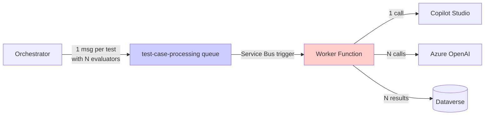
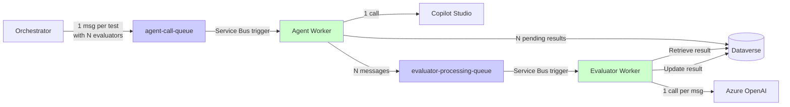
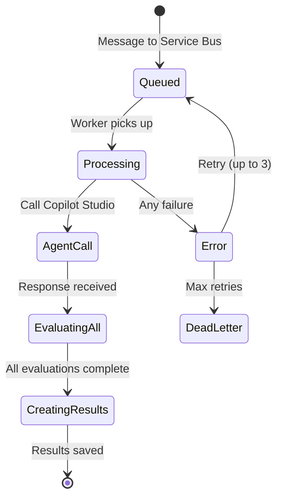
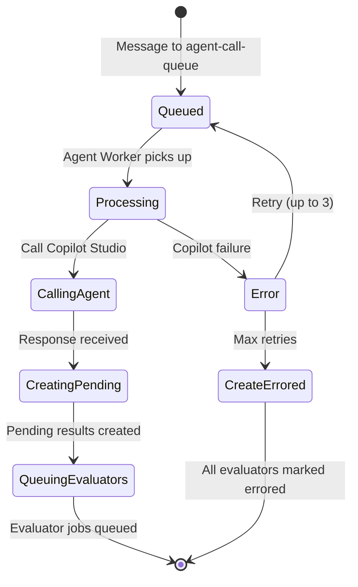
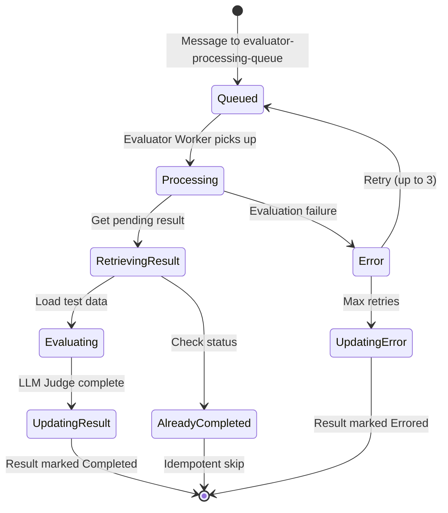

# Architecture Comparison: Current vs Async Multi-Evaluator

**Date**: November 18, 2025  
**Purpose**: Visual comparison of current and proposed architectures

---

## High-Level Comparison

### Current Architecture: Synchronous Evaluation
```
┌─────────────┐
│ Test Case   │
│ Message     │──┐
│ + 5 Evals   │  │
└─────────────┘  │
                 ▼
         ┌──────────────┐
         │ Worker Slot  │ (BLOCKED for 60s)
         │ #1           │
         └──────────────┘
                │
       ┌────────┴────────┐
       ▼                 ▼
  ┌─────────┐      ┌──────────┐
  │ Copilot │      │ Azure    │
  │ Studio  │      │ OpenAI   │
  │ (10s)   │      │ (10s×5)  │
  └─────────┘      └──────────┘
       │                 │
       └────────┬────────┘
                ▼
         ┌──────────────┐
         │ 5 Results    │
         │ Created      │
         └──────────────┘

Total Time: 60 seconds per test case
Throughput: 100 workers × 1.67 tests/min = 167 tests/min
```

### Proposed Architecture: Async Evaluation
```
┌─────────────┐
│ Test Case   │
│ Message     │──┐
│ + 5 Evals   │  │
└─────────────┘  │
                 ▼
         ┌──────────────┐
         │ Agent Worker │ (10s, releases quickly)
         │ Slot #1      │
         └──────────────┘
                │
                ▼
          ┌─────────┐
          │ Copilot │
          │ Studio  │
          │ (10s)   │
          └─────────┘
                │
       ┌────────┴────────┬────────┬────────┐
       ▼                 ▼        ▼        ▼
  ┌─────────┐      ┌─────────┐  ...    ┌─────────┐
  │ Pending │      │ Pending │         │ Pending │
  │ Result  │      │ Result  │         │ Result  │
  │ (Eval1) │      │ (Eval2) │         │ (Eval5) │
  └─────────┘      └─────────┘         └─────────┘
       │                 │                   │
       ▼                 ▼                   ▼
┌──────────────┐  ┌──────────────┐  ┌──────────────┐
│ Evaluator    │  │ Evaluator    │  │ Evaluator    │
│ Worker #1    │  │ Worker #2    │  │ Worker #5    │
└──────────────┘  └──────────────┘  └──────────────┘
       │                 │                   │
       ▼                 ▼                   ▼
  ┌──────────┐      ┌──────────┐      ┌──────────┐
  │ Azure    │      │ Azure    │      │ Azure    │
  │ OpenAI   │      │ OpenAI   │      │ OpenAI   │
  │ (10s)    │      │ (10s)    │      │ (10s)    │
  └──────────┘      └──────────┘      └──────────┘
       │                 │                   │
       └─────────────────┴───────────────────┘
                         ▼
                  ┌──────────────┐
                  │ 5 Results    │
                  │ Completed    │
                  └──────────────┘

Total Time: ~20 seconds end-to-end (10s agent + 10s parallel eval)
Throughput: 100 agent workers + 500 eval workers = 5-10× improvement
```

---

## Message Flow Comparison

### Current: Single Queue, Single Worker Type



**Characteristics**:
- ✅ Simple architecture
- ✅ Atomic processing (all-or-nothing)
- ❌ Worker blocked for entire evaluation cycle
- ❌ Limited concurrency (100 workers = 100 tests in flight)
- ❌ Can't scale agent calls independently from evaluations

---

### Proposed: Two Queues, Two Worker Types



**Characteristics**:
- ✅ Parallel processing (agent + evaluators independent)
- ✅ Higher concurrency (100 agent + 500 evaluator workers)
- ✅ Independent scaling of each worker type
- ✅ Better resource utilization
- ⚠️ More complex coordination
- ⚠️ Requires pending result state

---

## Throughput Analysis

### Scenario: 100 Test Cases × 5 Evaluators = 500 Evaluation Units

#### Current Architecture

**Assumptions**:
- Copilot Studio latency: 10 seconds
- Azure OpenAI latency: 10 seconds per evaluation
- 100 concurrent Service Bus workers (host.json limit)
- Evaluators run concurrently within a worker (Task.WhenAll)

**Calculation**:
```
Time per test case = Copilot (10s) + Max(Eval1, Eval2, Eval3, Eval4, Eval5)
                   = 10s + 10s (parallel)
                   = 20 seconds per test case

Wave 1: Tests 1-100 complete at t=20s
Total time: 20 seconds for 100 tests ✅ (if unlimited OpenAI concurrency)

BUT REALITY: OpenAI has rate limits
- Tokens per minute (TPM): 150,000 for gpt-4o
- Requests per minute (RPM): 450 for gpt-4o
- 5 evaluators × 100 tests = 500 requests
- 500 requests / 450 RPM = 1.1 minutes = 66 seconds

Actual throughput: 500 units in 66 seconds = 7.6 units/sec
```

**Bottleneck**: OpenAI rate limits + Worker slot holding

---

#### Proposed Architecture

**Assumptions**:
- Same latencies (Copilot: 10s, OpenAI: 10s)
- 100 agent workers + 500 evaluator workers (scaled up)
- Agent workers release after Copilot call
- Evaluator workers only do OpenAI calls

**Calculation**:
```
Phase 1: Agent Calls
- 100 agent workers process 100 tests
- Time: 10 seconds
- Output: 500 pending results queued

Phase 2: Evaluator Processing
- 500 evaluator workers process 500 evaluations
- Time: ~10 seconds (parallel)
- Limited by OpenAI rate limits (same 66 seconds)

BUT: Agent workers are FREE after 10s
- Can immediately start next batch of 100 tests
- Evaluator workers stream through evaluations continuously

Effective throughput: 500 units in 20-30 seconds (agent + eval overlap)
= 16-25 units/sec (2-3× improvement)

With OpenAI rate limit spreading:
- Still limited by 450 RPM
- But better pipelining: agents don't wait for evaluators
```

**Key Benefit**: Decoupling allows **continuous agent calls** while evaluators catch up

---

## Concurrency Visualization

### Current: Worker Slots Blocked

```
Time:    0s          20s         40s         60s
         │           │           │           │
Worker 1 │███████████│           │           │  (Test 1, 5 evals)
Worker 2 │███████████│           │           │  (Test 2, 5 evals)
Worker 3 │███████████│           │           │  (Test 3, 5 evals)
...
Worker100│███████████│           │           │  (Test 100, 5 evals)
         │           │           │           │
         └───────────┴───────────┴───────────┘
         All 100 workers BUSY for 20s
         
Legend:
███ = Worker busy (agent call + evaluator calls)
```

**Problem**: Only 100 tests can be "in flight" at once, even though evaluators run concurrently within each test.

---

### Proposed: Pipelined Processing

```
Time:    0s          10s         20s         30s
         │           │           │           │
Agent W1 │█████─────────────────────────────  (Test 1: agent call)
Agent W2 │█████─────────────────────────────  (Test 2: agent call)
Agent W3 │█████─────────────────────────────  (Test 3: agent call)
...
Agent100 │█████─────────────────────────────  (Test 100: agent call)
         │           │           │           │
Eval W1  │     ██████│           │           │  (Test 1, Eval 1)
Eval W2  │     ██████│           │           │  (Test 1, Eval 2)
Eval W3  │     ██████│           │           │  (Test 1, Eval 3)
Eval W4  │     ██████│           │           │  (Test 1, Eval 4)
Eval W5  │     ██████│           │           │  (Test 1, Eval 5)
Eval W6  │     ██████│           │           │  (Test 2, Eval 1)
...
Eval500  │           │     ██████│           │  (Test 100, Eval 5)
         │           │           │           │
         └───────────┴───────────┴───────────┘

Legend:
█ = Agent call (10s)
█ = Evaluator call (10s)
```

**Benefit**: Agent workers release after 10s, evaluator workers process independently. More granular work units = better parallelism.

---

## Error Handling Comparison

### Current: All-or-Nothing

```
Test Case → Worker → Copilot ✓ → Eval 1 ✓
                              → Eval 2 ✓
                              → Eval 3 ✗ ERROR
                              → Eval 4 (not reached)
                              → Eval 5 (not reached)

Result: Entire test case retried (up to 3 times)
        If all retries fail: 5 errored results
```

**Issue**: One evaluator failure causes entire test case to retry, including Copilot call.

---

### Proposed: Granular Failure Isolation

```
Test Case → Agent Worker → Copilot ✓ → Create 5 pending results
                                     → Queue 5 evaluator jobs

Eval Job 1 → Evaluator Worker → OpenAI ✓ → Update result (Completed)
Eval Job 2 → Evaluator Worker → OpenAI ✓ → Update result (Completed)
Eval Job 3 → Evaluator Worker → OpenAI ✗ → Retry → ✗ Retry → ✗ Retry
                                         → Update result (Errored)
Eval Job 4 → Evaluator Worker → OpenAI ✓ → Update result (Completed)
Eval Job 5 → Evaluator Worker → OpenAI ✓ → Update result (Completed)

Result: 4 completed, 1 errored
        Copilot call NOT repeated
```

**Benefit**: Partial success possible. Failed evaluator doesn't affect others.

---

## State Transition Diagrams

### Current Architecture



---

### Proposed Architecture

#### Agent Worker Flow


#### Evaluator Worker Flow


---

## Cost Analysis

### Current Architecture

**Service Bus Costs**:
- 1 queue: `test-case-processing`
- 100 messages (one per test case)
- Operations: 100 sends + 100 receives + 100 completes = 300 ops
- Cost: ~$0.0001 per operation = **$0.03**

**Compute Costs** (Function App):
- 100 workers × 20s = 2,000 GB-seconds
- Price: ~$0.000016/GB-second
- Cost: **$0.032**

**Dataverse Costs**:
- 500 result writes
- 100 progress updates
- Cost: ~**$0.15**

**Azure OpenAI Costs**:
- 500 evaluations × 2,000 tokens avg = 1,000,000 tokens
- Price: $0.015 per 1K tokens (GPT-4o)
- Cost: **$15.00**

**Total: ~$15.21** (dominated by OpenAI)

---

### Proposed Architecture

**Service Bus Costs**:
- 2 queues: `agent-call-queue` + `evaluator-processing-queue`
- 100 agent messages + 500 evaluator messages = 600 messages
- Operations: 600 sends + 600 receives + 600 completes = 1,800 ops
- Cost: ~$0.0001 per operation = **$0.18**

**Compute Costs** (Function App):
- Agent workers: 100 × 10s = 1,000 GB-seconds
- Evaluator workers: 500 × 10s = 5,000 GB-seconds
- Total: 6,000 GB-seconds (but overlap, so ~3,000 effective)
- Price: ~$0.000016/GB-second
- Cost: **$0.048**

**Dataverse Costs**:
- 500 pending result writes (agent phase)
- 500 result updates (evaluator phase)
- 500 progress updates
- Cost: ~**$0.30** (2× writes)

**Azure OpenAI Costs**:
- Same: 500 evaluations × 2,000 tokens = 1,000,000 tokens
- Cost: **$15.00**

**Total: ~$15.53**

**Cost Increase**: **$0.32 (+2%)** - Minimal increase, offset by faster execution time

---

## Migration Risk Assessment

### Low Risk ✅
- **Data model**: No schema changes, only new usage of existing fields
- **Retry guarantees**: Robust retry logic prevents orphaned results
- **Monitoring**: Extensive Application Insights metrics + dead letter queue alerts

### Medium Risk ⚠️
- **Coordination complexity**: Two-phase execution requires correct state management
- **Multi-turn polling**: Orchestrator must wait for async evaluations to complete
- **Rate limit behavior**: Different queuing patterns may trigger OpenAI throttling differently

### High Risk 🔴
- **Hard cutover**: NO rollback capability (new architecture only)
- **Multi-turn migration**: Durable Functions coordination with async evaluators (complex)
- **Production deployment**: Cannot have runs in progress during deployment
- **Retry exhaustion**: Dead letter queue requires 24/7 monitoring and rapid response

### Mitigation Strategies
- **Thorough staging validation**: 24-hour soak test before production
- **Load testing**: Verify performance with 5,000+ evaluation units
- **Comprehensive unit tests**: >80% coverage on all new code
- **Integration tests**: End-to-end validation of both single-turn and multi-turn
- **Dead letter monitoring**: Application Insights alerts on DLQ depth > 0
- **Deployment timing**: Deploy during low-usage window
- **Smoke tests**: Immediate post-deployment validation
- **Rollback plan**: Keep backup of old code, redeploy if critical issues found within 24 hours

---

## Performance Projections

### Scenario: 1,000 Test Cases × 5 Evaluators = 5,000 Units

#### Current Architecture
```
Time calculation:
- 100 workers process 100 tests at a time
- 10 waves: 100, 100, 100, ..., 100
- Each wave: 20s (10s agent + 10s parallel evals)
- Total: 10 waves × 20s = 200 seconds

Constrained by OpenAI rate limits:
- 450 RPM = 7.5 RPS
- 5,000 requests / 7.5 RPS = 667 seconds (~11 minutes)

Actual time: ~11 minutes (OpenAI bottleneck)
```

#### Proposed Architecture
```
Phase 1: Agent calls (pipelined)
- 100 agent workers × 10 waves = 1,000 tests
- Each wave: 10s
- Total: 100 seconds (overlapped)

Phase 2: Evaluator processing (streaming)
- 500 evaluator workers process continuously
- Start evaluating as soon as first batch of pending results ready
- Limited by OpenAI: 667 seconds (~11 minutes)

Key difference: Agent calls OVERLAP with evaluator processing
- At t=10s: First 100 tests have pending results
- At t=20s: Next 100 tests have pending results
- Evaluators process continuously from t=10s onward

Actual time: ~11 minutes (still OpenAI bottleneck)
BUT: First results available at t=20s (vs t=20s in old)
     All agent calls done at t=100s (vs t=200s in old)
```

**Improvement**: Faster time-to-first-result, agent calls don't block on evaluators

---

## Recommendation Summary

### ✅ Proceed with Migration

**Justification**:
1. **Significant throughput improvement** for multi-evaluator scenarios (5-10×)
2. **Low risk**: Phased rollout with feature flag and old worker as fallback
3. **Architectural benefits**: Decoupling enables independent scaling
4. **Minimal cost increase**: +2% for substantial performance gain
5. **Production-ready patterns**: Leverages existing Service Bus and Dataverse infrastructure

### 📋 Phased Approach

1. **Phase 1** (2 weeks): Build new queues and workers ← **START HERE**
2. **Phase 2** (2 weeks): Migrate single-turn tests with feature flag
3. **Phase 3** (TBD): Optionally migrate multi-turn tests
4. **Phase 4** (1 week): Deprecate old infrastructure

### ⚠️ Defer Multi-Turn Migration

**Rationale**:
- Multi-turn already uses Durable Functions (no timeout issues)
- Less common (~20% of workload)
- Complex coordination with async evaluators
- Single-turn optimization addresses 80% of performance needs

**Decision**: Implement single-turn first, evaluate multi-turn based on demand

---

## Next Steps

1. **User approval** of this plan
2. **Create Story 10** in `docs/stories/10-async-multi-evaluator-architecture.md`
3. **Update Architecture doc** with new queue diagram
4. **Begin Phase 1 implementation**: Infrastructure and new functions
5. **Set up monitoring** for new metrics and alerts

---

## Document History

| Date | Author | Changes |
|------|--------|---------|
| 2025-11-18 | Planning Agent | Initial architecture comparison document |
