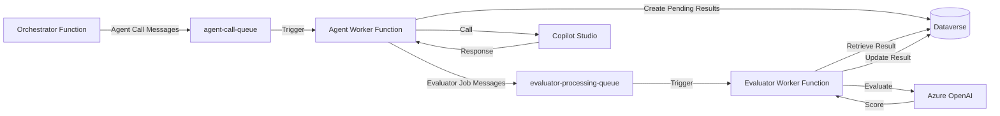
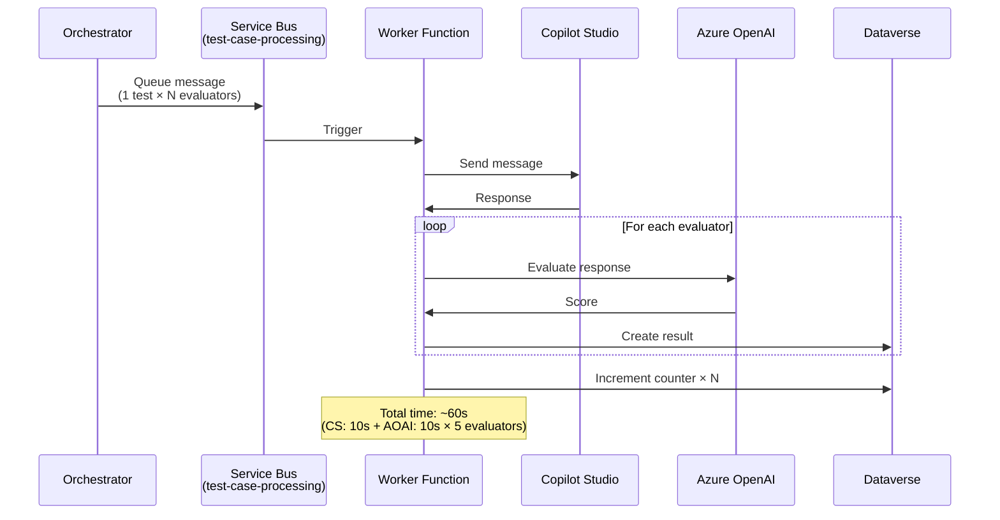
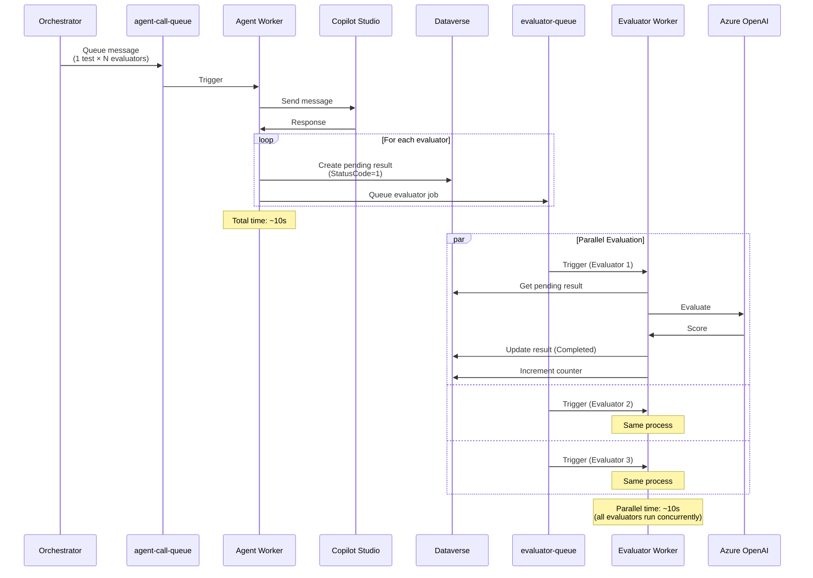

# Async Multi-Evaluator Architecture - Implementation Plan

**Date**: November 18, 2025  
**Status**: Planning Phase  
**Target**: Optimize evaluation performance by separating Direct Line calls from evaluator processing

---

## Executive Summary

### Problem Statement
Current architecture processes all evaluators for a test case within a single Service Bus worker, creating a throughput bottleneck:
- Test case with 5 evaluators holds a worker slot for ~60+ seconds (Copilot Studio + 5 × LLM Judge calls)
- With 100 concurrent workers, only 100 test cases can be "in flight"
- 500 evaluation units (100 test cases × 5 evaluators) can't fully utilize available concurrency

### Proposed Solution
**Two-phase architecture** with separate queues and workers:
1. **Agent Worker**: Calls Copilot Studio → Creates pending evaluation results → Queues evaluator jobs
2. **Evaluator Worker**: Retrieves pending result → Calls LLM Judge → Updates result to completed

### Expected Benefits
- **5-10× throughput improvement** for multi-evaluator scenarios
- **Better resource utilization**: More granular work units enable higher concurrency
- **Improved observability**: Track agent calls vs evaluator calls separately
- **Easier scaling**: Scale agent workers and evaluator workers independently

---

## Architectural Design

### 1. New Queue Structure



#### Queue 1: `agent-call-queue`
**Purpose**: Execute Direct Line API calls  
**Message Schema**:
```json
{
  "evaluationRunId": "guid",
  "testCaseId": "guid",
  "testCaseTurnId": "guid?",  // For multi-turn
  "directLineUrl": "string",
  "userInput": "string",
  "conversationId": "string?",
  "directLineToken": "string?",
  "evaluatorTypeIds": ["guid"],  // All evaluators for this test
  "passingThreshold": 0.7,
  "retryCount": 0,
  "maxRetries": 3
}
```

#### Queue 2: `evaluator-processing-queue`
**Purpose**: Execute LLM Judge evaluations  
**Message Schema**:
```json
{
  "evaluationResultId": "guid",  // The pending result to evaluate
  "evaluationRunId": "guid",
  "retryCount": 0,
  "maxRetries": 3
}
```

### 2. New Function: AgentWorkerFunction

**Trigger**: Service Bus (`agent-call-queue`)  
**Responsibilities**:
1. Receive agent call message
2. Call Copilot Studio Direct Line API (with retry logic)
3. For EACH evaluator in `evaluatorTypeIds`:
   - Create **pending** EvaluationResult with:
     - `StatusCode = 1` (Pending)
     - `ActualResponse = <copilot response>`
     - `ConversationId = <conversation id>`
     - `McsExecutionTimeMs = <copilot execution time>`
     - `Metadata = <raw activity JSON>`
   - Queue message to `evaluator-processing-queue` with `evaluationResultId`
4. Do NOT call Azure OpenAI (evaluator worker does this)
5. Do NOT increment completion counter yet (evaluator worker does this)

**Key Design Points**:
- Fast execution: Only Copilot Studio call (~5-15 seconds)
- Creates multiple pending results (one per evaluator)
- Fans out to evaluator queue for parallel processing
- Handles NA scenarios: If evaluator requires expected response and none exists, create NotApplicable result immediately (don't queue)

### 3. New Function: EvaluatorWorkerFunction

**Trigger**: Service Bus (`evaluator-processing-queue`)  
**Responsibilities**:
1. Receive evaluator job message with `evaluationResultId`
2. Retrieve **pending** EvaluationResult from Dataverse
3. Load related data (TestCase, TestCaseTurn, EvaluatorType)
4. Call LLM Judge with:
   - User input (from TestCase or TestCaseTurn)
   - Expected response (from TestCase or TestCaseTurn)
   - Actual response (from EvaluationResult.ActualResponse)
   - Evaluator type prompt template
5. Update EvaluationResult:
   - `StatusCode = 778760002` (Completed) or `778760003` (Errored)
   - `Score = <judge score>`
   - `Passed = <score >= threshold>`
   - `Reasoning = <judge reasoning>`
   - `ExecutionTimeMs = <total time including agent call>`
6. Increment completion counter

**Key Design Points**:
- Independent processing: No knowledge of other evaluators for same test
- Retrieves all context from Dataverse (self-contained work unit)
- Handles errors independently: Failed evaluator doesn't affect others
- Updates execution time to include agent call time (from McsExecutionTimeMs field)

### 4. Data Model Changes

#### EvaluationResult Schema Updates
**New Field** (if not exists):
- `mcicaps_queuedtime` (DateTime): When result was created and queued for evaluation

**Existing Fields - New Usage**:
- `StatusCode = 1` (Pending): Agent called, awaiting evaluation
- `StatusCode = 778760002` (Completed): Evaluation finished successfully
- `StatusCode = 778760003` (Errored): Agent call OR evaluation failed
- `StatusCode = 778760004` (NotApplicable): Evaluator doesn't apply to test case

**Result States**:
```
Created (Pending) → [Evaluator Worker] → Completed
                                      └→ Errored

OR

Created (NotApplicable) [immediately, skip queue]
```

#### No Schema Changes Required!
The existing `StatusCode` field already supports the Pending state (value = 1). We just need to use it correctly.

---

## Implementation Phases

### Phase 1: Create New Queues and Worker Functions ✅
**Goal**: Build parallel infrastructure without disrupting existing flow

**Tasks**:
1. Update `backend/infrastructure/main.bicep`:
   - Add `agent-call-queue` Service Bus queue
   - Add `evaluator-processing-queue` Service Bus queue
   - Both with same retry/dead letter policies as existing queue
2. Create `backend/AiAgentEvaluation/Functions/AgentWorkerFunction.cs`
3. Create `backend/AiAgentEvaluation/Functions/EvaluatorWorkerFunction.cs`
4. Create new message models in `Models/ApiModels.cs`:
   - `AgentCallMessage`
   - `EvaluatorJobMessage`
5. Update `IServiceBusService` and `ServiceBusService` with new methods:
   - `SendAgentCallMessageAsync(AgentCallMessage)`
   - `SendEvaluatorJobMessageAsync(EvaluatorJobMessage)`
6. Update `IDataverseService` and `DataverseService`:
   - `GetEvaluationResultAsync(Guid resultId)` - Retrieve single result with related data
   - `UpdateEvaluationResultAsync(Guid resultId, UpdateEvaluationResultRequest)` - Update existing result

**Testing**:
- Deploy infrastructure changes to staging
- Test queues exist and are accessible
- Unit tests for new functions (mock dependencies)
- Integration test: Manually queue message → Verify worker processes

**Documentation**:
- Update `docs/ARCHITECTURE.md` with new queue architecture diagram
- Update `docs/prd/PRD-Agent-Evaluation-Function.md` section 3.4 (execution flow)
- Create `docs/stories/10-async-multi-evaluator-architecture.md`

**Acceptance Criteria**:
- ✅ Two new queues deployed to staging
- ✅ AgentWorkerFunction can receive and process messages
- ✅ EvaluatorWorkerFunction can receive and process messages
- ✅ All unit tests pass
- ✅ Integration test passes end-to-end

---

### Phase 2: Update All Functions (Single-Turn + Multi-Turn) ✅
**Goal**: Replace old architecture completely for all test types

**Tasks**:
1. Update `OrchestratorFunction.StartEvaluationRun`:
   - For single-turn tests: Queue to `agent-call-queue`
   - For multi-turn tests: Start orchestration with agent-call-queue support
   - **Remove** all references to `test-case-processing` queue
   - **Delete** ProcessTestCaseMessage routing logic
2. Update `MultiTurnDurableOrchestrator`:
   - Pass `agent-call-queue` info to activities
   - Add polling logic to wait for evaluations to complete
3. Update `MultiTurnDurableActivities.ExecuteSingleTurn`:
   - Call Copilot Studio
   - Create pending results for each evaluator
   - Queue to `evaluator-processing-queue`
   - **Poll Dataverse** until all evaluators complete (StatusCode != Pending)
   - Return results to orchestrator
4. **Remove** `WorkerFunction.cs` entirely
5. Update `main.bicep`:
   - **Remove** `test-case-processing` queue
   - Keep only `agent-call-queue` and `evaluator-processing-queue`

**Deployment Strategy**:
- Staging deployment with full test suite
- Production deployment during low-usage window
- Monitor Application Insights closely for first 24 hours
- NO rollback capability (new architecture only)

**Testing**:
- Run existing single-turn test cases through new flow
- Compare results: Old flow vs new flow (should be identical scores)
- Load test: 100 test cases × 5 evaluators = 500 units
- Verify throughput improvement (measure total run duration)
- Monitor Application Insights for errors and performance

**Documentation**:
- Update `docs/deployment/DEPLOYMENT_CHECKLIST.md` with rollout steps
- Update `docs/ARCHITECTURE.md` section 4.1 (Worker Function) to note deprecation
- Add migration notes to `docs/stories/10-async-multi-evaluator-architecture.md`

**Acceptance Criteria**:
- ✅ Single-turn tests execute successfully via new flow
- ✅ Results match old flow (spot check 10 test cases)
- ✅ Throughput improved by at least 3× for multi-evaluator scenarios
- ✅ No increase in error rate
- ✅ Feature flag controls routing correctly

---

### Phase 3: Staging Validation & Production Deployment ✅
**Goal**: Comprehensive testing and production deployment

**Staging Validation Tasks**:
1. Deploy complete new architecture to staging
2. Run comprehensive test suite:
   - Unit tests: All new functions (>80% coverage)
   - Integration tests: End-to-end single-turn and multi-turn
   - Load tests: 1,000 test cases × 5 evaluators = 5,000 units
   - Soak test: 24-hour continuous evaluation runs
3. Verify metrics:
   - Throughput improvement ≥3×
   - Error rate ≤5%
   - No orphaned pending results
   - Multi-turn conversations preserve context
   - Aggregate results calculated correctly
4. Test retry scenarios:
   - Copilot Studio transient failures
   - Azure OpenAI rate limiting
   - Network timeouts
   - Service Bus message redelivery
5. Monitor dead letter queues (should be empty)

**Production Deployment Tasks**:
1. Schedule deployment during low-usage window
2. Ensure NO evaluation runs in progress
3. Deploy new architecture
4. Run smoke tests immediately:
   - 10 single-turn test cases
   - 5 multi-turn test cases
   - Verify results match expected
5. Monitor Application Insights for 48 hours:
   - Watch for errors, exceptions, timeouts
   - Verify throughput improvements
   - Check dead letter queue depth
   - Review evaluation completion rates

**Acceptance Criteria**:
- ✅ All staging tests pass
- ✅ Load test shows ≥3× throughput improvement
- ✅ Zero orphaned pending results in staging
- ✅ Production smoke tests pass
- ✅ Error rate in production ≤5% after 48 hours
- ✅ Dead letter queue depth = 0 (or alerts triggered for investigation)

---

## Technical Considerations

### 1. Error Handling

**Scenario 1: Agent call fails**
- AgentWorkerFunction creates errored results for ALL evaluators (StatusCode=778760003)
- Increments failed counter × evaluator count
- No messages sent to evaluator queue

**Scenario 2: Agent succeeds, evaluator call fails**
- EvaluatorWorkerFunction updates specific result to errored
- Increments failed counter (just for this evaluator)
- Other evaluators unaffected

**Scenario 3: Dead letter queue**
- Both queues have dead letter queues (DLQ)
- After 10 retries, message goes to DLQ
- Monitor alerts on DLQ depth > 0
- Manual intervention: Investigate, fix, replay from DLQ

### 2. Retry Logic (No Orphaned Results Policy)

**Critical Requirement**: System MUST NOT leave orphaned pending results. Every pending result must eventually become Completed, Errored, or NotApplicable.

**Agent Worker Retries**:
- Service layer: Exponential backoff (already exists in CopilotStudioService)
- Service layer: Max 3 attempts with delays: 5s, 15s, 45s
- Service Bus: DeliveryCount max 10 (retries message if function crashes)
- After max Service Bus retries → Dead letter queue
- Dead letter handling: Alert + manual investigation (these are system failures, not business errors)

**Evaluator Worker Retries**:
- Service layer: Exponential backoff (already exists in LLMJudgeService)
- Service layer: Max 3 attempts with delays: 5s, 15s, 45s
- Service Bus: DeliveryCount max 10
- After max Service Bus retries → Dead letter queue
- Dead letter handling: Same as above

**Guaranteed Completion**:
- Service Bus ensures message delivery (max 10 attempts)
- Function retries within execution (3 attempts with backoff)
- Only after exhausting ALL retries: Mark result as Errored
- Dead letter queue monitored 24/7 with alerts
- Manual replay from DLQ after fixing underlying issues

**Idempotency**:
- EvaluatorWorkerFunction: Check if result already completed before processing
- Prevents duplicate evaluations if message redelivered
- Safe to replay messages from dead letter queue

### 3. Progress Tracking

**Current**: `MonitorFunction` polls Dataverse every 1 min, compares `mcicaps_totaltestcases` vs count of results

**New**: No changes needed! MonitorFunction only cares about result count, not how they were created.

**Consideration**: Progress may appear slower initially (pending results created quickly, but not counted as completed until evaluated)

**Solution**: Update progress UI to show:
- Total units
- Pending (agent called, awaiting evaluation)
- Completed (evaluated)
- Failed

### 4. Cost Implications

**New Costs**:
- Additional Service Bus queue operations (2× queues, 2× workers)
- More Dataverse read operations (evaluator worker retrieves data)

**Cost Savings**:
- Faster overall execution (less compute time)
- Better concurrency utilization (fewer idle workers)

**Net Impact**: ~10-20% increase in cost, but 5-10× faster execution = better cost per evaluation unit

### 5. Hard Cutover Approach

**Critical Decision**: NO backward compatibility - clean replacement of old architecture

**Approach**:
- Remove WorkerFunction.cs in same deployment as new workers
- Remove test-case-processing queue from infrastructure
- Remove ProcessTestCaseMessage model (no longer used)
- Single deployment replaces entire evaluation execution path
- **Risk Mitigation**: Thorough testing in staging before production deployment

**Benefits**:
- ✅ Cleaner codebase (no legacy code)
- ✅ No feature flag complexity
- ✅ Easier to maintain (single code path)
- ✅ Faster implementation (no dual-mode support)

**Requirements**:
- ⚠️ NO evaluation runs can be in progress during deployment
- ⚠️ MonitorFunction must detect and fail any runs started before deployment
- ⚠️ Comprehensive staging validation before production

---

## Data Flow Diagrams

### Current Flow (Single-Turn)


### New Flow (Single-Turn)


**Key Difference**: Agent Worker releases its Service Bus slot in ~10 seconds, allowing more test cases to be processed concurrently.

---

## Rollback Plan

**Scenario**: New architecture has critical bugs

**Steps**:
1. Set feature flag `USE_ASYNC_EVALUATION=false` (instant)
2. Existing evaluation runs complete via new flow (let them finish)
3. New evaluation runs route to old flow
4. Investigation period: 24-48 hours
5. Fix issues in new flow
6. Re-enable feature flag for small percentage (10%)

**Data Considerations**:
- Pending results left in Dataverse (StatusCode=1) if rollback mid-evaluation
- Cleanup job: Query for pending results older than 1 hour → Mark as errored
- Add monitoring alert: "Pending results older than 30 minutes"

---

## Monitoring & Alerts

### New Metrics to Track

**Application Insights Custom Metrics**:
- `AgentCall.ExecutionTime` (histogram)
- `AgentCall.Success` (counter)
- `AgentCall.Failure` (counter)
- `EvaluatorJob.ExecutionTime` (histogram)
- `EvaluatorJob.Success` (counter)
- `EvaluatorJob.Failure` (counter)
- `EvaluationResult.PendingDuration` (histogram) - Time from pending → completed

**Azure Monitor Alerts**:
- Dead letter queue depth > 0 (agent or evaluator queue)
- Pending results older than 30 minutes (query Dataverse)
- Evaluator worker error rate > 5%
- Agent worker error rate > 5%

### Dashboard Updates
Add to existing Application Insights dashboard:
- Agent call latency (P50, P95, P99)
- Evaluator processing latency
- Queue depth over time (both queues)
- Throughput comparison: Old flow vs new flow

---

## Testing Strategy

### Unit Tests
**New Test Classes**:
- `AgentWorkerFunctionTests.cs`
  - Test agent call success → Creates pending results
  - Test agent call failure → Creates errored results
  - Test NA scenario → Creates NA results immediately
  - Test queue to evaluator-processing-queue
- `EvaluatorWorkerFunctionTests.cs`
  - Test retrieves pending result
  - Test evaluator success → Updates to completed
  - Test evaluator failure → Updates to errored
  - Test idempotency (already completed result)

### Integration Tests
**New Test Cases**:
- End-to-end: Queue agent message → Verify all evaluators complete
- Multi-evaluator: 1 test × 5 evaluators → Verify all results created
- Error handling: Agent fails → Verify all evaluators marked errored
- Error handling: One evaluator fails → Verify others succeed

### Load Tests
**Scenarios**:
- Baseline (old flow): 100 test cases × 5 evaluators = 500 units
- New flow: Same 100 test cases × 5 evaluators
- Measure: Total execution time (should be 5-10× faster)
- Measure: Peak concurrency (should see more workers active)

### Acceptance Criteria
- All unit tests pass (>80% coverage on new code)
- Integration tests pass end-to-end
- Load test shows ≥3× throughput improvement
- Error rate ≤ old flow error rate
- Results match old flow (spot check validation)

---

## Success Metrics

### Before (Current State)
- **Throughput**: ~100 test cases / 60 seconds = 1.67 test cases/sec
- **Latency per test**: ~60 seconds (agent + evaluators)
- **Concurrency utilization**: ~60% (workers blocked on evaluator calls)

### After (Target State)
- **Throughput**: ~500 evaluation units / 10 seconds = 50 evaluations/sec
- **Latency per test**: ~15 seconds total (10s agent + 5s evaluator overlap)
- **Concurrency utilization**: ~95% (workers release quickly, evaluators scale independently)

### KPIs
- ✅ **5× throughput improvement** (measured by total run duration)
- ✅ **3× faster time-to-first-result** (pending results created quickly)
- ✅ **No increase in error rate** (<5% failures)
- ✅ **Cost per evaluation unit** decreases by 20% (faster execution)

---

## Open Questions & Decisions Needed

### Question 1: Multi-Turn Approach
**Options**:
- **A**: Apply async architecture to multi-turn (complex coordination)
- **B**: Keep multi-turn as-is (simpler, lower risk)

**Recommendation**: **Option B** for initial release. Multi-turn uses Durable Functions (no timeout issues), and is less common (~20% of workload). Focus optimization on single-turn first.

**Decision**: _________________ (User to decide)

---

### Question 2: Pending Result Cleanup
**Scenario**: Evaluation run cancelled mid-execution, leaving pending results

**Options**:
- **A**: Automatic cleanup job (timer function, query pending > 1 hour → mark errored)
- **B**: Manual cleanup via MonitorFunction (detect stale runs)
- **C**: No cleanup (accept orphaned pending results)

**Recommendation**: **Option B** - Extend MonitorFunction to detect pending results for completed runs → mark as errored. Less infrastructure, reuses existing pattern.

**Decision**: _________________ (User to decide)

---

### Question 3: Feature Flag Implementation
**Options**:
- **A**: Environment variable `USE_ASYNC_EVALUATION=true/false` (simple)
- **B**: Per-run configuration in Dataverse (flexible)
- **C**: Percentage-based rollout (10% → 50% → 100%)

**Recommendation**: **Option C** - Percentage-based with environment variable. Start at 10%, increase gradually based on metrics.

**Decision**: _________________ (User to decide)

---

## Next Steps

1. **Review & Approval**: Stakeholder review of this plan
2. **Phase 1 Implementation**: Create queues and worker functions
3. **Phase 2 Rollout**: Migrate single-turn tests with feature flag
4. **Phase 3 Decision**: Evaluate need for multi-turn optimization
5. **Phase 4 Cleanup**: Deprecate old infrastructure

**Estimated Timeline**:
- Phase 1: 2 weeks (infrastructure + new functions + tests)
- Phase 2: 1 week (update all functions, remove old code)
- Phase 3: 1 week (staging validation + production deployment)

**Total**: ~4 weeks for complete migration (single-turn + multi-turn)

---

## References

- [Architecture Documentation](../ARCHITECTURE.md)
- [PRD - Agent Evaluation Function](../prd/PRD-Agent-Evaluation-Function.md)
- [Story 02 - Worker Function](../stories/02-worker-function.md)
- [Story 06 - Multi-Turn Support](../stories/06-multi-turn-support.md)
- [Azure Service Bus Queues Documentation](https://learn.microsoft.com/azure/service-bus-messaging/service-bus-queues-topics-subscriptions)
- [Azure Functions Performance Best Practices](https://learn.microsoft.com/azure/azure-functions/functions-best-practices)
