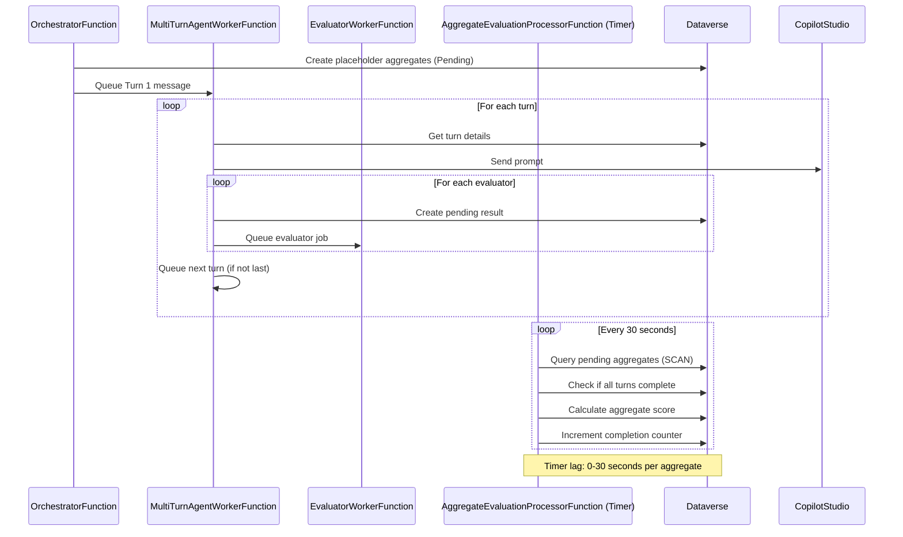
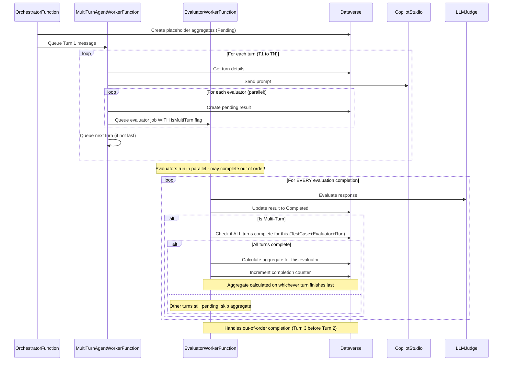

# Multi-Turn Aggregate Optimization - Implementation Plan

**Date Created**: November 23, 2025  
**Last Updated**: November 26, 2025  
**Author**: Planning Agent  
**Status**: ✅ **IMPLEMENTED**  
**Related Stories**: Story 09 (Multi-Evaluator), Story 11 (Service Bus Migration)

---

## ✅ Implementation Complete

**This optimization has been implemented.** The following changes were made:

### Implemented Features (As of November 26, 2025)
- ✅ `EvaluatorJobMessage` now contains multi-turn metadata (IsMultiTurn, TestCaseId, EvaluatorTypeId, TurnSequence, TotalTurns)
- ✅ `MultiTurnAgentWorkerFunction` sets multi-turn metadata when queuing evaluator jobs
- ✅ `EvaluatorWorkerFunction` checks for completion after EVERY multi-turn evaluation and triggers aggregate calculation
- ✅ `IDataverseService` has new methods: `CheckIfAllTurnsCompleteForEvaluatorAsync`, `CalculateAndUpdateAggregateAsync`, `GetAggregateResultForTestCaseAndEvaluatorAsync`
- ✅ `DataverseService` implements the new interface methods
- ✅ `AggregateEvaluationProcessorFunction` timer remains as fallback with updated logging
- ✅ Unit tests added for all new functionality (124 tests pass)

### How It Works
1. When `MultiTurnAgentWorkerFunction` queues an evaluator job, it includes IsMultiTurn=true and metadata
2. After `EvaluatorWorkerFunction` completes an evaluation, it checks if this is a multi-turn test
3. If multi-turn, it queries Dataverse to check if ALL turns are now complete for that evaluator
4. If all turns complete, it immediately calculates and updates the aggregate result
5. The timer function (`AggregateEvaluationProcessorFunction`) serves as a fallback safety net

---

## Executive Summary

**Current State**: Multi-turn aggregates are calculated by a timer-based function (`AggregateEvaluationProcessorFunction`) that polls every 30 seconds, processing 20 aggregates at a time. This creates latency and can result in evaluation runs completing before aggregates are finalized.

**Proposed State**: Mark all multi-turn evaluator messages with metadata, then check for completion after EVERY turn evaluation. When all turns are complete for a given (TestCase + EvaluatorType + Run), trigger immediate aggregate calculation. This handles out-of-order completion and eliminates timer dependency.

**Benefits**:
- ⚡ Near real-time aggregate completion (no 30-second polling lag)
- 🎯 Accurate completion tracking (MonitorFunction sees immediate updates)
- 🔧 Simpler architecture (no timer scanning 2000+ pending aggregates)
- 📊 Better resource utilization (event-driven vs polling)

---

## Current Architecture Analysis

### Multi-Turn Flow (As-Is)



### Problems with Timer-Based Approach

1. **Latency**: Aggregates wait 0-30 seconds after last turn completes
2. **Scalability**: Queries ALL pending aggregates every 30 seconds (expensive at scale)
3. **Completion Detection**: MonitorFunction can't reliably know when run is "truly" done
4. **Resource Waste**: Continuously polling even when no work to do
5. **Batch Limits**: Only processes 20 aggregates per cycle, causing backlog

---

## Proposed Architecture

### Multi-Turn Flow (To-Be)



---

## Implementation Plan

### Phase 1: Add Last Turn Signal to Queue Messages

#### Step 1.1: Extend `EvaluatorJobMessage` Model

**File**: `backend/AiAgentEvaluation/Models/ApiModels.cs`

Add new properties to `EvaluatorJobMessage`:

```csharp
/// <summary>
/// Service Bus message for evaluator job processing (Phase 1 - New Architecture)
/// Queued to evaluator-processing-queue by AgentWorkerFunction
/// </summary>
public class EvaluatorJobMessage
{
    [Required]
    [JsonPropertyName("evaluationResultId")]
    public Guid EvaluationResultId { get; set; }

    [Required]
    [JsonPropertyName("evaluationRunId")]
    public Guid EvaluationRunId { get; set; }

    /// <summary>
    /// Number of retry attempts for this message (used for exponential backoff)
    /// </summary>
    [JsonPropertyName("retryCount")]
    public int RetryCount { get; set; } = 0;

    // ===== NEW PROPERTIES FOR AGGREGATE OPTIMIZATION =====
    
    /// <summary>
    /// Indicates this evaluation is for a multi-turn test case.
    /// When true, EvaluatorWorkerFunction should check if all turns are complete
    /// for this evaluator after each turn completion and trigger aggregate calculation.
    /// </summary>
    [JsonPropertyName("isMultiTurn")]
    public bool IsMultiTurn { get; set; }

    /// <summary>
    /// Test case ID (needed for aggregate calculation for multi-turn tests)
    /// </summary>
    [JsonPropertyName("testCaseId")]
    public Guid? TestCaseId { get; set; }

    /// <summary>
    /// Evaluator type ID (needed for aggregate calculation)
    /// </summary>
    [JsonPropertyName("evaluatorTypeId")]
    public Guid? EvaluatorTypeId { get; set; }

    /// <summary>
    /// Turn sequence number (for logging/debugging)
    /// </summary>
    [JsonPropertyName("turnSequence")]
    public int? TurnSequence { get; set; }

    /// <summary>
    /// Total number of turns for this test case (for validation)
    /// </summary>
    [JsonPropertyName("totalTurns")]
    public int? TotalTurns { get; set; }
}
```

**Rationale**: We need these fields in the evaluator message so the worker can:
1. Detect it's processing a multi-turn test (not just the last turn)
2. Know which test case and evaluator to calculate aggregate for
3. Check if ALL turns complete after EACH turn evaluation (handles out-of-order completion)
4. Validate completion before triggering aggregate

#### Step 1.2: Update `MultiTurnAgentWorkerFunction` to Set `isMultiTurn` Flag

**File**: `backend/AiAgentEvaluation/Functions/MultiTurnAgentWorkerFunction.cs`

**Find** (around line 225):

```csharp
// Queue evaluator job
await _serviceBusService.SendEvaluatorJobMessageAsync(new EvaluatorJobMessage
{
    EvaluationResultId = resultId,
    EvaluationRunId = message.EvaluationRunId
}, cancellationToken);
```

**Replace with**:

```csharp
// Queue evaluator job with multi-turn metadata for aggregate optimization
// Worker will check for completion after EVERY turn (not just last)
await _serviceBusService.SendEvaluatorJobMessageAsync(new EvaluatorJobMessage
{
    EvaluationResultId = resultId,
    EvaluationRunId = message.EvaluationRunId,
    IsMultiTurn = true, // Always true for multi-turn agent worker
    TestCaseId = message.TestCaseId,
    EvaluatorTypeId = evaluatorTypeId,
    TurnSequence = message.TurnSequence,
    TotalTurns = message.TotalTurns
}, cancellationToken);

_logger.LogInformation(
    "Queued evaluator job for result {ResultId} (Multi-turn, Turn {TurnSequence}/{TotalTurns})",
    resultId,
    message.TurnSequence,
    message.TotalTurns);
```

**Also update** the NA result creation (around line 195):

```csharp
// Increment completion counter
await _dataverseService.IncrementCompletedTestCasesAsync(
    message.EvaluationRunId,
    failed: false,
    cancellationToken);

// CRITICAL: For multi-turn NA results, check if aggregate should be calculated
// This handles the case where NA is the last result needed to complete the aggregate
await TryCalculateAggregateForCompletedTurns(
    message.TestCaseId,
    message.EvaluationRunId,
    evaluatorTypeId,
    message.TotalTurns,
    "NA result created",
    cancellationToken);

return; // Skip queue for NA results
```

**Add helper method** at the end of the class:

```csharp
/// <summary>
/// Helper method to attempt aggregate calculation after any turn result is created.
/// Checks if all turns are complete and triggers aggregate if ready.
/// Used for both normal evaluations and NA results.
/// </summary>
private async Task TryCalculateAggregateForCompletedTurns(
    Guid testCaseId,
    Guid evaluationRunId,
    Guid evaluatorTypeId,
    int expectedTurnCount,
    string triggerReason,
    CancellationToken cancellationToken)
{
    try
    {
        _logger.LogInformation(
            "Checking aggregate eligibility for TestCase={TestCaseId}, Evaluator={EvaluatorId}, Reason={Reason}",
            testCaseId, evaluatorTypeId, triggerReason);

        var allTurnsComplete = await _dataverseService.CheckIfAllTurnsCompleteForEvaluatorAsync(
            testCaseId,
            evaluationRunId,
            evaluatorTypeId,
            expectedTurnCount,
            cancellationToken);

        if (allTurnsComplete)
        {
            _logger.LogInformation(
                "All {TurnCount} turns completed for evaluator {EvaluatorId}, triggering aggregate calculation",
                expectedTurnCount, evaluatorTypeId);

            var aggregate = await _dataverseService.GetAggregateResultForTestCaseAndEvaluatorAsync(
                testCaseId,
                evaluationRunId,
                evaluatorTypeId,
                cancellationToken);

            if (aggregate != null)
            {
                await _dataverseService.CalculateAndUpdateAggregateAsync(
                    aggregate.Id,
                    testCaseId,
                    evaluationRunId,
                    evaluatorTypeId,
                    cancellationToken);
            }
        }
    }
    catch (Exception ex)
    {
        _logger.LogError(ex,
            "Error checking/calculating aggregate after {TriggerReason} - timer will handle as fallback",
            triggerReason);
        // Don't throw - timer function will handle as fallback
    }
}
```

---

### Phase 2: Implement Aggregate Calculation in EvaluatorWorkerFunction

#### Step 2.1: Add Aggregate Calculation Method to `IDataverseService`

**File**: `backend/AiAgentEvaluation/Services/IDataverseService.cs`

Add new interface methods:

```csharp
/// <summary>
/// Checks if all turn results are completed for a specific test case, evaluation run, and evaluator type.
/// Used to determine when to trigger aggregate calculation for last turn optimization.
/// </summary>
/// <param name="testCaseId">Test case ID</param>
/// <param name="evaluationRunId">Evaluation run ID</param>
/// <param name="evaluatorTypeId">Evaluator type ID</param>
/// <param name="expectedTurnCount">Expected number of turns</param>
/// <param name="cancellationToken">Cancellation token</param>
/// <returns>True if all turns are completed (not pending), false otherwise</returns>
Task<bool> CheckIfAllTurnsCompleteForEvaluatorAsync(
    Guid testCaseId,
    Guid evaluationRunId,
    Guid evaluatorTypeId,
    int expectedTurnCount,
    CancellationToken cancellationToken = default);

/// <summary>
/// Calculates and updates the aggregate result for a multi-turn test case and evaluator.
/// Called by EvaluatorWorkerFunction when last turn completes (optimization).
/// </summary>
/// <param name="aggregateResultId">ID of the pending aggregate result to update</param>
/// <param name="testCaseId">Test case ID</param>
/// <param name="evaluationRunId">Evaluation run ID</param>
/// <param name="evaluatorTypeId">Evaluator type ID</param>
/// <param name="cancellationToken">Cancellation token</param>
Task CalculateAndUpdateAggregateAsync(
    Guid aggregateResultId,
    Guid testCaseId,
    Guid evaluationRunId,
    Guid evaluatorTypeId,
    CancellationToken cancellationToken = default);
```

#### Step 2.2: Implement Methods in `DataverseService`

**File**: `backend/AiAgentEvaluation/Services/DataverseService.cs`

Add implementations:

```csharp
public async Task<bool> CheckIfAllTurnsCompleteForEvaluatorAsync(
    Guid testCaseId,
    Guid evaluationRunId,
    Guid evaluatorTypeId,
    int expectedTurnCount,
    CancellationToken cancellationToken = default)
{
    try
    {
        _logger.LogInformation(
            "Checking turn completion for TestCase={TestCaseId}, Run={RunId}, Evaluator={EvaluatorId}, ExpectedTurns={ExpectedTurns}",
            testCaseId, evaluationRunId, evaluatorTypeId, expectedTurnCount);

        // Get all turn results for this combination
        var turnResults = await GetTurnResultsForTestCaseAsync(
            testCaseId,
            evaluationRunId,
            evaluatorTypeId,
            cancellationToken);

        // Must have expected number of turns
        if (turnResults.Count != expectedTurnCount)
        {
            _logger.LogInformation(
                "Turn count mismatch: Expected {Expected}, Found {Actual}",
                expectedTurnCount, turnResults.Count);
            return false;
        }

        // Check if any are still pending
        var pendingCount = turnResults.Count(r => r.StatusCode == EvaluationResultStatus.Pending);
        
        _logger.LogInformation(
            "Turn completion check: {TotalCount} turns, {PendingCount} pending",
            turnResults.Count, pendingCount);

        return pendingCount == 0;
    }
    catch (Exception ex)
    {
        _logger.LogError(ex,
            "Error checking turn completion for TestCase={TestCaseId}, Run={RunId}, Evaluator={EvaluatorId}",
            testCaseId, evaluationRunId, evaluatorTypeId);
        return false; // Fail safe - don't trigger aggregate on error
    }
}

public async Task CalculateAndUpdateAggregateAsync(
    Guid aggregateResultId,
    Guid testCaseId,
    Guid evaluationRunId,
    Guid evaluatorTypeId,
    CancellationToken cancellationToken = default)
{
    try
    {
        _logger.LogInformation(
            "Calculating aggregate for Result={ResultId}, TestCase={TestCaseId}, Run={RunId}, Evaluator={EvaluatorId}",
            aggregateResultId, testCaseId, evaluationRunId, evaluatorTypeId);

        // Get all turn results
        var turnResults = await GetTurnResultsForTestCaseAsync(
            testCaseId,
            evaluationRunId,
            evaluatorTypeId,
            cancellationToken);

        if (!turnResults.Any())
        {
            _logger.LogWarning("No turn results found for aggregate calculation");
            return;
        }

        // Apply same logic as AggregateEvaluationProcessorFunction
        var completedTurns = turnResults.Where(r => r.StatusCode == EvaluationResultStatus.Completed).ToList();
        var erroredTurns = turnResults.Where(r => r.StatusCode == EvaluationResultStatus.Errored).ToList();
        var notApplicableTurns = turnResults.Where(r => r.StatusCode == EvaluationResultStatus.NotApplicable).ToList();

        decimal aggregateScore;
        bool aggregatePassed;
        string? errorMessage = null;
        int statusCode;

        if (erroredTurns.Any())
        {
            aggregateScore = 0m;
            aggregatePassed = false;
            errorMessage = $"{erroredTurns.Count} of {turnResults.Count} turns errored";
            statusCode = EvaluationResultStatus.Errored;
        }
        else if (notApplicableTurns.Count == turnResults.Count)
        {
            aggregateScore = 0m;
            aggregatePassed = false;
            statusCode = EvaluationResultStatus.NotApplicable;
        }
        else if (completedTurns.Any())
        {
            aggregateScore = completedTurns.Average(r => r.Score ?? 0m);
            
            var evaluationRun = await GetEvaluationRunAsync(evaluationRunId, cancellationToken);
            var passingThreshold = evaluationRun?.PassingThreshold ?? 0.7m;
            
            aggregatePassed = aggregateScore >= passingThreshold;
            statusCode = EvaluationResultStatus.Completed;
        }
        else
        {
            aggregateScore = 0m;
            aggregatePassed = false;
            errorMessage = "No completed turns to calculate aggregate";
            statusCode = EvaluationResultStatus.Errored;
        }

        var totalExecutionTime = turnResults.Sum(r => r.ExecutionTimeMs ?? 0);

        // Update aggregate result
        await UpdateEvaluationResultAsync(
            aggregateResultId,
            new UpdateEvaluationResultRequest
            {
                StatusCode = statusCode,
                Score = aggregateScore,
                Passed = aggregatePassed,
                ErrorMessage = errorMessage,
                ExecutionTimeMs = totalExecutionTime,
                Reasoning = $"Aggregate of {turnResults.Count} turns: {completedTurns.Count} completed, {erroredTurns.Count} errored, {notApplicableTurns.Count} NA (calculated on last turn completion)"
            },
            cancellationToken);

        // Increment completion counter
        await IncrementCompletedTestCasesAsync(
            evaluationRunId,
            !aggregatePassed,
            cancellationToken);

        _logger.LogInformation(
            "Aggregate updated via last-turn optimization: Result={ResultId}, Status={Status}, Score={Score:F2}, Passed={Passed}",
            aggregateResultId,
            EvaluationResultStatus.GetName(statusCode),
            aggregateScore,
            aggregatePassed);
    }
    catch (Exception ex)
    {
        _logger.LogError(ex,
            "Error calculating aggregate for Result={ResultId}",
            aggregateResultId);
        throw;
    }
}
```

#### Step 2.3: Update `EvaluatorWorkerFunction` to Trigger Aggregate Calculation

**File**: `backend/AiAgentEvaluation/Functions/EvaluatorWorkerFunction.cs`

**Find** (around line 145, after UpdateEvaluationResultAsync succeeds):

```csharp
// Increment completion counter
await _dataverseService.IncrementCompletedTestCasesAsync(
    message.EvaluationRunId,
    failed: false,
    cancellationToken);

_logger.LogInformation(
    "Evaluator job completed: Result={ResultId}, Score={Score}, Passed={Passed}, Time={TotalTime}ms",
    result.Id,
    judgeResponse.Score,
    judgeResponse.Score >= passingThreshold,
    stopwatch.ElapsedMilliseconds);
```

**Replace with**:

```csharp
// Increment completion counter
await _dataverseService.IncrementCompletedTestCasesAsync(
    message.EvaluationRunId,
    failed: false,
    cancellationToken);

_logger.LogInformation(
    "Evaluator job completed: Result={ResultId}, Score={Score}, Passed={Passed}, Time={TotalTime}ms",
    result.Id,
    judgeResponse.Score,
    judgeResponse.Score >= passingThreshold,
    stopwatch.ElapsedMilliseconds);

// ===== AGGREGATE OPTIMIZATION: Check for completion after EVERY multi-turn evaluation =====
// This handles out-of-order completion (e.g., Turn 3 finishes before Turn 2)
if (message.IsMultiTurn && message.TestCaseId.HasValue && message.EvaluatorTypeId.HasValue && message.TotalTurns.HasValue)
{
    _logger.LogInformation(
        "Multi-turn evaluation completed (Turn {TurnSequence}/{TotalTurns}), checking if all turns done for evaluator {EvaluatorTypeId}",
        message.TurnSequence,
        message.TotalTurns,
        message.EvaluatorTypeId);

    try
    {
        // Check if ALL turns are now complete for this test case + evaluator + run
        // This accounts for parallel execution and out-of-order completion
        var allTurnsComplete = await _dataverseService.CheckIfAllTurnsCompleteForEvaluatorAsync(
            message.TestCaseId.Value,
            message.EvaluationRunId,
            message.EvaluatorTypeId.Value,
            message.TotalTurns.Value,
            cancellationToken);

        if (allTurnsComplete)
        {
            _logger.LogInformation(
                "All {TotalTurns} turns completed for evaluator {EvaluatorTypeId}, triggering aggregate calculation (completed on turn {TurnSequence})",
                message.TotalTurns,
                message.EvaluatorTypeId,
                message.TurnSequence);

            // Find the aggregate result for this test case + evaluator
            var aggregate = await _dataverseService.GetAggregateResultForTestCaseAndEvaluatorAsync(
                message.TestCaseId.Value,
                message.EvaluationRunId,
                message.EvaluatorTypeId.Value,
                cancellationToken);

            if (aggregate != null)
            {
                await _dataverseService.CalculateAndUpdateAggregateAsync(
                    aggregate.Id,
                    message.TestCaseId.Value,
                    message.EvaluationRunId,
                    message.EvaluatorTypeId.Value,
                    cancellationToken);

                _logger.LogInformation(
                    "Aggregate {AggregateId} calculated successfully via turn-completion optimization",
                    aggregate.Id);
            }
            else
            {
                _logger.LogWarning(
                    "No pending aggregate found for TestCase={TestCaseId}, Evaluator={EvaluatorId} - may have already been processed (race condition)",
                    message.TestCaseId,
                    message.EvaluatorTypeId);
            }
        }
        else
        {
            _logger.LogInformation(
                "Not all turns complete yet for evaluator {EvaluatorTypeId} after turn {TurnSequence} - aggregate calculation deferred",
                message.EvaluatorTypeId,
                message.TurnSequence);
        }
    }
    catch (Exception ex)
    {
        _logger.LogError(ex,
            "Error during aggregate calculation check (turn {TurnSequence}) - timer will pick up as fallback",
            message.TurnSequence);
        // Don't throw - allow timer to handle as fallback
    }
}
```

**Also add new method to IDataverseService** (forgot this one):

```csharp
/// <summary>
/// Gets the pending aggregate result for a test case and evaluator type combination.
/// </summary>
Task<EvaluationResult?> GetAggregateResultForTestCaseAndEvaluatorAsync(
    Guid testCaseId,
    Guid evaluationRunId,
    Guid evaluatorTypeId,
    CancellationToken cancellationToken = default);
```

**Implementation in DataverseService**:

```csharp
public async Task<EvaluationResult?> GetAggregateResultForTestCaseAndEvaluatorAsync(
    Guid testCaseId,
    Guid evaluationRunId,
    Guid evaluatorTypeId,
    CancellationToken cancellationToken = default)
{
    try
    {
        var query = new QueryExpression(Prefixed("evaluationresults"))
        {
            ColumnSet = new ColumnSet(true)
        };

        query.Criteria.AddCondition(Prefixed("testcaseid"), ConditionOperator.Equal, testCaseId);
        query.Criteria.AddCondition(Prefixed("evaluationrunid"), ConditionOperator.Equal, evaluationRunId);
        query.Criteria.AddCondition(Prefixed("evaluatortypeid"), ConditionOperator.Equal, evaluatorTypeId);
        query.Criteria.AddCondition(Prefixed("isaggregate"), ConditionOperator.Equal, true);
        query.Criteria.AddCondition(Prefixed("statuscode"), ConditionOperator.Equal, EvaluationResultStatus.Pending);

        var results = await _serviceClient.RetrieveMultipleAsync(query, cancellationToken);
        
        if (results.Entities.Count == 0)
            return null;

        return MapEvaluationResult(results.Entities.First());
    }
    catch (Exception ex)
    {
        _logger.LogError(ex,
            "Error getting aggregate result for TestCase={TestCaseId}, Run={RunId}, Evaluator={EvaluatorId}",
            testCaseId, evaluationRunId, evaluatorTypeId);
        throw;
    }
}
```

---

### Phase 3: Keep Timer Function as Fallback

**CRITICAL**: Do NOT remove `AggregateEvaluationProcessorFunction`. Keep it as a safety net for:
- Race conditions where evaluator completes but aggregate calculation fails
- System crashes during aggregate calculation
- Edge cases not covered by last-turn optimization
- Historical runs that weren't using the optimization

**Update timer function** to add logging indicating whether aggregate was already processed:

**File**: `backend/AiAgentEvaluation/Functions/AggregateEvaluationProcessorFunction.cs`

Add at the beginning of `ProcessSingleAggregate` method:

```csharp
private async Task ProcessSingleAggregate(EvaluationResult aggregate, CancellationToken cancellationToken)
{
    _logger.LogInformation(
        "Processing aggregate result {ResultId} (IsAggregate={IsAggregate}, StatusCode={StatusCode}) for test case {TestCaseId}, run {RunId}, evaluator {EvaluatorId}",
        aggregate.Id, aggregate.IsAggregate, aggregate.StatusCode, aggregate.TestCaseId, aggregate.EvaluationRunId, aggregate.EvaluatorTypeId);

    // Check if already processed by last-turn optimization
    if (aggregate.Reasoning != null && aggregate.Reasoning.Contains("calculated on last turn completion"))
    {
        _logger.LogInformation(
            "Aggregate {ResultId} was already processed by last-turn optimization - skipping",
            aggregate.Id);
        return;
    }

    // ... rest of existing logic
}
```

**Update reasoning string** in aggregate calculation to distinguish timer vs optimization:

```csharp
Reasoning = $"Aggregate of {turnResults.Count} turns: {completedTurns.Count} completed, {erroredTurns.Count} errored, {notApplicableTurns.Count} NA (calculated by timer fallback)"
```

---

## Root Cause Analysis: Blank Reasoning/Score

### Potential Causes Identified

Based on code analysis of `AzureOpenAIJudgeService.cs` and `CopilotStudioJudgeService.cs`:

#### 1. **JSON Parsing Failures with Empty Fallback**

**Location**: `ParseLLMResponse` method (line 143+)

**Issue**: If Azure OpenAI or Copilot Studio returns malformed JSON:
- Score defaults to `0m`
- Reasoning defaults to `string.Empty`

**Example scenario**:
```json
{
  "score": 0.85,
  "reasoning": null  // <-- NULL VALUE
}
```

**Current behavior**: `reasoningElement.GetString() ?? string.Empty` → Returns empty string

**Fix**: Add validation and logging:

```csharp
if (jsonResponse.TryGetProperty("reasoning", out var reasoningElement))
{
    reasoning = reasoningElement.GetString() ?? string.Empty;
    
    if (string.IsNullOrWhiteSpace(reasoning))
    {
        _logger.LogWarning(
            "Reasoning field present but empty/null in JSON response. Score={Score}",
            score);
        reasoning = $"[No reasoning provided by judge. Score: {score}]";
    }
}
else
{
    _logger.LogWarning("No 'reasoning' property found in JSON response");
    reasoning = $"[Reasoning field missing from response. Score: {score}]";
}
```

#### 2. **Regex Fallback Parser Weaknesses**

**Location**: `ParseLLMResponseWithRegex` method (line 233+)

**Issue**: Regex parser tries multiple patterns but may fail silently:

```csharp
if (!scoreFound)
{
    // ONLY infer from keywords if we found absolutely no numeric score
    score = 0.5m; // Default neutral score
    _logger.LogWarning("Inferred score from keywords: {Score}", score);
}
```

**Problem**: If NO patterns match AND no keywords found:
- Score = 0.5 (arbitrary)
- Reasoning = full response text (may be empty)

**Fix**: Add explicit validation:

```csharp
if (string.IsNullOrWhiteSpace(reasoning))
{
    _logger.LogError(
        "Regex parser resulted in empty reasoning. Raw response: {RawResponse}",
        responseText);
    reasoning = $"[Failed to parse response. Raw text length: {responseText.Length}]";
}

return new LLMJudgeResponse
{
    Score = score,
    Reasoning = reasoning.Trim(),
    Success = !string.IsNullOrWhiteSpace(reasoning) // Mark as failure if reasoning empty
};
```

#### 3. **Azure OpenAI Empty Responses**

**Location**: `EvaluateResponseAsync` method (line 105+)

**Issue**: If Azure OpenAI returns empty content:

```csharp
var messageContent = response.Value.Content[0].Text;
_logger.LogInformation("Raw LLM response: {RawResponse}", messageContent);
```

**Problem**: `Text` could be null or empty string

**Fix**: Add validation before parsing:

```csharp
var messageContent = response.Value.Content[0].Text;
_logger.LogInformation("Raw LLM response: {RawResponse}", messageContent);

if (string.IsNullOrWhiteSpace(messageContent))
{
    _logger.LogError(
        "Azure OpenAI returned empty response for evaluation request. EvaluatorTypeId={EvaluatorTypeId}",
        request.EvaluatorTypeId);
    
    return new LLMJudgeResponse
    {
        Success = false,
        ErrorMessage = "Azure OpenAI returned empty response",
        ExecutionTimeMs = (int)stopwatch.ElapsedMilliseconds,
        Score = 0m,
        Reasoning = "[Empty response from Azure OpenAI]"
    };
}
```

#### 4. **Copilot Studio Empty/Null Responses**

**Location**: `CopilotStudioJudgeService.cs` line 100+

**Issue**: Similar to Azure OpenAI, Copilot Studio might return:
- Empty `Response` field
- Success=true but no actual content

**Fix**: Add validation after Copilot call:

```csharp
if (!copilotResponse.Success)
{
    return new LLMJudgeResponse
    {
        Success = false,
        ErrorMessage = $"Copilot Studio judge call failed: {copilotResponse.ErrorMessage}",
        ExecutionTimeMs = (int)stopwatch.ElapsedMilliseconds
    };
}

// VALIDATION: Check for empty response
if (string.IsNullOrWhiteSpace(copilotResponse.Response))
{
    _logger.LogError(
        "Copilot Studio returned success but empty response. ConversationId={ConversationId}",
        copilotResponse.ConversationId);
    
    return new LLMJudgeResponse
    {
        Success = false,
        ErrorMessage = "Copilot Studio returned empty response",
        ExecutionTimeMs = (int)stopwatch.ElapsedMilliseconds,
        Score = 0m,
        Reasoning = "[Empty response from Copilot Studio]"
    };
}

// 4. Parse response (JSON or regex fallback)
var result = ParseLLMResponse(copilotResponse.Response);
```

#### 5. **Dataverse Write Failures**

**Location**: Result saving in `EvaluatorWorkerFunction.cs`

**Issue**: If Dataverse update succeeds but Score/Reasoning are null/empty in the update request:

```csharp
await _dataverseService.UpdateEvaluationResultAsync(result.Id, new UpdateEvaluationResultRequest
{
    StatusCode = EvaluationResultStatus.Completed,
    Score = judgeResponse.Score,
    Passed = judgeResponse.Score >= passingThreshold,
    Reasoning = judgeResponse.Reasoning, // <-- Could be empty string
    ExecutionTimeMs = (int)stopwatch.ElapsedMilliseconds
}, cancellationToken);
```

**Fix**: Add validation before saving:

```csharp
// Validate judge response before saving
if (string.IsNullOrWhiteSpace(judgeResponse.Reasoning))
{
    _logger.LogWarning(
        "LLM Judge returned empty reasoning for result {ResultId}, score {Score}",
        result.Id,
        judgeResponse.Score);
    judgeResponse.Reasoning = $"[Judge provided score {judgeResponse.Score} but no reasoning]";
}

await _dataverseService.UpdateEvaluationResultAsync(result.Id, new UpdateEvaluationResultRequest
{
    StatusCode = EvaluationResultStatus.Completed,
    Score = judgeResponse.Score,
    Passed = judgeResponse.Score >= passingThreshold,
    Reasoning = judgeResponse.Reasoning,
    ExecutionTimeMs = (int)stopwatch.ElapsedMilliseconds
}, cancellationToken);
```

---

## Testing Strategy

### Unit Tests

#### Test 1: Last Turn Flag Detection

```csharp
[Fact]
public async Task ProcessEvaluatorJob_LastTurnCompleted_TriggersAggregateCalculation()
{
    // Arrange
    var message = new EvaluatorJobMessage
    {
        EvaluationResultId = Guid.NewGuid(),
        EvaluationRunId = Guid.NewGuid(),
        IsLastTurn = true,
        TestCaseId = Guid.NewGuid(),
        EvaluatorTypeId = Guid.NewGuid(),
        TurnSequence = 3,
        TotalTurns = 3
    };

    mockDataverseService
        .Setup(x => x.CheckIfAllTurnsCompleteForEvaluatorAsync(
            It.IsAny<Guid>(), It.IsAny<Guid>(), It.IsAny<Guid>(), It.IsAny<int>(), It.IsAny<CancellationToken>()))
        .ReturnsAsync(true);

    mockDataverseService
        .Setup(x => x.GetAggregateResultForTestCaseAndEvaluatorAsync(
            It.IsAny<Guid>(), It.IsAny<Guid>(), It.IsAny<Guid>(), It.IsAny<CancellationToken>()))
        .ReturnsAsync(new EvaluationResult { Id = Guid.NewGuid(), StatusCode = EvaluationResultStatus.Pending });

    // Act
    await evaluatorWorkerFunction.ProcessEvaluatorJob(JsonSerializer.Serialize(message), CancellationToken.None);

    // Assert
    mockDataverseService.Verify(x => x.CalculateAndUpdateAggregateAsync(
        It.IsAny<Guid>(), It.IsAny<Guid>(), It.IsAny<Guid>(), It.IsAny<Guid>(), It.IsAny<CancellationToken>()),
        Times.Once);
}
```

#### Test 2: Empty Reasoning Detection

```csharp
[Fact]
public void ParseLLMResponse_EmptyReasoning_ReturnsDescriptiveDefault()
{
    // Arrange
    var jsonResponse = @"{""score"": 0.85, ""reasoning"": """"}";

    // Act
    var result = ParseLLMResponse(jsonResponse);

    // Assert
    Assert.Equal(0.85m, result.Score);
    Assert.Contains("[No reasoning provided", result.Reasoning);
    Assert.False(string.IsNullOrWhiteSpace(result.Reasoning));
}

[Fact]
public void ParseLLMResponse_NullReasoning_ReturnsDescriptiveDefault()
{
    // Arrange
    var jsonResponse = @"{""score"": 0.85, ""reasoning"": null}";

    // Act
    var result = ParseLLMResponse(jsonResponse);

    // Assert
    Assert.Equal(0.85m, result.Score);
    Assert.Contains("[No reasoning provided", result.Reasoning);
}
```

### Integration Tests

#### Test 3: End-to-End Last Turn Flow

```csharp
[Fact]
public async Task MultiTurnEvaluation_LastTurnCompletes_AggregateCalculatedImmediately()
{
    // Arrange: Create 3-turn test case
    var evaluationRun = await CreateEvaluationRunAsync();
    var testCase = await CreateMultiTurnTestCaseAsync(turnCount: 3);
    
    // Act: Trigger evaluation
    await StartEvaluationRunAsync(evaluationRun.Id);
    
    // Wait for completion with short timeout (should complete faster than timer cycle)
    var stopwatch = Stopwatch.StartNew();
    await WaitForAggregateCompletionAsync(testCase.Id, timeout: TimeSpan.FromSeconds(45));
    stopwatch.Stop();
    
    // Assert: Aggregate completed before 30-second timer could run
    Assert.True(stopwatch.Elapsed.TotalSeconds < 30, 
        $"Aggregate should complete via last-turn optimization (<30s), actual: {stopwatch.Elapsed.TotalSeconds}s");
    
    var aggregate = await GetAggregateResultAsync(testCase.Id);
    Assert.Equal(EvaluationResultStatus.Completed, aggregate.StatusCode);
    Assert.Contains("calculated on last turn completion", aggregate.Reasoning);
}
```

#### Test 4: Reasoning Validation

```csharp
[Fact]
public async Task LLMJudge_EmptyResponse_MarkedAsError()
{
    // Arrange
    var request = new LLMJudgeRequest
    {
        UserInput = "Test input",
        ExpectedResponse = "Expected",
        ActualResponse = "Actual"
    };

    // Mock Azure OpenAI to return empty response
    mockChatClient
        .Setup(x => x.CompleteChatAsync(It.IsAny<IEnumerable<ChatMessage>>(), It.IsAny<ChatCompletionOptions>(), It.IsAny<CancellationToken>()))
        .ReturnsAsync(new ChatCompletion { Content = new[] { new ChatMessageContent { Text = "" } } });

    // Act
    var response = await llmJudgeService.EvaluateResponseAsync(request);

    // Assert
    Assert.False(response.Success);
    Assert.Contains("empty response", response.ErrorMessage);
}
```

---

## Rollout Plan

### Phase 1: Code Changes (Week 1)
1. ✅ Update `ApiModels.cs` with new fields
2. ✅ Modify `MultiTurnAgentWorkerFunction` to set `isLastTurn` flag
3. ✅ Add validation logic to LLM Judge services (empty reasoning handling)
4. ✅ Write unit tests for new functionality

### Phase 2: Dataverse Service Methods (Week 1)
1. ✅ Implement `CheckIfAllTurnsCompleteForEvaluatorAsync`
2. ✅ Implement `CalculateAndUpdateAggregateAsync`
3. ✅ Implement `GetAggregateResultForTestCaseAndEvaluatorAsync`
4. ✅ Write unit tests for new Dataverse methods

### Phase 3: EvaluatorWorkerFunction Update (Week 2)
1. ✅ Add last-turn detection logic
2. ✅ Integrate aggregate calculation call
3. ✅ Add error handling and fallback logic
4. ✅ Update timer function with optimization detection

### Phase 4: Testing (Week 2)
1. ✅ Unit tests (95%+ coverage of new code)
2. ✅ Integration tests with real multi-turn scenarios
3. ✅ Load testing with concurrent evaluations
4. ✅ Validation of empty reasoning handling

### Phase 5: Deployment (Week 3)
1. ✅ Deploy to staging environment
2. ✅ Validate with test evaluation runs
3. ✅ Monitor logs for "calculated on last turn completion" vs "calculated by timer fallback"
4. ✅ Deploy to production if staging validates successfully

---

## Monitoring & Validation

### Key Metrics

1. **Aggregate Calculation Latency**
   - Before: 0-30 seconds (timer polling)
   - After: <1 second (event-driven)
   - Query: Application Insights `customMetrics | where name == "AggregateCal calculationMethod"`

2. **Aggregate Calculation Method**
   - Count by "last-turn optimization" vs "timer fallback"
   - Target: >95% via last-turn optimization

3. **Empty Reasoning Rate**
   - Query: `traces | where message contains "[No reasoning provided"` 
   - Target: <1% of evaluations

4. **Timer Function Load**
   - Number of aggregates processed per timer cycle
   - Target: <5 per cycle (down from 20)

### Logging

Add custom metrics in code:

```csharp
// In EvaluatorWorkerFunction after aggregate calculation
_logger.LogMetric("AggregateCalculation", 1, new Dictionary<string, object>
{
    { "Method", "LastTurnOptimization" },
    { "TestCaseId", message.TestCaseId },
    { "EvaluatorTypeId", message.EvaluatorTypeId },
    { "LatencyMs", aggregateCalculationStopwatch.ElapsedMilliseconds }
});
```

```csharp
// In AggregateEvaluationProcessorFunction
_logger.LogMetric("AggregateCalculation", 1, new Dictionary<string, object>
{
    { "Method", "TimerFallback" },
    { "TestCaseId", aggregate.TestCaseId },
    { "EvaluatorTypeId", aggregate.EvaluatorTypeId }
});
```

---

## Risks & Mitigation

### Risk 1: Race Conditions

**Risk**: Multiple evaluators completing simultaneously might trigger duplicate aggregate calculations.

**Mitigation**:
- Dataverse query checks aggregate status before updating (idempotent)
- Timer function provides safety net for any missed cases
- Unique constraint on aggregate records prevents duplicates

### Risk 2: Incomplete Turn Detection

**Risk**: Turn completion check fails, leaving aggregate in Pending state.

**Mitigation**:
- Wrap aggregate trigger in try-catch (don't fail evaluation if aggregate calc fails)
- Timer function will pick up any missed aggregates within 30 seconds
- Extensive logging for debugging

### Risk 3: Empty Reasoning Not Detected

**Risk**: New validation logic doesn't catch all edge cases.

**Mitigation**:
- Multiple layers of validation (parsing, saving, retrieval)
- Fallback to descriptive defaults rather than empty strings
- Monitoring alerts for empty reasoning patterns

### Risk 4: Performance Impact

**Risk**: Additional Dataverse queries for aggregate checks slow down evaluations.

**Mitigation**:
- Only executes on last turn (not all evaluations)
- Queries are indexed on testCaseId, evaluationRunId, evaluatorTypeId
- Async/non-blocking calls don't delay message processing

---

## Success Criteria

✅ **Performance**: Aggregate calculation latency reduced from avg 15s to <1s  
✅ **Reliability**: >95% of aggregates calculated via last-turn optimization  
✅ **Data Quality**: <1% of evaluations with empty reasoning  
✅ **Fallback**: Timer function catches any missed aggregates within 30s  
✅ **Tests**: 95%+ code coverage on new/modified code  
✅ **Documentation**: Architecture and PRD updated to reflect new flow  

---

## Next Steps

1. **Approval**: Review this plan with team/stakeholders
2. **Estimation**: Break down into specific tasks with time estimates
3. **Implementation**: Follow phased rollout plan
4. **Validation**: Run integration tests in staging
5. **Deployment**: Production rollout with monitoring
6. **Documentation**: Update Architecture.md, PRD, and Story 11

---

## References

- **Current Implementation**: `AggregateEvaluationProcessorFunction.cs` (timer-based)
- **Related Stories**: Story 09 (Multi-Evaluator), Story 11 (Service Bus Migration)
- **Architecture Doc**: `docs/ARCHITECTURE.md`
- **PRD**: `docs/prd/PRD-Agent-Evaluation-Function.md`
