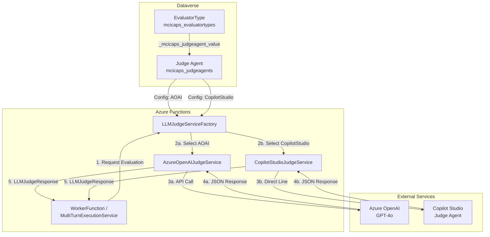

# Story 10: Configurable LLM Judge (Azure OpenAI + Copilot Studio)

**Created**: November 13, 2025  
**Status**: Planning  
**Priority**: High  
**Complexity**: Medium-High  

---

## Overview

Enable users to choose between **Azure OpenAI** or **Copilot Studio** as the LLM Judge for evaluation. This provides flexibility to use different evaluation backends based on cost, performance, or organizational preferences. Judge configuration is managed through a new **Judge Agents** table in Dataverse, allowing reusable judge configurations across multiple evaluator types.

### Business Value
- **Cost Optimization**: Choose between Azure OpenAI token-based pricing or Power Platform licensing
- **Flexibility**: Use specialized Copilot Studio agents for domain-specific evaluations
- **Scalability**: Distribute evaluation load across multiple services
- **Reusability**: Central judge agent configuration shared across evaluator types

---

## Acceptance Criteria

### Functional Requirements
- [ ] Users can create Judge Agent records in Dataverse with Azure OpenAI or Copilot Studio configuration
- [ ] EvaluatorType records reference a Judge Agent (replacing hardcoded deployment name)
- [ ] Single-turn tests execute with both Azure OpenAI and Copilot Studio judges
- [ ] Multi-turn tests execute with both judge types
- [ ] Both judges return consistent response format: score (0-1 decimal) and reasoning (string)
- [ ] Error messages clearly indicate which judge type failed and why
- [ ] Health check endpoint validates connectivity to configured judges

### Technical Requirements
- [ ] Factory pattern implementation selects correct judge service based on Judge Agent configuration
- [ ] Existing Azure OpenAI implementation refactored into `AzureOpenAIJudgeService`
- [ ] New `CopilotStudioJudgeService` implements `ILLMJudgeService` interface
- [ ] Dataverse schema updated with `mcicaps_judgeagents` table
- [ ] EvaluatorType model and service updated to fetch Judge Agent lookup
- [ ] JSON response parsing handles both Azure OpenAI and Copilot Studio formats
- [ ] Regex fallback parsing for non-JSON responses

### Testing Requirements
- [ ] Unit tests for `AzureOpenAIJudgeService` (refactored, all existing tests pass)
- [ ] Unit tests for `CopilotStudioJudgeService` (JSON parsing, error handling, timeouts)
- [ ] Unit tests for `LLMJudgeServiceFactory` (selection logic, invalid config)
- [ ] Integration tests for single-turn with both judge types
- [ ] Integration tests for multi-turn with both judge types
- [ ] Code coverage >80% on all new code

### Documentation Requirements
- [ ] Architecture diagram updated to show factory pattern and judge agent table
- [ ] PRD updated with new data model and configuration options
- [ ] Deployment guide includes Judge Agent setup instructions
- [ ] JSON format specification documented for Copilot Studio agent configuration
- [ ] Test plan created with validation scenarios

---

## Architecture Design

### High-Level Architecture



### Component Responsibilities

#### **LLMJudgeServiceFactory** (New)
- Fetches Judge Agent configuration from Dataverse via EvaluatorType lookup
- Selects appropriate implementation: `AzureOpenAIJudgeService` or `CopilotStudioJudgeService`
- Validates configuration completeness (e.g., Direct Line URL present for Copilot Studio)
- Returns strongly-typed `ILLMJudgeService` instance

#### **AzureOpenAIJudgeService** (Refactored from LLMJudgeService)
- Implements `ILLMJudgeService`
- Uses Judge Agent fields: `mcicaps_aoaiendpoint`, `mcicaps_aoaideploymentname`
- Unchanged evaluation logic (existing implementation)
- JSON response parsing with regex fallback

#### **CopilotStudioJudgeService** (New)
- Implements `ILLMJudgeService`
- Uses Judge Agent fields: `mcicaps_directlineurl`, `mcicaps_modelname`
- Injects model name at start of prompt (e.g., "MODEL: gpt-4o") for Copilot Studio topic routing
- Starts new conversation per evaluation (stateless)
- Sends evaluation prompt to Copilot Studio agent
- Parses JSON response: `{"score": 0.85, "reasoning": "..."}`
- Regex fallback for non-JSON responses
- Cleans up conversation after evaluation (optional, auto-expires)

---

## Data Model Changes

### New Table: Judge Agents (`mcicaps_judgeagents`)

**Purpose**: Central repository for LLM judge configurations (Azure OpenAI or Copilot Studio)

| Field Name | Type | Description | Required | Default |
|------------|------|-------------|----------|---------|
| `mcicaps_judgeagentid` | Primary Key (GUID) | Unique identifier | Yes | Auto |
| `mcicaps_name` | Single Line of Text (100) | Display name (e.g., "GPT-4o Judge", "Legal Domain Judge") | Yes | - |
| `mcicaps_judgetype` | Option Set | Judge type:<br>778760000 = Azure OpenAI<br>778760001 = Copilot Studio | Yes | 778760000 |
| `mcicaps_aoaiendpoint` | Single Line of Text (500) | Azure OpenAI endpoint URL<br>(e.g., `https://my-openai.openai.azure.com/`) | Conditional* | - |
| `mcicaps_aoaideploymentname` | Single Line of Text (100) | Azure OpenAI deployment name<br>(e.g., `gpt-4o`, `gpt-4-turbo`) | Conditional* | - |
| `mcicaps_directlineurl` | Single Line of Text (500) | Copilot Studio Direct Line token endpoint<br>(e.g., `https://xxx.powerplatform.com/.../directline/token`) | Conditional** | - |
| `mcicaps_modelname` | Single Line of Text (100) | Model name for Copilot Studio topic routing<br>(e.g., `gpt-4o`, `gpt-4-turbo`, `gpt-35-turbo`)<br>Injected at start of prompt for MCS agent to route to correct topic<br>If empty, agent routes to default topic | No | - |
| `mcicaps_description` | Multiple Lines of Text | Optional notes about judge purpose or configuration | No | - |
| `statecode` | State | Active (0) / Inactive (1) | Yes | 0 |
| `statuscode` | Status | Active (1) / Inactive (2) | Yes | 1 |
| `createdon` | Date Time | Record creation timestamp | Yes | Auto |
| `modifiedon` | Date Time | Last modification timestamp | Yes | Auto |

**\*Required if** `mcicaps_judgetype` = 778760000 (Azure OpenAI)  
**\*\*Required if** `mcicaps_judgetype` = 778760001 (Copilot Studio)

**Business Rules**:
1. If `judgetype` = Azure OpenAI, validate that `aoaiendpoint` and `aoaideploymentname` are populated
2. If `judgetype` = Copilot Studio, validate that `directlineurl` is populated
3. `modelname` is optional for Copilot Studio - if empty, agent routes to default topic
4. Only one active judge of each type should be marked as "default" (for future use)

**Sample Records**:

| Name | Judge Type | AOAI Endpoint | AOAI Deployment | Direct Line URL | Model Name | Description |
|------|------------|---------------|-----------------|-----------------|------------|-------------|
| Default GPT-4o Judge | Azure OpenAI | `https://aoai-prod.openai.azure.com/` | `gpt-4o` | (empty) | (empty) | Standard judge for all evaluations |
| GPT-4 Turbo Judge | Azure OpenAI | `https://aoai-prod.openai.azure.com/` | `gpt-4-turbo` | (empty) | (empty) | Faster judge for high-volume tests |
| MCS Default Judge | Copilot Studio | (empty) | (empty) | `https://judge-bot.powerplatform.com/.../token` | (empty) | Copilot Studio judge using agent's default topic |
| MCS GPT-4o Judge | Copilot Studio | (empty) | (empty) | `https://judge-bot.powerplatform.com/.../token` | `gpt-4o` | Copilot Studio judge using GPT-4o model |
| MCS GPT-4 Turbo Judge | Copilot Studio | (empty) | (empty) | `https://judge-bot.powerplatform.com/.../token` | `gpt-4-turbo` | Copilot Studio judge using GPT-4 Turbo model |
| Legal Domain Judge | Copilot Studio | (empty) | (empty) | `https://legal-bot.powerplatform.com/.../token` | `gpt-4o` | Specialized judge for legal compliance |

---

### Updated Table: Evaluator Types (`mcicaps_evaluatortypes`)

**Changes**:

| Change Type | Field Name | Type | Description |
|-------------|------------|------|-------------|
| **DEPRECATED** | `mcicaps_deploymentname` | Single Line of Text (100) | ~~Deployment name~~ (replaced by Judge Agent lookup) |
| **NEW** | `_mcicaps_judgeagentid` | Lookup (to mcicaps_judgeagents) | Reference to Judge Agent record |

**Migration Strategy**:
1. Create Judge Agent records for all existing deployment names
2. Update EvaluatorType records to reference corresponding Judge Agent
3. Mark `mcicaps_deploymentname` as deprecated (keep for backward compatibility, but don't use)
4. Future: Remove `mcicaps_deploymentname` in breaking change release

**Example Migration**:

Before:
```json
{
  "mcicaps_name": "Similarity Evaluator",
  "mcicaps_deploymentname": "gpt-4o",
  "mcicaps_evaluatorprompt": "..."
}
```

After:
```json
{
  "mcicaps_name": "Similarity Evaluator",
  "_mcicaps_judgeagent_value": "guid-of-default-gpt4o-judge",
  "mcicaps_evaluatorprompt": "..."
}
```

---

### Updated Model Classes

#### **New Model: JudgeAgent.cs**

```csharp
using System.ComponentModel.DataAnnotations;
using System.Text.Json.Serialization;

namespace AiAgentEvaluation.Models;

/// <summary>
/// Represents a Judge Agent entity from Dataverse (mcicaps_judgeagents)
/// Configures either Azure OpenAI or Copilot Studio as the LLM judge
/// </summary>
public class JudgeAgent
{
    [JsonPropertyName("mcicaps_judgeagentid")]
    public Guid Id { get; set; }

    [JsonPropertyName("mcicaps_name")]
    [Required]
    public string Name { get; set; } = string.Empty;

    /// <summary>
    /// Judge type: 778760000 = Azure OpenAI, 778760001 = Copilot Studio
    /// </summary>
    [JsonPropertyName("mcicaps_judgetype")]
    [Required]
    public int JudgeType { get; set; }

    /// <summary>
    /// Azure OpenAI endpoint URL (required if JudgeType = Azure OpenAI)
    /// Example: https://my-openai.openai.azure.com/
    /// </summary>
    [JsonPropertyName("mcicaps_aoaiendpoint")]
    public string? AoaiEndpoint { get; set; }

    /// <summary>
    /// Azure OpenAI deployment name (required if JudgeType = Azure OpenAI)
    /// Example: gpt-4o, gpt-4-turbo
    /// </summary>
    [JsonPropertyName("mcicaps_aoaideploymentname")]
    public string? AoaiDeploymentName { get; set; }

    /// <summary>
    /// Copilot Studio Direct Line token endpoint (required if JudgeType = Copilot Studio)
    /// Example: https://xxx.powerplatform.com/powervirtualagents/.../directline/token
    /// </summary>
    [JsonPropertyName("mcicaps_directlineurl")]
    public string? DirectLineUrl { get; set; }

    /// <summary>
    /// Model name for Copilot Studio topic routing (optional)
    /// Injected at start of prompt to allow MCS agent to route to correct topic/model
    /// If empty/null, agent routes to default topic
    /// Example: gpt-4o, gpt-4-turbo, gpt-35-turbo
    /// </summary>
    [JsonPropertyName("mcicaps_modelname")]
    public string? ModelName { get; set; }

    [JsonPropertyName("mcicaps_description")]
    public string? Description { get; set; }

    [JsonPropertyName("statecode")]
    public int StateCode { get; set; } = 0;

    [JsonPropertyName("statuscode")]
    public int StatusCode { get; set; } = 1;

    [JsonPropertyName("createdon")]
    public DateTime CreatedOn { get; set; }

    [JsonPropertyName("modifiedon")]
    public DateTime ModifiedOn { get; set; }
}

/// <summary>
/// Judge type constants
/// </summary>
public static class JudgeType
{
    public const int AzureOpenAI = 778760000;
    public const int CopilotStudio = 778760001;

    public static string GetName(int judgeType) => judgeType switch
    {
        AzureOpenAI => "Azure OpenAI",
        CopilotStudio => "Copilot Studio",
        _ => "Unknown"
    };
}
```

#### **Updated Model: EvaluatorType.cs**

```csharp
// Add new property to existing class:

/// <summary>
/// Lookup to Judge Agent for evaluation backend configuration
/// Replaces the deprecated mcicaps_deploymentname field
/// </summary>
[JsonPropertyName("_mcicaps_judgeagent_value")]
public Guid? JudgeAgentId { get; set; }

/// <summary>
/// DEPRECATED: Use JudgeAgentId instead
/// Kept for backward compatibility during migration
/// </summary>
[JsonPropertyName("mcicaps_deploymentname")]
[Obsolete("Use JudgeAgentId to reference a Judge Agent record instead")]
public string? DeploymentName { get; set; }
```

---

## Copilot Studio Judge Agent Configuration

### JSON Response Format Specification

Your Copilot Studio judge agent **MUST** return a JSON response in the following format:

```json
{
  "score": 0.85,
  "reasoning": "The response accurately addresses the user's question about pricing. It includes specific numbers and covers the key points from the expected response. Minor discrepancy in formatting, but content is correct."
}
```

**Field Requirements**:

| Field | Type | Range | Required | Description |
|-------|------|-------|----------|-------------|
| `score` | Number (decimal) | 0.0 - 1.0 | Yes | Evaluation score where 0 = completely wrong, 1 = perfect match |
| `reasoning` | String | Any length | Yes | Explanation of the score, highlighting strengths and weaknesses |

### Agent Instructions Template

Configure your Copilot Studio judge agent to return JSON responses. The agent should be instructed to:

**Response Format Requirement**:
```json
{
  "score": <decimal value>,
  "reasoning": "<explanation of the score>"
}
```

**Default Scale**:
- **0-0.2**: Very poor quality
- **0.3-0.4**: Poor quality with major issues
- **0.5-0.6**: Fair quality with notable room for improvement
- **0.7-0.8**: Good quality with minor issues
- **0.9-1.0**: Excellent quality, meets or exceeds expectations

**Key Instructions for Your Agent**:
- Always respond with valid JSON only
- Include both `score` and `reasoning` fields
- Use the `Default Scale` if no Scoring Guidelines are provided in the user prompt. 
- Score must be a decimal value
- Provide specific reasoning that references the user input, expected response, and actual response

### Example Evaluation Prompts

The system sends evaluation prompts based on templates stored in Dataverse `EvaluatorType` records. Here are examples of the types of prompts your Copilot Studio judge agent will receive:

**IMPORTANT**: For Copilot Studio judges, the system will **automatically inject the model name at the very start** of the prompt to enable topic routing (if model name is specified). The actual prompts will follow the structure of templates stored in the `backend/prompt-templates/` folder.

**Example: Default Evaluation Prompt (with Model Routing)**:
```
MODEL: gpt-4o

IMPORTANT: You must respond with ONLY valid JSON in this format:
{
  "score": <number between 0 and 1>,
  "reasoning": "<your explanation>"
}

You are an expert evaluator tasked with assessing the quality of an AI agent's response.

## Evaluation Criteria

You must evaluate the overall quality of the actual response in relation to the expected 
response and user input. Consider the following aspects:

1. **Appropriateness**: Is the response appropriate for the user's question or request?
2. **Quality**: Is the response well-constructed, clear, and helpful?
3. **Completeness**: Does the response adequately address the user's needs?
4. **Accuracy**: Is the information provided correct and reliable?
5. **Alignment**: How well does the actual response align with the expected response?

## Scoring Guidelines

- **0-0.2**: Very poor - Response is inappropriate, unhelpful, or contains significant issues
- **0.3-0.4**: Poor - Response has major problems but some redeeming qualities
- **0.5-0.6**: Fair - Response is acceptable but has notable room for improvement
- **0.7-0.8**: Good - Response is well-constructed with minor issues
- **0.9-1.0**: Excellent - Response is exemplary and fully meets expectations

## Input Information

**User Input**: What is your return policy?

**Expected Response**: We offer 30-day money-back guarantee on all products.

**Actual Response**: You can return items within 30 days for a full refund.

**Test Type**: Similarity

## Required Output Format

You must provide your evaluation in the following JSON format:

```json
{
  "score": [0-1],
  "reasoning": "Your detailed reasoning explaining your assessment, highlighting strengths 
   and weaknesses of the actual response"
}
```
```

**Example: Similarity Evaluation Prompt**:
```
You are an expert evaluator tasked with assessing the similarity between an expected 
response and an actual response from an AI agent.

## Evaluation Criteria

You must compare the expected response with the actual response and evaluate their 
semantic similarity. Consider the following aspects:

1. **Semantic Meaning**: Do both responses convey the same core information or message?
2. **Content Coverage**: Does the actual response cover the main points from the expected response?
3. **Information Accuracy**: Is the information in the actual response consistent with the expected response?
4. **Intent Alignment**: Do both responses address the same purpose or goal?

## Scoring Guidelines

- **0-0.2**: Completely different - No similarity in meaning, content, or intent
- **0.3-0.4**: Low similarity - Some common elements but major differences in meaning or content
- **0.5-0.6**: Moderate similarity - Shares some key information but has notable differences
- **0.7-0.8**: High similarity - Conveys similar meaning with minor differences in wording or detail
- **0.9-1.0**: Very high similarity - Nearly identical meaning, possibly with different phrasing

**User Input**: {UserInput}
**Expected Response**: {ExpectedResponse}
**Actual Response**: {ActualResponse}
**Test Type**: {TestType}
```

**Example: Accuracy Evaluation Prompt**:
```
You are an expert evaluator tasked with assessing the factual accuracy of an AI agent's response.

## Evaluation Criteria

You must evaluate whether the actual response contains factually correct and accurate 
information. Consider the following aspects:

1. **Factual Correctness**: Are the facts, data, and statements in the actual response accurate?
2. **Information Completeness**: Does the actual response provide complete and sufficient information?
3. **Alignment with Expected**: How well does the actual response match the accuracy of the expected response?
4. **Misleading Information**: Does the actual response contain any misleading or incorrect information?
5. **Contextual Accuracy**: Is the information appropriate and accurate for the user's query?

## Scoring Guidelines

- **0-0.2**: Highly inaccurate - Contains significant factual errors or misleading information
- **0.3-0.4**: Partially accurate - Some correct information but notable errors or omissions
- **0.5-0.6**: Moderately accurate - Mostly correct with minor errors or incomplete information
- **0.7-0.8**: Accurate - Factually correct information with very minor issues
- **0.9-1.0**: Highly accurate - Completely accurate, comprehensive, and reliable information

**User Input**: {UserInput}
**Expected Response**: {ExpectedResponse}
**Actual Response**: {ActualResponse}
**Test Type**: {TestType}
```

**Note**: The actual prompts are stored in Dataverse `EvaluatorType` records and can be customized. The system also supports domain-specific prompts (e.g., fashion industry evaluations with product ID validation, color accuracy, etc.). See `backend/prompt-templates/` for reference templates.

**Sample Expected Responses**:

Valid JSON response (ideal):
```json
{
  "score": 0.75,
  "reasoning": "Response covers the main topic but lacks specific details mentioned in expected response."
}
```

Valid alternative formatting (will be parsed):
```json
{
  "score": "0.75",
  "reasoning": "Response covers the main topic but lacks specific details mentioned in expected response."
}
```

Invalid response (will trigger regex fallback parsing):
```
The response seems pretty good. I'd give it about an 8 out of 10. The main issue is 
that it doesn't mention the warranty period.
```
*(Note: Regex fallback will attempt to extract score and use full text as reasoning)*

---

## Implementation Plan

### Phase 1: Infrastructure & Data Model (Week 1)

**1.1 Create Dataverse Table: Judge Agents**
- [ ] Create `mcicaps_judgeagents` table with all fields
- [ ] Configure Option Set for `mcicaps_judgetype`
- [ ] Set up validation rules for conditional required fields
- [ ] Create 2-3 sample records (Azure OpenAI + Copilot Studio)

**1.2 Update Dataverse Table: Evaluator Types**
- [ ] Add lookup field `_mcicaps_judgeagent_value` to `mcicaps_evaluatortypes`
- [ ] Mark `mcicaps_deploymentname` as deprecated (add description note)
- [ ] Create Judge Agent records for existing deployment names
- [ ] Update existing EvaluatorType records to reference Judge Agents

**1.3 Create Model Classes**
- [ ] Create `backend/AiAgentEvaluation/Models/JudgeAgent.cs`
- [ ] Update `backend/AiAgentEvaluation/Models/EvaluatorType.cs` (add JudgeAgentId property)
- [ ] Add `JudgeType` static class with constants

**1.4 Update Dataverse Service**
- [ ] Add method: `Task<JudgeAgent?> GetJudgeAgentAsync(Guid judgeAgentId, CancellationToken cancellationToken)`
- [ ] Update `GetEvaluatorTypeAsync` to expand `_mcicaps_judgeagent_value` lookup
- [ ] Add unit tests for new Dataverse methods

**Testing**:
- [ ] Unit tests: Dataverse service methods with mocked responses
- [ ] Integration tests: Fetch real Judge Agent and EvaluatorType from staging Dataverse

---

### Phase 2: Refactor Existing LLM Judge (Week 1-2)

**2.1 Rename Current Implementation**
- [ ] Rename `LLMJudgeService.cs` → `AzureOpenAIJudgeService.cs`
- [ ] Update class name: `class AzureOpenAIJudgeService : ILLMJudgeService`
- [ ] Update constructor to accept `JudgeAgent` parameter
- [ ] Remove dependency on `AppSettings.AzureOpenAI` - use JudgeAgent fields instead
- [ ] Keep all evaluation logic unchanged

**2.2 Update Tests**
- [ ] Rename test file: `LLMJudgeServiceTests.cs` → `AzureOpenAIJudgeServiceTests.cs`
- [ ] Update test class names and mocks
- [ ] Run all existing tests - **must pass with zero regressions**

**2.3 Remove Direct DI Registration (prepare for factory)**
- [ ] Comment out direct registration in `Program.cs`
- [ ] Prepare for factory-based instantiation (don't wire up yet)

**Testing**:
- [ ] All existing LLM Judge unit tests pass
- [ ] No breaking changes to evaluation behavior
- [ ] Manual test: Single-turn evaluation still works

---

### Phase 3: Implement Copilot Studio Judge (Week 2)

**3.1 Create CopilotStudioJudgeService**

File: `backend/AiAgentEvaluation/Services/CopilotStudioJudgeService.cs`

```csharp
using AiAgentEvaluation.Models;
using Microsoft.Extensions.Logging;
using System.Text.Json;
using System.Text.RegularExpressions;

namespace AiAgentEvaluation.Services;

/// <summary>
/// Implementation of LLM Judge service using Copilot Studio via Direct Line API
/// </summary>
public class CopilotStudioJudgeService : ILLMJudgeService, IDisposable
{
    private readonly ILogger<CopilotStudioJudgeService> _logger;
    private readonly ICopilotStudioService _copilotStudioService;
    private readonly IDataverseService _dataverseService;
    private readonly JudgeAgent _judgeAgent;
    private bool _disposed;

    public CopilotStudioJudgeService(
        ILogger<CopilotStudioJudgeService> logger,
        ICopilotStudioService copilotStudioService,
        IDataverseService dataverseService,
        JudgeAgent judgeAgent)
    {
        _logger = logger;
        _copilotStudioService = copilotStudioService;
        _dataverseService = dataverseService;
        _judgeAgent = judgeAgent;

        // Validate configuration
        if (string.IsNullOrEmpty(_judgeAgent.DirectLineUrl))
        {
            throw new InvalidOperationException(
                $"Judge Agent '{_judgeAgent.Name}' is configured for Copilot Studio " +
                $"but has no Direct Line URL");
        }

        // Model name is optional - if not specified, agent routes to default topic
        if (string.IsNullOrEmpty(_judgeAgent.ModelName))
        {
            _logger.LogInformation(
                "Judge Agent '{JudgeName}' has no model name - agent will route to default topic",
                _judgeAgent.Name);
        }
    }

    public async Task<LLMJudgeResponse> EvaluateResponseAsync(
        LLMJudgeRequest request, 
        CancellationToken cancellationToken = default)
    {
        _logger.LogInformation(
            "Evaluating response with Copilot Studio judge '{JudgeName}' (evaluator type {EvaluatorTypeId})", 
            _judgeAgent.Name, request.EvaluatorTypeId);
        
        var stopwatch = System.Diagnostics.Stopwatch.StartNew();

        try
        {
            // 1. Get prompt template from Dataverse
            var promptTemplate = await GetPromptTemplateAsync(
                request.EvaluatorTypeId, cancellationToken);
            
            // 2. Build evaluation prompt with placeholders replaced
            var evaluationPrompt = BuildEvaluationPrompt(promptTemplate, request);
            
            _logger.LogDebug("Copilot Studio judge prompt: {Prompt}", 
                evaluationPrompt.Substring(0, Math.Min(200, evaluationPrompt.Length)));
            
            // 3. Send to Copilot Studio judge agent (new conversation each time)
            var copilotResponse = await _copilotStudioService.SendMessageAsync(
                _judgeAgent.DirectLineUrl,
                evaluationPrompt,
                conversationId: null, // Start fresh conversation
                directLineToken: null,
                cancellationToken);
            
            stopwatch.Stop();
            
            if (!copilotResponse.Success)
            {
                _logger.LogError(
                    "Copilot Studio judge failed: {ErrorMessage}", 
                    copilotResponse.ErrorMessage);
                
                return new LLMJudgeResponse
                {
                    Success = false,
                    ErrorMessage = $"Copilot Studio judge call failed: {copilotResponse.ErrorMessage}",
                    ExecutionTimeMs = (int)stopwatch.ElapsedMilliseconds
                };
            }
            
            // 4. Parse response (JSON or regex fallback)
            var result = ParseLLMResponse(copilotResponse.Response ?? string.Empty);
            result.ExecutionTimeMs = (int)stopwatch.ElapsedMilliseconds;
            result.Success = true;
            
            _logger.LogInformation(
                "Copilot Studio judge completed with score {Score} in {ElapsedMs}ms", 
                result.Score, result.ExecutionTimeMs);
            
            return result;
        }
        catch (Exception ex)
        {
            _logger.LogError(ex, 
                "Error during Copilot Studio judge evaluation for evaluator type {EvaluatorTypeId}", 
                request.EvaluatorTypeId);
            
            stopwatch.Stop();
            
            return new LLMJudgeResponse
            {
                Success = false,
                ErrorMessage = $"Exception during Copilot Studio evaluation: {ex.Message}",
                ExecutionTimeMs = (int)stopwatch.ElapsedMilliseconds
            };
        }
    }

    public async Task<string> GetPromptTemplateAsync(
        Guid? evaluatorTypeId, 
        CancellationToken cancellationToken = default)
    {
        var (promptTemplate, _) = await GetPromptTemplateAndDeploymentAsync(
            evaluatorTypeId, cancellationToken);
        return promptTemplate;
    }

    public async Task<(string promptTemplate, string deploymentName)> GetPromptTemplateAndDeploymentAsync(
        Guid? evaluatorTypeId, 
        CancellationToken cancellationToken = default)
    {
        // Copilot Studio doesn't use deployment name, return judge agent name instead
        var deploymentName = _judgeAgent.Name;
        
        try
        {
            if (evaluatorTypeId.HasValue)
            {
                var evaluatorType = await _dataverseService.GetEvaluatorTypeAsync(
                    evaluatorTypeId.Value, cancellationToken);
                
                if (evaluatorType != null && !string.IsNullOrWhiteSpace(evaluatorType.EvaluatorPrompt))
                {
                    _logger.LogInformation(
                        "Retrieved evaluator '{EvaluatorName}' prompt for Copilot Studio judge", 
                        evaluatorType.Name);
                    
                    // Wrap prompt with JSON instruction
                    var wrappedPrompt = WrapPromptForJsonResponse(evaluatorType.EvaluatorPrompt);
                    return (wrappedPrompt, deploymentName);
                }
            }
            
            _logger.LogWarning(
                "No evaluator type specified or prompt not found, using default");
            return (WrapPromptForJsonResponse(GetDefaultPromptTemplate()), deploymentName);
        }
        catch (Exception ex)
        {
            _logger.LogWarning(ex, 
                "Failed to get prompt for evaluator type {EvaluatorTypeId}, using default", 
                evaluatorTypeId);
            return (WrapPromptForJsonResponse(GetDefaultPromptTemplate()), deploymentName);
        }
    }

    private string WrapPromptForJsonResponse(string originalPrompt)
    {
        // Inject model name at the very start for Copilot Studio topic routing
        // If no model name specified, send empty string - agent routes to default topic
        var modelInstruction = !string.IsNullOrEmpty(_judgeAgent.ModelName)
            ? $"MODEL: {_judgeAgent.ModelName}\n\n"
            : string.Empty; // Empty string - agent uses default topic

        // Add instruction to ensure JSON response format
        return $@"{modelInstruction}IMPORTANT: You must respond with ONLY valid JSON in this format:
{{
  ""score"": <number between 0 and 1>,
  ""reasoning"": ""<your explanation>""
}}

{originalPrompt}

Remember: Respond with ONLY valid JSON, no additional text.";
    }

    private string BuildEvaluationPrompt(string template, LLMJudgeRequest request)
    {
        return template
            .Replace("{UserInput}", request.UserInput)
            .Replace("{ExpectedResponse}", request.ExpectedResponse)
            .Replace("{ActualResponse}", request.ActualResponse)
            .Replace("{ConversationId}", request.ConversationId ?? "N/A");
    }

    private LLMJudgeResponse ParseLLMResponse(string responseText)
    {
        // Reuse parsing logic from AzureOpenAIJudgeService
        // (Copy the entire ParseLLMResponse and ParseLLMResponseWithRegex methods)
        // ... (same implementation as current LLMJudgeService)
    }

    private static string GetDefaultPromptTemplate()
    {
        return "Evaluate the quality of the actual response compared to the expected response and user input. " +
               "Provide a score from 0 to 1, where 0 is completely incorrect and 1 is perfect. " +
               "Consider accuracy, relevance, and completeness in your evaluation.";
    }

    public async Task<bool> CheckHealthAsync(CancellationToken cancellationToken = default)
    {
        try
        {
            // Test connectivity by sending a simple evaluation request
            var testRequest = new LLMJudgeRequest
            {
                UserInput = "Hello",
                ExpectedResponse = "Hi there!",
                ActualResponse = "Hello!"
            };
            
            var result = await EvaluateResponseAsync(testRequest, cancellationToken);
            return result.Success;
        }
        catch (Exception ex)
        {
            _logger.LogWarning(ex, 
                "Copilot Studio judge health check failed for judge '{JudgeName}'", 
                _judgeAgent.Name);
            return false;
        }
    }

    public void Dispose()
    {
        Dispose(true);
        GC.SuppressFinalize(this);
    }

    protected virtual void Dispose(bool disposing)
    {
        if (!_disposed && disposing)
        {
            // No resources to dispose (ICopilotStudioService managed by DI)
            _disposed = true;
        }
    }
}
```

**3.2 Extract Common Parsing Logic**

Create a shared utility class to avoid code duplication:

File: `backend/AiAgentEvaluation/Utils/LLMResponseParser.cs`

```csharp
// Move ParseLLMResponse and ParseLLMResponseWithRegex to shared utility
// Both AzureOpenAIJudgeService and CopilotStudioJudgeService will use it
```

**3.3 Unit Tests**

File: `backend/tests/AiAgentEvaluation.UnitTests/CopilotStudioJudgeServiceTests.cs`

- [ ] Test JSON response parsing (valid format)
- [ ] Test JSON with string score ("0.85" vs 0.85)
- [ ] Test non-JSON response with regex fallback
- [ ] Test error handling (Copilot Studio call fails)
- [ ] Test timeout scenarios
- [ ] Test health check
- [ ] Test with model name specified (verify "MODEL: gpt-4o" appears at start of prompt)
- [ ] Test with empty/null model name (verify no MODEL prefix, routes to default)
- [ ] Test different model names (gpt-4o, gpt-4-turbo, gpt-35-turbo)

**Testing**:
- [ ] All CopilotStudioJudgeService unit tests pass
- [ ] Code coverage >80%

---

### Phase 4: Implement Factory Pattern (Week 2-3)

**4.1 Create LLMJudgeServiceFactory**

File: `backend/AiAgentEvaluation/Services/LLMJudgeServiceFactory.cs`

```csharp
using AiAgentEvaluation.Models;
using Microsoft.Extensions.Logging;

namespace AiAgentEvaluation.Services;

/// <summary>
/// Factory for creating LLM Judge service instances based on Judge Agent configuration
/// </summary>
public class LLMJudgeServiceFactory : ILLMJudgeServiceFactory
{
    private readonly IServiceProvider _serviceProvider;
    private readonly IDataverseService _dataverseService;
    private readonly ILogger<LLMJudgeServiceFactory> _logger;

    public LLMJudgeServiceFactory(
        IServiceProvider serviceProvider,
        IDataverseService dataverseService,
        ILogger<LLMJudgeServiceFactory> logger)
    {
        _serviceProvider = serviceProvider;
        _dataverseService = dataverseService;
        _logger = logger;
    }

    public async Task<ILLMJudgeService> CreateJudgeServiceAsync(
        Guid? evaluatorTypeId,
        CancellationToken cancellationToken = default)
    {
        // 1. Fetch EvaluatorType with Judge Agent lookup
        if (!evaluatorTypeId.HasValue)
        {
            throw new ArgumentException(
                "EvaluatorTypeId is required to determine judge configuration");
        }

        var evaluatorType = await _dataverseService.GetEvaluatorTypeAsync(
            evaluatorTypeId.Value, cancellationToken);

        if (evaluatorType == null)
        {
            throw new InvalidOperationException(
                $"EvaluatorType {evaluatorTypeId} not found in Dataverse");
        }

        if (!evaluatorType.JudgeAgentId.HasValue)
        {
            throw new InvalidOperationException(
                $"EvaluatorType '{evaluatorType.Name}' has no Judge Agent configured");
        }

        // 2. Fetch Judge Agent
        var judgeAgent = await _dataverseService.GetJudgeAgentAsync(
            evaluatorType.JudgeAgentId.Value, cancellationToken);

        if (judgeAgent == null)
        {
            throw new InvalidOperationException(
                $"Judge Agent {evaluatorType.JudgeAgentId} not found in Dataverse");
        }

        _logger.LogInformation(
            "Creating judge service: Evaluator='{EvaluatorName}', Judge='{JudgeName}', Type={JudgeType}",
            evaluatorType.Name, judgeAgent.Name, JudgeType.GetName(judgeAgent.JudgeType));

        // 3. Create appropriate service based on judge type
        return judgeAgent.JudgeType switch
        {
            JudgeType.AzureOpenAI => CreateAzureOpenAIJudge(judgeAgent),
            JudgeType.CopilotStudio => CreateCopilotStudioJudge(judgeAgent),
            _ => throw new NotSupportedException(
                $"Judge type {judgeAgent.JudgeType} is not supported")
        };
    }

    private ILLMJudgeService CreateAzureOpenAIJudge(JudgeAgent judgeAgent)
    {
        // Validate Azure OpenAI configuration
        if (string.IsNullOrEmpty(judgeAgent.AoaiEndpoint))
        {
            throw new InvalidOperationException(
                $"Judge Agent '{judgeAgent.Name}' is configured for Azure OpenAI " +
                $"but has no AOAI Endpoint");
        }

        if (string.IsNullOrEmpty(judgeAgent.AoaiDeploymentName))
        {
            throw new InvalidOperationException(
                $"Judge Agent '{judgeAgent.Name}' is configured for Azure OpenAI " +
                $"but has no AOAI Deployment Name");
        }

        _logger.LogInformation(
            "Creating Azure OpenAI judge: Endpoint={Endpoint}, Deployment={Deployment}",
            judgeAgent.AoaiEndpoint, judgeAgent.AoaiDeploymentName);

        // Resolve dependencies from DI container
        var logger = _serviceProvider.GetRequiredService<ILogger<AzureOpenAIJudgeService>>();
        var dataverseService = _serviceProvider.GetRequiredService<IDataverseService>();

        return new AzureOpenAIJudgeService(logger, dataverseService, judgeAgent);
    }

    private ILLMJudgeService CreateCopilotStudioJudge(JudgeAgent judgeAgent)
    {
        // Validate Copilot Studio configuration
        if (string.IsNullOrEmpty(judgeAgent.DirectLineUrl))
        {
            throw new InvalidOperationException(
                $"Judge Agent '{judgeAgent.Name}' is configured for Copilot Studio " +
                $"but has no Direct Line URL");
        }

        // Model name is optional - if not specified, agent routes to default topic
        var modelInfo = string.IsNullOrEmpty(judgeAgent.ModelName) 
            ? "(default topic)" 
            : judgeAgent.ModelName;

        _logger.LogInformation(
            "Creating Copilot Studio judge: DirectLineUrl={Url}, Model={Model}",
            judgeAgent.DirectLineUrl, modelInfo);

        // Resolve dependencies from DI container
        var logger = _serviceProvider.GetRequiredService<ILogger<CopilotStudioJudgeService>>();
        var copilotService = _serviceProvider.GetRequiredService<ICopilotStudioService>();
        var dataverseService = _serviceProvider.GetRequiredService<IDataverseService>();

        return new CopilotStudioJudgeService(logger, copilotService, dataverseService, judgeAgent);
    }
}

/// <summary>
/// Factory interface for creating LLM Judge services
/// </summary>
public interface ILLMJudgeServiceFactory
{
    Task<ILLMJudgeService> CreateJudgeServiceAsync(
        Guid? evaluatorTypeId,
        CancellationToken cancellationToken = default);
}
```

**4.2 Update Dependency Injection**

File: `backend/AiAgentEvaluation/Program.cs`

```csharp
// Remove direct ILLMJudgeService registration
// builder.Services.AddScoped<ILLMJudgeService, LLMJudgeService>();

// Add factory registration
builder.Services.AddScoped<ILLMJudgeServiceFactory, LLMJudgeServiceFactory>();

// Register both judge implementations (factory will instantiate)
// Note: These are NOT registered as ILLMJudgeService - factory creates them directly
builder.Services.AddTransient<AzureOpenAIJudgeService>();
builder.Services.AddTransient<CopilotStudioJudgeService>();
```

**4.3 Update Consumers**

**WorkerFunction.cs** changes:

```csharp
// Before:
private readonly ILLMJudgeService _llmJudgeService;

public WorkerFunction(
    ILogger<WorkerFunction> logger,
    ILLMJudgeService llmJudgeService, // OLD
    ...)

// After:
private readonly ILLMJudgeServiceFactory _llmJudgeServiceFactory;

public WorkerFunction(
    ILogger<WorkerFunction> logger,
    ILLMJudgeServiceFactory llmJudgeServiceFactory, // NEW
    ...)

// Inside ProcessTestCase method:
var judgeService = await _llmJudgeServiceFactory.CreateJudgeServiceAsync(
    testCase.EvaluatorTypeId, cancellationToken);

var judgeResponse = await judgeService.EvaluateResponseAsync(
    judgeRequest, cancellationToken);
```

**MultiTurnExecutionService.cs** changes:

```csharp
// Same pattern as WorkerFunction - replace ILLMJudgeService with ILLMJudgeServiceFactory
// Create judge service per test case (or reuse if same evaluator type)
```

**4.4 Unit Tests**

File: `backend/tests/AiAgentEvaluation.UnitTests/LLMJudgeServiceFactoryTests.cs`

- [ ] Test Azure OpenAI judge creation with valid config
- [ ] Test Copilot Studio judge creation with valid config (with model name)
- [ ] Test Copilot Studio judge creation without model name (should succeed, use default topic)
- [ ] Test error: EvaluatorType not found
- [ ] Test error: Judge Agent not found
- [ ] Test error: Judge Agent missing required fields (AOAI endpoint, Direct Line URL)
- [ ] Test error: Azure OpenAI judge missing AOAI Deployment Name
- [ ] Test error: Copilot Studio judge missing Direct Line URL
- [ ] Test error: Unsupported judge type
- [ ] Test error: EvaluatorType has no JudgeAgentId

**Testing**:
- [ ] All factory unit tests pass
- [ ] Updated WorkerFunction tests pass with factory mock
- [ ] Updated MultiTurnExecutionService tests pass

---

### Phase 5: Integration & End-to-End Testing (Week 3)

**5.1 Staging Environment Setup**
- [ ] Deploy updated function app to staging
- [ ] Create Judge Agent records in staging Dataverse:
  - Azure OpenAI judge (existing GPT-4o)
  - Copilot Studio judge (new dedicated agent)
- [ ] Update EvaluatorType records to reference Judge Agents
- [ ] Configure Copilot Studio judge agent with JSON response instructions

**5.2 Integration Tests**

File: `backend/tests/AiAgentEvaluation.IntegrationTests/ConfigurableJudgeIntegrationTests.cs`

- [ ] Execute single-turn test with Azure OpenAI judge
- [ ] Execute single-turn test with Copilot Studio judge
- [ ] Execute multi-turn test (3 turns) with Azure OpenAI judge
- [ ] Execute multi-turn test (3 turns) with Copilot Studio judge
- [ ] Verify scores and reasoning are populated correctly
- [ ] Compare evaluation results between both judge types (should be similar)
- [ ] Test evaluator type override behavior

**5.3 Performance Testing**
- [ ] Measure execution time: Azure OpenAI judge (baseline)
- [ ] Measure execution time: Copilot Studio judge (compare)
- [ ] Document performance difference (expected: CS 1.5-2x slower)
- [ ] Verify no degradation in existing Azure OpenAI performance

**5.4 Manual Testing Checklist**
- [ ] Create test run with Azure OpenAI judge evaluator
- [ ] Create test run with Copilot Studio judge evaluator
- [ ] Verify both complete successfully
- [ ] Compare evaluation results for consistency
- [ ] Test error scenarios (invalid Direct Line URL, judge agent inactive)
- [ ] Verify Application Insights logs show judge type clearly

**Testing**:
- [ ] All integration tests pass in staging environment
- [ ] Performance metrics documented
- [ ] No regressions in existing functionality

---

### Phase 6: Documentation & Deployment (Week 4)

**6.1 Update Architecture Documentation**

File: `docs/ARCHITECTURE.md`

- [ ] Add Judge Agent table to data model section
- [ ] Update architecture diagram with factory pattern
- [ ] Document judge selection logic
- [ ] Add performance considerations section

**6.2 Update PRD**

File: `docs/prd/PRD-Agent-Evaluation-Function.md`

- [ ] Add Judge Agent data schema
- [ ] Document configuration options
- [ ] Update API examples
- [ ] Add judge type to configuration section

**6.3 Create Deployment Guide**

File: `docs/deployment/judge-agent-configuration-guide.md`

- [ ] Step-by-step: Create Judge Agent records
- [ ] Step-by-step: Configure Copilot Studio judge agent
- [ ] Step-by-step: Update EvaluatorType records
- [ ] Migration guide for existing deployments
- [ ] Troubleshooting common issues

**6.4 Update Story Documentation**

This file (`docs/stories/10-configurable-llm-judge.md`):
- [ ] Mark all tasks as completed
- [ ] Add implementation notes and lessons learned
- [ ] Document final performance metrics
- [ ] Add link to deployment guide

**6.5 Production Deployment**
- [ ] Review all documentation with stakeholders
- [ ] Deploy to production function app
- [ ] Create production Judge Agent records
- [ ] Migrate production EvaluatorType records
- [ ] Monitor first production evaluation run with both judge types
- [ ] Document any production issues and resolutions

**Testing**:
- [ ] Documentation reviewed and approved
- [ ] Production deployment successful
- [ ] First production run completes successfully

---

## Risk Mitigation

### Risk 1: Copilot Studio Returns Non-JSON Response
**Probability**: Medium  
**Impact**: Medium  
**Mitigation**:
- Robust regex fallback parsing (reuse existing logic from Azure OpenAI judge)
- Clear agent instructions emphasizing JSON format
- Validation testing with various prompt styles
- Detailed error logging to identify patterns

### Risk 2: Copilot Studio Judge Performance Issues
**Probability**: Medium  
**Impact**: Low  
**Mitigation**:
- Set higher timeout for Copilot Studio evaluations (90s vs 60s)
- Document expected 1.5-2x slower performance vs Azure OpenAI
- Monitor execution time metrics in Application Insights
- Recommend Azure OpenAI for high-volume evaluations

### Risk 3: Token Management Complexity
**Probability**: Low  
**Impact**: Low  
**Mitigation**:
- Reuse existing token caching in `CopilotStudioService`
- Each evaluation starts fresh conversation (stateless)
- No cross-evaluation state to manage

### Risk 4: Breaking Changes to Existing Evaluations
**Probability**: Very Low  
**Impact**: High  
**Mitigation**:
- Phase 2 refactor with zero behavior change - all tests must pass
- Backward compatibility: Keep deprecated `mcicaps_deploymentname` field
- Migration guide for updating existing evaluator types
- Canary deployment: Test in staging before production

### Risk 5: Dataverse Schema Changes Cause Downtime
**Probability**: Very Low  
**Impact**: Medium  
**Mitigation**:
- Dataverse schema changes are non-breaking (new table + new lookup field)
- Deploy application code before migrating data
- Fallback: Application checks for Judge Agent; if null, uses deprecated deployment name field

---

## Success Metrics

### Technical Metrics
- [ ] Zero regressions: All existing unit tests pass
- [ ] Code coverage >80% on new code
- [ ] Azure OpenAI judge performance unchanged (baseline ±5%)
- [ ] Copilot Studio judge completes evaluations successfully (95%+ success rate)

### Functional Metrics
- [ ] Both judge types return scores in 0-1 range with reasoning
- [ ] Judge selection works correctly based on EvaluatorType configuration
- [ ] Error messages clearly indicate judge type and failure reason
- [ ] Health check validates both judge types correctly

### Operational Metrics
- [ ] Deployment completes without downtime
- [ ] No P1/P2 incidents during first week post-deployment
- [ ] Documentation complete and validated by stakeholders
- [ ] Support team trained on new configuration options

---

## Lessons Learned

*(To be completed after implementation)*

### What Went Well
- TBD

### What Could Be Improved
- TBD

### Key Takeaways
- TBD

---

## Related Documentation

- [Architecture Documentation](../ARCHITECTURE.md)
- [PRD - Agent Evaluation Function](../prd/PRD-Agent-Evaluation-Function.md)
- [Story 02 - Worker Function](./02-worker-function.md)
- [Story 06 - Multi-Turn Support](./06-multi-turn-support.md)
- [Deployment Guide - Judge Agent Configuration](../deployment/judge-agent-configuration-guide.md) *(to be created)*

---

## Appendix A: Example Dataverse Queries

### Create Judge Agent (Azure OpenAI)
```http
POST https://your-org.crm.dynamics.com/api/data/v9.2/mcicaps_judgeagents
Content-Type: application/json

{
  "mcicaps_name": "Default GPT-4o Judge",
  "mcicaps_judgetype": 778760000,
  "mcicaps_aoaiendpoint": "https://my-openai.openai.azure.com/",
  "mcicaps_aoaideploymentname": "gpt-4o",
  "mcicaps_description": "Standard judge for all evaluations using Azure OpenAI GPT-4o"
}
```

### Create Judge Agent (Copilot Studio with Model Routing)
```http
POST https://your-org.crm.dynamics.com/api/data/v9.2/mcicaps_judgeagents
Content-Type: application/json

{
  "mcicaps_name": "MCS GPT-4o Judge",
  "mcicaps_judgetype": 778760001,
  "mcicaps_directlineurl": "https://judge-bot.powerplatform.com/powervirtualagents/.../directline/token",
  "mcicaps_modelname": "gpt-4o",
  "mcicaps_description": "Copilot Studio judge using GPT-4o model with topic routing"
}
```

### Create Judge Agent (Copilot Studio with Default Topic)
```http
POST https://your-org.crm.dynamics.com/api/data/v9.2/mcicaps_judgeagents
Content-Type: application/json

{
  "mcicaps_name": "MCS Default Judge",
  "mcicaps_judgetype": 778760001,
  "mcicaps_directlineurl": "https://judge-bot.powerplatform.com/powervirtualagents/.../directline/token",
  "mcicaps_description": "Copilot Studio judge using default topic (no model routing)"
}
```
*Note: `mcicaps_modelname` is optional. If omitted, agent routes to default topic.*

### Update EvaluatorType to Use Judge Agent
```http
PATCH https://your-org.crm.dynamics.com/api/data/v9.2/mcicaps_evaluatortypes({evaluatorTypeId})
Content-Type: application/json

{
  "mcicaps_judgeagent@odata.bind": "/mcicaps_judgeagents({judgeAgentId})"
}
```

### Query EvaluatorType with Judge Agent Expansion
```http
GET https://your-org.crm.dynamics.com/api/data/v9.2/mcicaps_evaluatortypes({id})?$expand=mcicaps_judgeagent($select=mcicaps_name,mcicaps_judgetype,mcicaps_aoaiendpoint,mcicaps_aoaideploymentname,mcicaps_directlineurl,mcicaps_modelname)
```

---

## Appendix B: Copilot Studio Judge Agent Setup Checklist

### 1. Create New Copilot Studio Agent
- [ ] Name: "[Domain] Evaluation Judge" (e.g., "Legal Evaluation Judge")
- [ ] Description: "Evaluates chatbot responses for [domain] accuracy and quality"
- [ ] Language: English (or as appropriate)

### 2. Configure Agent Instructions
- [ ] Copy instructions from "Agent Instructions Template" section above
- [ ] Add to agent's system instructions/persona
- [ ] Test with sample evaluation prompts
- [ ] Verify JSON response format

### 2a. Configure Model-Based Topic Routing (Copilot Studio Agents Only - Optional)
**Important**: If you specify a model name in the Judge Agent record, the system will inject it at the start of every prompt. If no model name is specified, no prefix is added and your agent routes to its default topic.

**Example Prompt Format Sent by System (with Model Name)**:
```
MODEL: gpt-4o

IMPORTANT: You must respond with ONLY valid JSON in this format:
{
  "score": <number between 0 and 1>,
  "reasoning": "<your explanation>"
}

Evaluate the similarity between the actual response and expected response...
```

**Example Prompt Format Sent by System (without Model Name - Default Topic)**:
```
IMPORTANT: You must respond with ONLY valid JSON in this format:
{
  "score": <number between 0 and 1>,
  "reasoning": "<your explanation>"
}

Evaluate the similarity between the actual response and expected response...
```

**Your Agent's Topic Routing Strategy**:

**If you want to support multiple models**, configure your Copilot Studio agent to route to different topics/models based on the MODEL instruction:

**Option 1: Conditional Topic Triggering**
1. Create topics for each model: "GPT-4o Evaluation", "GPT-4 Turbo Evaluation", "GPT-35 Turbo Evaluation"
2. Use trigger phrases in each topic:
   - Topic "GPT-4o Evaluation": Trigger phrase = "MODEL: gpt-4o"
   - Topic "GPT-4 Turbo Evaluation": Trigger phrase = "MODEL: gpt-4-turbo"
   - Topic "GPT-35 Turbo Evaluation": Trigger phrase = "MODEL: gpt-35-turbo"
3. In each topic, configure the generative AI node to use the corresponding model

**Option 2: Variable Extraction + Switch**
1. Extract the model name from the prompt using a Power Fx expression
2. Store in a variable (e.g., `Topic.RequestedModel`)
3. Use a condition node to route to appropriate generative AI nodes with different models
4. Example Power Fx: `If(StartsWith(Activity.Text, "MODEL:"), Mid(Activity.Text, 8, Find("\n", Activity.Text) - 8), "gpt-4o")`

**If you want a simple single-model judge**, leave the model name empty in the Judge Agent record and configure your agent with a single default topic.

**Checklist (if using model routing)**:
- [ ] Configure topic routing strategy (Option 1 or Option 2)
- [ ] Test with "MODEL: gpt-4o" prefix → verify routes to GPT-4o
- [ ] Test with "MODEL: gpt-4-turbo" prefix → verify routes to GPT-4 Turbo
- [ ] Test with "MODEL: gpt-35-turbo" prefix → verify routes to GPT-35 Turbo
- [ ] Verify all models return consistent JSON format
- [ ] Document your routing configuration for future reference

**Checklist (if using default topic only)**:
- [ ] Test without MODEL prefix → verify routes to default topic
- [ ] Verify JSON response format from default topic

### 3. Create Direct Line Channel
- [ ] Enable Direct Line channel in Copilot Studio
- [ ] Copy token endpoint URL (format: `https://.../directline/token`)
- [ ] Test token endpoint with Postman/curl
- [ ] Save URL to Judge Agent record in Dataverse

### 4. Test Agent Manually
- [ ] Send test evaluation prompt via Direct Line with MODEL prefix
- [ ] Example test: "MODEL: gpt-4o\n\nEvaluate the response..."
- [ ] Verify JSON response format: `{"score": 0.85, "reasoning": "..."}`
- [ ] Test with various score ranges (0.0, 0.5, 1.0)
- [ ] Test different model routing (gpt-4o, gpt-4-turbo)
- [ ] Test error cases (missing fields, invalid input)

### 5. Configure in Dataverse
- [ ] Create Judge Agent record with type = Copilot Studio
- [ ] Set Direct Line URL
- [ ] **Set Model Name (optional)**: 
  - Leave empty/null for default topic routing
  - Or specify model (e.g., "gpt-4o", "gpt-4-turbo", "gpt-35-turbo") for topic routing
- [ ] Set Description documenting the routing configuration (or "uses default topic")
- [ ] Link to EvaluatorType record
- [ ] Test via staging function app

### 6. Monitor & Optimize
- [ ] Review first 10-20 evaluations for consistency
- [ ] Adjust agent instructions if needed
- [ ] Compare scores with Azure OpenAI judge baseline
- [ ] Document any prompt engineering learnings

---

**End of Story 10 Documentation**
